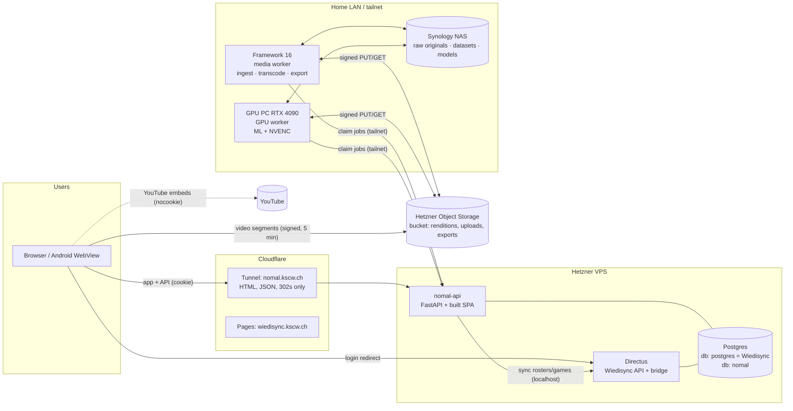
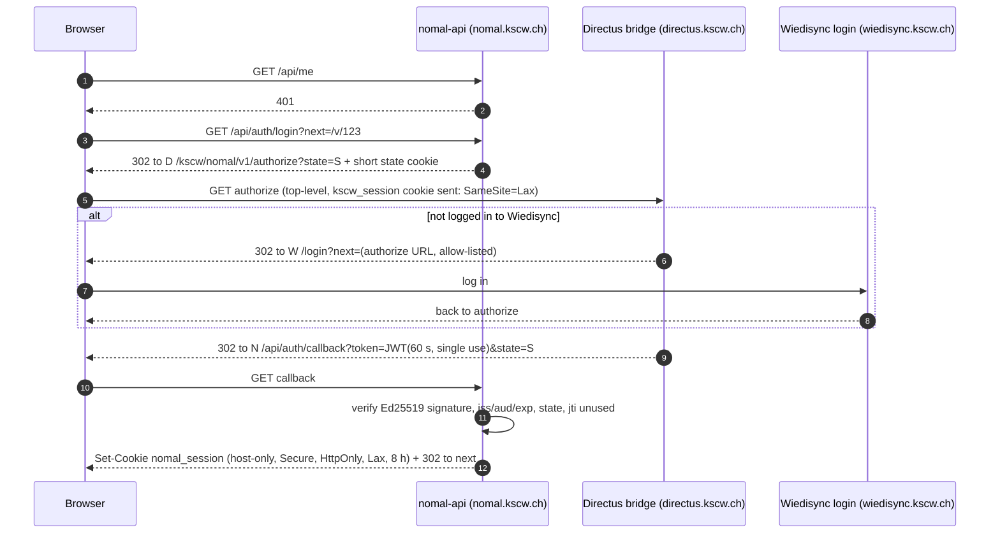
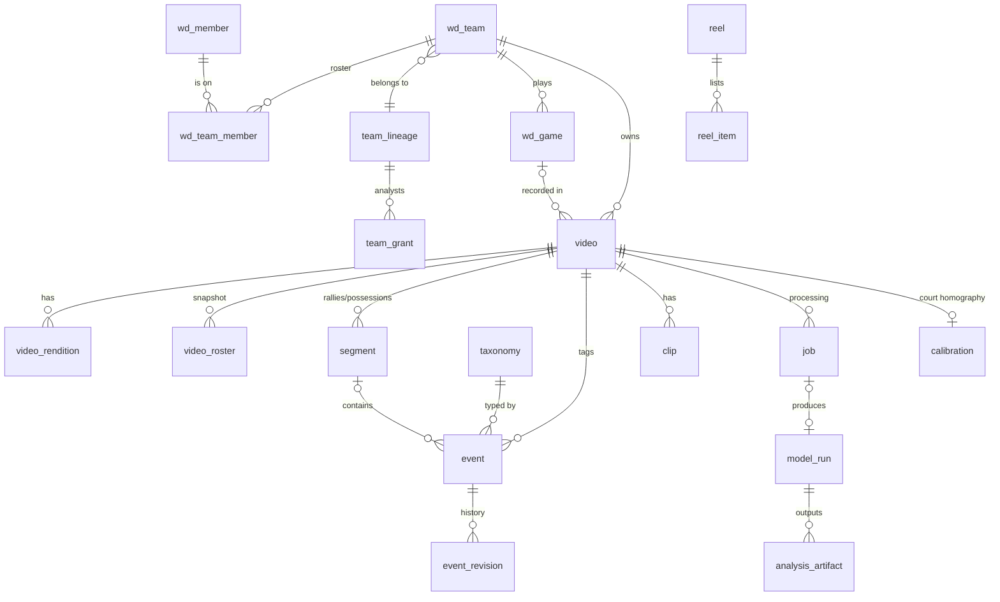
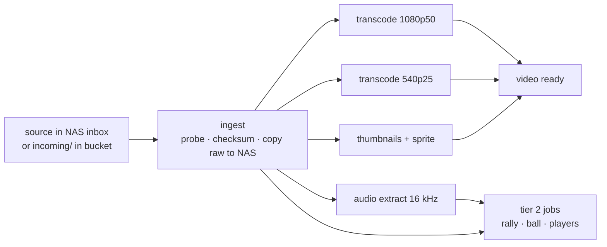

# Nomal: plan

> *Nomal* is Swiss German for "again": watch it again, learn from it.
> In-house video analysis for KSC Wiedikon, replacing what clubs pay Hudl or Balltime for.

| | |
|---|---|
| Status | **Plan, nothing built yet** (written 15.10.2026) |
| Owner | Luca Canepa (sole developer) |
| Repo | `KSC-Wiedikon/nomal` (AGPL-3.0, like Wiedisync) |
| Live host (planned) | `nomal.kscw.ch` (prod), `nomal-dev.kscw.ch` (dev) |
| Depends on | Wiedisync (accounts, teams, rosters, games), `KSC-Wiedikon/wiedisync` |

This document is the single plan of record. Decisions that change it get a short ADR in
`docs/adr/` and a one-line edit here. It deliberately contains **no secrets, IPs, vault
paths or account IDs**: those belong in the private ops notes (see §13).

---

## Contents

1. [Goals, non-goals, tiers](#1-goals-non-goals-tiers)
2. [Decisions so far](#2-decisions-so-far)
3. [Architecture](#3-architecture)
4. [Login and the Wiedisync bridge](#4-login-and-the-wiedisync-bridge)
5. [Permissions, privacy and revDSG](#5-permissions-privacy-and-revdsg)
6. [Data model](#6-data-model)
7. [Video pipeline](#7-video-pipeline)
8. [Jobs and workers (how the GPU gets work)](#8-jobs-and-workers-how-the-gpu-gets-work)
9. [Tagging UI (tier 1)](#9-tagging-ui-tier-1)
10. [Automatic analysis (tier 2)](#10-automatic-analysis-tier-2)
11. [Designing tier 1 as training data for tier 3](#11-designing-tier-1-as-training-data-for-tier-3)
12. [Repo, stack, environments, deploy](#12-repo-stack-environments-deploy)
13. [Operations and handover](#13-operations-and-handover)
14. [Running cost](#14-running-cost)
15. [Roadmap](#15-roadmap)
16. [Risks](#16-risks)
17. [Open questions and assumptions](#17-open-questions-and-assumptions)

---

## 1. Goals, non-goals, tiers

**Goal.** Coaches and players upload match and practice footage, tag what happens, and
watch clips and highlight reels, all behind their existing Wiedisync login. Volleyball
first; basketball is in the first batch of teams too, so the design is sport-generic
from day one (sport-specific parts are data, not code).

**Starting scope.** 4 adult teams (volleyball and basketball), about 100 matches in total
per season, plus some trainings.

### Tiers

| Tier | What | Runs where |
|---|---|---|
| **1 · MVP** | Upload a match video (file or YouTube link) · timestamp-synced manual tagging with keyboard shortcuts (event type + player number) · clips and per-player highlight reels · clip/reel export with ffmpeg · Wiedisync login | Web app + API on Hetzner, transcode/export on the home media worker |
| **2 · Automatic** | Rally detection (cut a 2 h match to the rallies) · ball tracking (TrackNet-style) · player detection + tracking (YOLO + tracker) · court homography → serve placement | Offline batch jobs on the RTX 4090 PC |
| **3 · Later / maybe** | Per-touch action classification and player attribution | Same GPU; trained on tier 1 + 2 data |

### Non-goals (to stay finishable by one person in the evenings)

- No live streaming, no live tagging during the match. Footage is processed after the fact.
- No public links of any kind, no social sharing, no embedding outside Nomal.
- No face recognition and no cross-video person re-identification, ever (see §5.6).
- No full DataVolley replacement. Statistics stay simple (counts and efficiencies per skill).
- No multi-camera sync, no drawing/telestration in the MVP (possible later).
- No minors: Nomal only processes footage of adult teams (§5.3).

---

## 2. Decisions so far

From the Q&A on 15.10.2026:

| # | Topic | Decision |
|---|---|---|
| D1 | Capture | Dedicated camera, **minimum 1080p50**, one elevated tripod behind the baseline. Some matches arrive as a **YouTube link** instead of (or as well as) a file. |
| D2 | Volume | 4 teams to start, ~100 matches per season. |
| D3 | Delivery | Small API on Hetzner; video bytes from **Hetzner Object Storage** via short-lived signed links, never through Cloudflare. Long matches are handled by signing **each 4-second segment** separately at request time (§7.6). |
| D4 | Compute | GPU worker = the RTX 4090 PC (Linux). Always-on media worker (transcode, export) = the **Framework 16**, not the Lenovo server (see assumption A1). |
| D5 | Permissions | Team-scoped (roster, coaches, team managers, picked analysts, sport admins). Players stream, coaches download. Opponents by number only. **Nothing under 18**: adult teams only, enforced in code. |
| D6 | OpenVolley | Not now. Keep the door open (rally boundaries and rosters from the e-scoresheet), see §10.6. |
| D7 | Stack | Own repo `KSC-Wiedikon/nomal`, AGPL. Python/FastAPI for API + workers, React (kscw-ui look) for the web app, own `nomal` database on the existing Postgres server, a small signed-token bridge in Wiedisync. |
| D8 | Docs | This plan lives in the Nomal repo and is committed (secret-free by rule). |

---

## 3. Architecture

### 3.1 Picture



The rule that shapes everything: **Cloudflare only ever carries small things** (the SPA,
JSON, 302 redirects). Cloudflare's terms do not allow serving video through the normal
proxy or a Tunnel on non-Enterprise plans, so every video byte goes straight from object
storage to the browser, and straight between object storage and the home workers.

### 3.2 Components

| Component | Runs on | Does | Tech |
|---|---|---|---|
| **nomal-web** | Built into the `nomal-api` image, served at `nomal.kscw.ch` | Library, player, tagging UI, reels, admin | React 19, TypeScript, Vite, Tailwind v4, shadcn (kscw-ui tokens), TanStack Query, hls.js |
| **nomal-api** | Hetzner VPS, Docker, `127.0.0.1` only, reached via the existing Cloudflare Tunnel; worker routes reachable only over the tailnet | Auth, permissions, metadata CRUD, upload orchestration, media redirects, job queue, audit log | Python 3.12, FastAPI, SQLAlchemy 2 + Alembic, Pydantic 2, psycopg 3 |
| **Postgres `nomal`** | Existing Postgres container on the VPS, separate database + own non-superuser role | All Nomal state incl. the job queue | Postgres 16 |
| **Object storage** | Hetzner Object Storage, same region as the VPS, private bucket | HLS renditions, thumbnails, upload staging, exports | S3 API |
| **Media worker** | Framework 16 at home, always on | Ingest (NAS inbox + browser uploads), transcode to HLS, thumbnails, audio extract, clip/reel export | Same Python package, `nomal-worker` container, ffmpeg |
| **GPU worker** | GPU PC (RTX 4090, 61 GB RAM, Linux), on when it is on | Tier 2/3 ML jobs; also transcode/export via NVENC when idle | `nomal-worker:gpu` container, NVIDIA Container Toolkit, PyTorch |
| **NAS** | Synology at home (≈18 TB free) | Raw originals (master copies), ML datasets, model weights, weekly mirror of the bucket | NFS/SMB share `nomal` |
| **Wiedisync bridge** | Inside Wiedisync's `kscw-endpoints` (Directus) | Mints the login token; serves roster/game sync to nomal-api | ~2 small endpoints, §4 |

### 3.3 Why this shape

- **Same origin for app and API** (`nomal.kscw.ch` serves both): Nomal's own session
  cookie is host-only, there is no CORS for Nomal's API, and the Android WebView just works.
- **Separate service, shared Postgres server**: keeps Wiedisync's Directus permissions out
  of the hot path (its CLAUDE.md is a list of permission traps) while reusing the existing
  backup pipeline and server. No cross-database foreign keys: Nomal stores Wiedisync IDs and
  a synced mirror (§6.2).
- **Pull-based workers**: home machines are behind NAT, sometimes off, and one of them is a
  gaming PC. They poll for work; nothing on the internet can reach them.
- **Python everywhere except the browser**: the ML side is Python regardless, so API, worker
  and ML share one package, one set of models and one test setup.

---

## 4. Login and the Wiedisync bridge

### 4.1 Constraint found in Wiedisync

The Wiedisync login cookie (`kscw_session`) has been **httpOnly and host-only on
`directus.kscw.ch`** since 28.09.2026. No other host, including `nomal.kscw.ch`, can read it.
Wiedisync's other apps (Spielplanung, Accounting) call Directus with credentialed CORS,
which needs entries in both the Directus `CORS_ORIGIN` env and `cors-credentials.js`.

Nomal avoids credentialed CORS entirely with a **redirect + signed token** flow (a minimal,
OIDC-shaped authorization flow).

### 4.2 Flow



- **Token**: EdDSA (Ed25519) JWT, `iss=wiedisync-prod|wiedisync-dev`, `aud=nomal`, 60 s
  lifetime, `jti` recorded by Nomal so it can be used once. The private key lives only in
  the Directus env; Nomal holds the public key(s), selected by `kid` (rotation = add a new
  key, then retire the old one).
- **Return URLs are allow-listed** in the bridge (`https://nomal.kscw.ch/api/auth/callback`,
  `https://nomal-dev.kscw.ch/...`, `http://localhost:…` on dev only). No open redirect.
- **Claims are minimal**: member ID and UUID, display name, global roles, sport-admin scopes,
  and team relations for the current and previous season. No email, no birthdate.

```json
{
  "iss": "wiedisync-prod", "aud": "nomal", "sub": "<members.uuid>", "mid": 123,
  "name": "First Last", "roles": ["user"], "sport_admin": [],
  "teams": [{"team": 456, "season": "2026/27", "rel": ["player", "captain"]},
            {"team": 457, "season": "2026/27", "rel": ["coach"]}],
  "state": "…", "jti": "…", "iat": 0, "exp": 60
}
```

- **Session**: server-side row in `session` (hashed ID in the cookie), 8 h, renewed by
  repeating the redirect silently (instant while the Wiedisync session is valid). Role
  changes reach Nomal within 8 h at most; admins get a "sign out everyone" button.
- **Logout** ends the Nomal session only; the UI links to Wiedisync logout.

### 4.3 Server-to-server sync

`nomal-api` keeps a small read-only mirror of the Wiedisync data it needs (§6.2):

- `GET /kscw/nomal/v1/sync?since=<ts>` on the bridge, authorized by a service token
  (hash compared in the endpoint), called over localhost on the VPS (both containers run
  there; no Cloudflare hop).
- Returns only **Nomal-enabled teams** (current + previous season), their rosters (member
  ID, UUID, name, jersey number, positions, relation, **`adult_verified` boolean, never the
  birthdate**), and their games and trainings (ID, date, time, home/away names, league,
  hall name, score).
- Runs hourly, on admin demand, and right before an upload is accepted (to re-check the
  adult gate).

### 4.4 Changes needed in Wiedisync (small, separate PR there)

| Change | Where | Notes |
|---|---|---|
| `GET /kscw/nomal/v1/authorize` | new `kscw-endpoints/src/nomal-bridge.js` | Reads `req.accountability`, builds claims, signs, redirects. Logs the issuance with `writeUserLog` (actor capture rule). |
| `GET /kscw/nomal/v1/sync` | same file | Service-token auth, read-only, versioned contract with tests. |
| Allow-listed cross-host `next` on `/login` | `LoginPage` / `AuthRoute` (`?next=` exists for in-app paths today) | Only the bridge's authorize URL. |
| Team toggle `features_enabled.nomal` | `teams.features_enabled` (edited in `RosterEditor` today) | **Admin-only** toggle, not coach-editable, because enabling a team triggers the adult/consent checks. |
| Env | Directus `.env` (prod + dev) | `NOMAL_JWT_PRIVATE_KEY`, `NOMAL_JWT_KID`, `NOMAL_RETURN_URLS`, `NOMAL_SYNC_TOKEN_HASH`; recreate the container (restart does not re-read env). |
| Later: "Video" link on game cards | `GameCard` | Plain link to `nomal.kscw.ch/games/<id>`; Nomal shows the video or "no video yet". |
| Docs | `INFRA.md`, `SECURITY.md`, `PERMISSIONS.md` | Same commit, per Wiedisync rules. |

No `CORS_ORIGIN` change is needed for this flow. A Cloudflare Tunnel public hostname
`nomal.kscw.ch` (and `nomal-dev.kscw.ch`) pointing at the API's local port is.

---

## 5. Permissions, privacy and revDSG

*Not legal advice. The goal is a design a Swiss data-protection review would find
reasonable; have the club's privacy contact read §5 before launch.*

### 5.1 Who can do what

Relations come from the login token (team relations) and Nomal's own `team_grant` table
(analysts). "Team" means the team's **lineage** (§6.3) unless a season is named.

| Action | Player | Analyst¹ | Coach / team manager | Sport admin (that sport) | Admin / superuser² |
|---|---|---|---|---|---|
| Watch team videos, tags, clips | own seasons³ | ✓ | ✓ all seasons | ✓ | ✓ (logged, banner) |
| Create own private reels | ✓ | ✓ | ✓ | ✓ | |
| Share a reel with the team | | ✓ | ✓ | ✓ | |
| Upload / link a video, edit roster snapshot | | ✓ | ✓ | ✓ | |
| Tag, mark rallies, correct model output | | ✓ | ✓ | ✓ | |
| Download / export MP4 (watermarked) | | | ✓ | ✓ | |
| Delete a video | | | ✓ | ✓ | ✓ |
| Grant analyst | | | ✓ | ✓ | |
| Enable a team for Nomal | | | | | in Wiedisync |

¹ A player a coach picks to help tag; Nomal-local grant per team lineage.
² Board members without an admin scope get no access: they don't need match footage.
³ Players see the seasons they were rostered in. Coaches see the lineage's history.

The rules live in **one module** (`nomal/core/permissions.py`) with a table-driven unit test
that enumerates this matrix. Every API route goes through it; nothing is filtered in the UI only.

### 5.2 No public links

- Every media request goes through `nomal-api` with the session cookie; the API answers
  with a 302 to an object-storage URL signed for **5 minutes** and **one 4-second segment**
  (§7.6). A copied link is a few seconds of video that stops working within minutes.
- Exports (MP4) are downloadable by coaches only, via the same redirect mechanism, are
  **burned-in watermarked** ("KSCW intern · <name> · <date>"), and expire after 30 days.
- No share-by-link feature exists. Sharing means "visible to the team in Nomal".

### 5.3 Adults only (nothing under 18)

Enforced, not just stated:

1. Wiedisync computes `adult_verified` per rostered member: birthdate known and ≥ 18 at the
   recording date. If only `yob` is known, the member counts as verified only from the
   year they turn 19 (the safe side). Unknown means **not verified**.
2. A team can be enabled only if every rostered player is verified. Nomal shows the coach
   which members block it ("birthdate missing in Wiedisync").
3. Every upload re-checks the gate against the recording date. Blocked uploads are refused
   before any bytes are stored.
4. Nightly check: if a non-verified member joins an enabled team, new uploads freeze, the
   coach and admin are notified, existing videos stay but are flagged for review.
5. Nomal is for teams in **adult competitions** only. Opponent teams in adult leagues can
   still field a 16- or 17-year-old; Nomal never names opponents (numbers only), keeps their
   data team-internal, and deletes or trims footage on request. This residual risk is
   documented in `docs/PRIVACY.md`.

### 5.4 Consent and information

Recommended (see open question Q4): **explicit opt-in per player**, recorded in Nomal
(`consent` table: notice version, accepted/withdrawn, how). New players see it on first
login; the coach can record a paper consent. A team can be filmed when every current
roster player has opted in. Withdrawal removes the player's name from tags (they become
"#7"), deletes their personal reels, and blocks future filming of the team until resolved.
Opt-in is stricter than strictly needed for adults, but it is simple, provable, and also
covers the "profiling" question once automatic analysis rates individual performance.

The club's privacy policy on `kscw.ch` gets a Nomal section; Nomal has its own short
privacy page (what, why, who sees it, how long, contact, rights).

### 5.5 Retention

| Data | Where | Default retention |
|---|---|---|
| Upload staging | Object storage `incoming/` | Until ingested; lifecycle rule deletes after 14 days regardless |
| HLS renditions, thumbnails | Object storage `media/` | Recording season + 1 more (e.g. a 2026/27 match until 31.05.2028) |
| Raw originals | NAS `nomal/raw/` | Same as renditions, then deleted; short labelled windows may stay in the ML dataset (§11) |
| Exports | Object storage `exports/` | 30 days |
| Tags, rallies, rosters | Postgres | As long as the video; member link removed when a player withdraws or leaves and asks |
| ML datasets (labelled windows) | NAS `nomal/datasets/` | Until the model using them is retired; listed in a dataset manifest |
| Audit log | Postgres | 12 months |
| Sessions, login nonces | Postgres | Purged after 30 days |

A nightly `retention` job enforces this and writes what it deleted to the audit log.

### 5.6 Things Nomal never does

- No face recognition, no face embeddings, no person re-identification across videos.
  Player attribution uses **jersey numbers and position on court only**. (Biometric data
  for unique identification is sensitive personal data under the revDSG; avoid it entirely.)
- No processing of people outside the court where avoidable: detection is masked to the
  court polygon plus a margin, which also excludes spectators.
- No third-party analytics. The only third party in the browser is the YouTube embed, and
  only on YouTube-sourced videos, via `youtube-nocookie.com`.
- No data outside Switzerland/EU: Hetzner (Germany/Finland) for servers and storage.
  Cloudflare only carries HTML/JSON/redirects.

### 5.7 Audit log

`audit_log` records: logins, video views (once per video per session, not per segment),
uploads, deletions, exports and downloads, permission changes, admin "view as", consent
changes, retention deletions. Coaches can see the log for their team's videos; members can
request their own entries.

### 5.8 Audio

Camera audio carries whistles (useful for rally detection) and also bench talk. Default:
keep audio in renditions; a per-video "mute for viewers" switch strips it from playback
(the NAS original keeps it for ML).

---

## 6. Data model

### 6.1 Overview



Sketches below are **not final DDL**; they fix names, keys and the shape of the hard parts.
All IDs are UUIDv7 (time-ordered, client-generatable) except mirrored Wiedisync IDs
(integers). All timestamps are `timestamptz`. Video times are **integer milliseconds of
media time** plus the frame number where it matters.

### 6.2 Wiedisync mirror (read-only, replaced by sync)

```text
wd_member        id int PK (= members.id), uuid, display_name, number, positions[],
                 adult_verified bool, active bool, synced_at
wd_team          id int PK (= teams.id), lineage_id → team_lineage, name, sport
                 ('volleyball'|'basketball'), season '2026/27', league, nomal_enabled, synced_at
wd_team_member   (team_id, member_id, rel)  rel ∈ player|coach|team_responsible|captain
wd_game          id int PK (= games.id), team_id, date, time, home_name, away_name,
                 our_side 'home'|'away', league, hall_name, home_score, away_score
wd_training      id int PK (= trainings.id), team_id, date, start_time, hall_name
sync_state       last_run, last_ok, counts, error
```

Data minimisation: no email, phone, address or birthdate ever reaches Nomal.

### 6.3 Seasons and team lineage

Wiedisync **clones every team row on 1 June** (new IDs, `active=false` on the old rows).
A video belongs to the team row of its season (`video.team_id`), so history stays correct.
For "this team across seasons" Nomal has `team_lineage (id, sport, label)`, matched at sync
time by `(sport, teams.team_id)` falling back to `(sport, name)`; an admin can fix a wrong
match. Analyst grants, coach history access and season-spanning reels hang off the lineage.
Player-centric views ("my attacks") hang off `member_id` and never need the lineage.

### 6.4 Videos

```text
video            id, team_id → wd_team, kind 'match'|'training'|'other',
                 game_id → wd_game NULL, training_id → wd_training NULL,
                 title, recorded_at, sport,
                 source 'file'|'youtube', youtube_id NULL, youtube_offset_ms NULL,
                 status 'awaiting_upload'|'uploading'|'queued'|'processing'|'ready'|'failed'|'deleted',
                 duration_ms, fps_num, fps_den, width, height, has_audio, audio_muted bool,
                 raw_path NULL (NAS), raw_sha256, raw_bytes,
                 retention_until, created_by → wd_member, created_at, deleted_at, deleted_by
video_rendition  video_id, name '1080p50'|'540p25', codec, bitrate, segment_seconds,
                 segment_count, storage_prefix, bytes, job_id
video_roster     video_id, side 'us'|'them', number, member_id NULL (us only),
                 position NULL, is_libero bool    UNIQUE(video_id, side, number)
inbox_file       id, nas_path, size, probed jsonb, recorded_at_guess, status, video_id NULL
```

`video_roster` is a **snapshot**: filled from the Wiedisync roster when the video is
created, editable by the coach (numbers differ between teams, guests play). Opponents get
numbers only. Tags resolve number → member through this snapshot, so later roster changes
never rewrite history.

### 6.5 Taxonomy (sport-specific, data not code)

```text
taxonomy         sport, version, code, name_key (i18n), hotkey, category,
                 default_pre_ms, default_post_ms, lead_ms,
                 attributes_schema jsonb (JSON Schema: grade enum, zones, sub-types…),
                 starts_segment bool, ends_segment_on jsonb, active
                 PK (sport, version, code)
```

Seeded from reviewed YAML in the repo (`taxonomies/volleyball.yaml`,
`taxonomies/basketball.yaml`). Volleyball codes follow **DataVolley conventions** (skills
S R E A B D F, grades `# + ! - / =`, zones 1–9) so coaches recognise them and a `.dvw`
import/export stays possible later. Changing a taxonomy creates a new `version`; old
events keep theirs, and a mapping table translates between versions for datasets.

### 6.6 Segments (rallies, possessions)

```text
segment          id, video_id, kind 'rally'|'possession'|'timeout'|'break'|'set_break',
                 start_ms, end_ms, period (set or quarter),
                 score_us_after, score_them_after, won_by 'us'|'them' NULL, serving 'us'|'them' NULL,
                 source 'manual'|'model'|'import', model_run_id NULL, confidence NULL,
                 review 'unreviewed'|'confirmed'|'corrected'|'rejected',
                 created_by, updated_by, timestamps, deleted_at
```

Tier 1 creates rallies manually (one key, §9). Tier 2 proposes them as `source='model'`.
The "rallies only" view is a query over this table, not a new file.

### 6.7 Events (the tags)

```text
event            id (client UUIDv7), video_id, segment_id NULL, sport, taxonomy_version, code,
                 t_ms, frame, time_precision 'live'|'adjusted'|'frame',
                 side 'us'|'them', number NULL, member_id NULL,
                 attributes jsonb   -- grade, zone_from, zone_to, subtype, made/missed, …
                 court_x NULL, court_y NULL   -- metres, from homography (tier 2)
                 clip_pre_ms NULL, clip_post_ms NULL, note NULL,
                 source 'manual'|'model'|'import', model_run_id NULL, confidence NULL,
                 review 'unreviewed'|'confirmed'|'corrected'|'rejected',
                 supersedes_id NULL, track_ref NULL (model_run + track id, tier 2/3),
                 created_by, created_at, updated_by, updated_at, deleted_at, version int
event_revision   id, event_id, version, changed_by, changed_at, action
                 'create'|'update'|'delete'|'restore'|'confirm'|'reject', before jsonb, after jsonb
```

- `event_revision` is written by a **Postgres trigger**, so no code path can skip it.
- Deletes are soft (`deleted_at`): undo is trivial, and rejected model output is kept as a
  hard negative for training.
- The client generates the ID, so saving is an idempotent `PUT /api/events/{id}` (§9.5).

### 6.8 Clips, reels, exports

```text
clip             id, video_id, start_ms, end_ms, title, note, event_id NULL,
                 owner, visibility 'private'|'team', created_at
reel             id, owner, lineage_id NULL, title, kind 'smart'|'manual',
                 query jsonb NULL   -- smart: {member_id, codes, grades, seasons, videos…}
                 visibility 'private'|'team', created_at
reel_item        reel_id, position, video_id, start_ms, end_ms, event_id NULL, clip_id NULL, caption
export           id, kind 'clip'|'reel'|'condensed', source jsonb, params_hash,
                 status, object_key, bytes, requested_by, job_id, expires_at
```

- A **clip** is just a time range. Watching it seeks inside the HLS stream: no file, no
  waiting, no storage.
- A **per-player highlight reel** is a *smart reel*: a saved query ("member 123, attacks
  graded #, season 2026/27") evaluated on open, so it updates as tagging continues.
- An **export** renders a clip or reel to MP4 with ffmpeg on a worker (§7.7).

### 6.9 Jobs, workers, ML provenance

```text
job              id, kind, video_id NULL, params jsonb, priority int,
                 required_caps text[], depends_on uuid[],
                 status 'queued'|'leased'|'running'|'succeeded'|'failed'|'cancelled',
                 attempts, max_attempts, not_before,
                 lease_owner → worker, lease_expires_at, heartbeat_at, progress real, message,
                 checkpoint jsonb, result jsonb, error, created_at, started_at, finished_at
worker           id, name, caps text[], token_hash, paused bool, version, last_seen_at
model_run        id, job_id, model_name, model_version (git sha), weights_sha256,
                 params jsonb, metrics jsonb, created_at
analysis_artifact id, video_id, model_run_id, kind 'ball_track'|'player_tracks'|'audio_features'|…,
                 object_key or nas_path, format 'parquet', schema_version, stats jsonb
calibration      id, video_id, image_points jsonb, court_points jsonb, homography jsonb (3×3),
                 method 'manual'|'auto', reproj_error_cm, created_by, copied_from NULL
```

Per-frame data (ball positions, player boxes) is **not** stored in Postgres: a 2 h match at
50 fps is 360 000 frames. It goes into Parquet files referenced by `analysis_artifact`;
only derived facts (rallies, serve placements, proposed events) become rows.

### 6.10 People, access, privacy

```text
session          id_hash, member_id, claims jsonb, created_at, expires_at, last_seen_at, user_agent
login_nonce      jti, used_at
team_grant       lineage_id, member_id, grant 'analyst', granted_by, granted_at, revoked_at
consent          member_id, scope 'nomal', notice_version, status 'accepted'|'withdrawn',
                 via 'nomal'|'paper', recorded_by, at
audit_log        id, at, actor_member_id, action, object_type, object_id, details jsonb
```

---

## 7. Video pipeline

### 7.1 Capture standard (goes into `docs/FILMING_GUIDE.md`)

| Setting | Standard | Why |
|---|---|---|
| Position | Elevated tripod (≥ 3 m if possible) behind the baseline, centred | Whole court visible, net divides the teams (helps tier 2) |
| Framing | Whole court + ~2 m margin, **fixed zoom**, never moved during the match | One homography per video; consistent ML input |
| Resolution / rate | **1080p50 minimum**, 4K50 if the camera can | Far-court ball tracking needs pixels |
| Shutter | **1/500 s or faster** (raise ISO, accept noise) | Motion blur is what kills ball tracking |
| Exposure / focus / white balance | Locked (manual) | Auto modes pump during play |
| Audio | On | Whistles help rally detection |
| Start | Record from warm-up, one continuous file if possible | Simpler sync; splits are fine (multi-part ingest) |

Basketball note: behind the baseline sees one half well and the far half badly.
Basketball is normally filmed elevated from the side at half court. See Q3.

### 7.2 Three ways in

| Path | For | How |
|---|---|---|
| **NAS inbox** (preferred) | Anyone at home with SD card access | Copy files into the `nomal-inbox` share. The media worker sees stable files (size unchanged for 2 min), probes them, registers them as *inbox files*. In Nomal the coach picks the game (suggested from the recording time vs. games that day). Nothing crosses the internet twice. |
| **Browser upload** | Coaches elsewhere | Resumable S3 **multipart** upload straight to object storage (`incoming/<video>/`), parts signed by the API (64 MB parts → files up to ~640 GB, 4 in parallel, survives page reloads). The worker then downloads, archives to NAS, deletes the staging object. Works in the Android WebView, but 20–40 GB from a phone is not a supported path. |
| **YouTube link** | League/club streams | No download. The video plays through the YouTube IFrame API (nocookie) with the same tagging UI; tags, clips and reels work as time ranges. No export, no tier 2 (no file). If the club owns the channel, download the original from YouTube Studio and upload it; Nomal converts the video to `source='file'` keeping all tags (with an offset if the two versions differ in start). Nomal does not use `yt-dlp` (YouTube's terms). |

Before any of these is accepted: the adult gate (§5.3), consent (§5.4) and a permission
check run. Refused means no bytes stored.

### 7.3 Processing chain



Each box is a `job` row (§8). `ready` needs both renditions and thumbnails; tier 2 jobs
are queued automatically for matches once the GPU features exist.

### 7.4 Renditions

| Rendition | Use | Encoding (H.264 High, AAC) | ≈ size |
|---|---|---|---|
| `1080p50` | Tagging, desktop viewing, frame stepping | ~5 Mb/s VBR (max 7), closed GOP 2 s, 4 s fMP4 HLS segments | 2.3 GB/h |
| `540p25` | Phones, weak connections | ~1.2 Mb/s, GOP 2 s, 4 s segments | 0.6 GB/h |
| Thumbnail sprite + WebVTT | Scrub previews | 1 frame / 10 s, 160 px wide | few MB |

H.264 rather than HEVC/AV1 because every browser and the Android WebView decode it in
hardware. The FW16 encodes with x264 (or VAAPI); the 4090 uses NVENC when it is on and
idle. Both are many times faster than real time.

### 7.5 Storage tiers

| Tier | Where | Holds | Size per season (100 matches × ~1.75 h) |
|---|---|---|---|
| Hot | Hetzner Object Storage | HLS renditions, thumbnails, exports, staging | ≈ 0.5–0.6 TB |
| Master | NAS `nomal/raw/` | Original camera files (25–50 Mb/s) | ≈ 2–4 TB (NAS has ≈ 18 TB free) |
| ML | NAS `nomal/datasets/`, `nomal/models/`, GPU PC local NVMe cache | Labelled windows, Parquet tracks, weights | tens of GB |
| Mirror | NAS `nomal/bucket-mirror/` | Weekly `rclone sync` of the bucket | = hot |

Raw originals are **not** copied offsite (too big, and the renditions are a usable fallback).
The database (tags) is backed up with Wiedisync's existing pipeline (§13.2).

### 7.6 Playback, and why long matches are fine

The question was whether a signed link that expires after an hour breaks a 2 h match. It
doesn't, because no link covers the whole match:

1. The player (hls.js) loads `GET /api/media/{video}/{rendition}/index.m3u8` from
   `nomal.kscw.ch` with the session cookie. The API checks permission and returns a playlist
   whose segment URIs point back at the API: `/api/media/{video}/{rendition}/seg/{n}.m4s`.
2. For each 4-second segment, as the player needs it, the API checks the session (cached
   per session + video for 60 s) and answers **302** to an object-storage URL **signed for
   5 minutes, for that one segment**.
3. The browser fetches the bytes directly from object storage (bucket CORS allows
   `nomal.kscw.ch`).

A 2 h match is ~1 800 segments per rendition; each redirect costs the API about a
millisecond and Cloudflare carries only the tiny 302. A 3 h match or a 6 h tournament
works the same. Signing is local HMAC, no call to the storage service.

Seeking is exact (hls.js decodes from the segment start); frame stepping uses
`requestVideoFrameCallback` for the true media time of the shown frame. iPhones: hls.js
runs on iOS 17.1+ (Managed Media Source); older iOS falls back to native HLS, which follows
redirects. **Test on an iPhone in M1.**

If redirects ever add noticeable start latency, the fallback is an hls.js custom loader
that asks the API for signed URLs of the next N segments in one call.

### 7.7 Clips, reels, exports with ffmpeg

- **Watching** a clip or reel never renders anything: the player seeks to `start_ms`,
  plays to `end_ms`, jumps to the next item (preloading it). Per-event clip windows come from
  the taxonomy (`default_pre_ms` / `default_post_ms`, e.g. attack −3 s/+2 s), adjustable per event.
- **Condensed match** ("rallies only") is the same mechanism over the rally segments.
- **Export** (coach only) queues an `export` job: the worker cuts from the **NAS
  original** (best quality; falls back to the 1080p rendition if the raw is gone),
  re-encodes each piece for frame-accurate in/out points, concatenates, burns in the
  watermark and optional captions (player, opponent, date), uploads to `exports/`, and
  notifies. Re-encoding a 2-minute reel takes seconds.
- If both home workers are off, exports wait and the UI says so. An optional low-priority
  export worker on the VPS (1 CPU, renditions only) can be enabled later if that becomes annoying.

---

## 8. Jobs and workers (how the GPU gets work)

### 8.1 Queue in Postgres, workers pull

No message broker. The `job` table *is* the queue, and only `nomal-api` touches it.
Workers call four endpoints over the **tailnet** (the VPS is already on it; worker routes
are refused when a request arrives through Cloudflare):

| Endpoint | Does |
|---|---|
| `POST /api/worker/claim` `{caps, max}` | Atomically leases the highest-priority runnable job whose `required_caps` ⊆ the worker's caps and whose dependencies succeeded (`SELECT … FOR UPDATE SKIP LOCKED`). Lease: 5 min. Long-polls up to 30 s when empty. |
| `POST /api/worker/jobs/{id}/heartbeat` `{progress, message, checkpoint}` | Extends the lease, stores progress and a resumable checkpoint. |
| `POST /api/worker/jobs/{id}/sign` `{op, keys}` | Returns signed PUT/GET URLs for the object keys this job may touch. **Workers never hold storage credentials**, so a compromised gaming PC can only touch its current job's objects. |
| `POST /api/worker/jobs/{id}/complete` / `fail` `{result | error, retryable}` | Finishes the job; the API writes derived rows (renditions, segments, events) in one transaction. |

A reaper in the API returns expired leases to the queue (`attempts+1`, back-off via
`not_before`) or fails them after `max_attempts`. Each worker authenticates with its own
token (stored hashed in `worker`), revocable from the admin page.

### 8.2 Worker hosts

| Worker | Caps | Availability | Notes |
|---|---|---|---|
| **Framework 16** (`media`) | `ingest`, `transcode`, `thumbs`, `audio`, `export`, `nas`, `inbox` | Always on | Suspend disabled, plugged in, **battery charge limit ~80 %** in firmware. Mounts the NAS share. If it is ever retired, the same container runs on any Linux box (e.g. the Lenovo server) unchanged. |
| **GPU PC** (`gpu`) | `cuda`, `ml`, `transcode`, `export`, `nas` | When it is on | See gaming guard below. Local NVMe (1.6 TB free) caches raw files during ML jobs. |

**Gaming guard** on the GPU worker: it stops claiming new jobs when (a) a configured game
or GPU-heavy process is running, (b) outside a configurable window (default: any time it
is idle, or only at night), or (c) `nomal-worker pause` was run. ML jobs process video in
**5-minute chunks** and checkpoint after each, so pausing or switching the PC off loses at
most one chunk. Optional later: the FW16 sends Wake-on-LAN to the GPU PC at night when ML
jobs are waiting.

### 8.3 Job kinds

| Kind | Caps | Output |
|---|---|---|
| `ingest` | `ingest`, `nas` | Probe, SHA-256, raw on NAS, staging object deleted |
| `transcode` (per rendition) | `transcode` | HLS in `media/{video}/{rendition}/` |
| `thumbs`, `audio` | `thumbs` / `audio` | Sprite + VTT; 16 kHz mono FLAC on NAS |
| `export` | `export` | MP4 in `exports/` |
| `retention`, `bucket_mirror` | `nas` | Deletions (audited), weekly mirror |
| `ml_rally`, `ml_ball`, `ml_players`, `ml_homography_auto`, `ml_serve_map` | `cuda`, `ml` | Parquet artifacts + proposed segments/events (§10) |

### 8.4 Visibility

Admin page: queue (with age of the oldest queued job), workers (last seen, paused,
version), recent failures with logs. Uptime Kuma (already at `status.kscw.ch`) gets push
monitors for each worker's heartbeat and for "a job has been queued > 24 h".

---

## 9. Tagging UI (tier 1)

### 9.1 Layout (desktop; tagging is a keyboard task)

```
┌─────────────────────────────────────────────┬──────────────────────────────┐
│                                             │ Roster   us: 1 3 5 7 9 11 …  │
│                 video                       │          them: 2 4 8 12 …    │
│                                             ├──────────────────────────────┤
│                                             │ Entry:  7A#_          ⏎ save │
│                                             │ → #7 Attack · Kill · 12:31.4 │
├─────────────────────────────────────────────┼──────────────────────────────┤
│ timeline: rally bands + tag markers + playhead (canvas)                    │
├────────────────────────────────────────────────────────────────────────────┤
│ event table (synced to playhead, click = seek, inline edit)                │
└────────────────────────────────────────────────────────────────────────────┘
```

On phones Nomal is a viewer (library, reels, "my clips"); tagging needs a keyboard. A
touch layout with roster and skill buttons exists for tablets and as a fallback.

### 9.2 Keyboard (configurable, cheatsheet on `?`)

| Key | Action |
|---|---|
| `Space` | Play / pause |
| `←` / `→` | 1 frame back/forward when paused, 2 s while playing |
| `Shift+←` / `Shift+→` | 5 s |
| `,` / `.` | Speed down / up (0.25×–2×) |
| `R` | Start rally here; again = end rally (prompts winner `u`/`t` unless the last tag implies it) |
| digits + skill + grade, `Enter` | Create a tag (grammar below) |
| `Tab` (while typing) | Toggle side us/them |
| `Esc` | Cancel entry |
| `Ctrl+Z` / `Ctrl+Shift+Z` | Undo / redo |
| `[` / `]` | Mark clip in / out, `C` saves the clip |
| `G` | Go to the selected event; `F` snaps its time to the current frame (precision → `frame`) |

### 9.3 Entry grammar (volleyball, DataVolley-flavoured)

`[a]<number><skill>[grade][zones]`, e.g. `7A#` = our #7 attack, kill; `a12S=` = their
#12 serve error; `5R+` = our #5 reception, positive; `9E` = our #9 set (grade optional).
The parser shows a live preview with names from the roster snapshot; unknown numbers are
flagged but allowed. Basketball has its own short grammar from its taxonomy (shots 2/3/FT
made/missed, rebound O/D, assist, turnover, steal, block, foul).

**Time capture**: the tag time is the playhead at the *first keystroke*, minus the
taxonomy's `lead_ms` (people react late), marked `time_precision='live'`. `F` snaps to the
exact frame later (`'frame'`). That distinction matters for training data (§11).

### 9.4 Rally automation from tags (volleyball)

A serve tag opens a rally if none is open. A terminal grade (`#` on attack/serve/block,
`=` error) proposes ending the rally, the winner and the next score. The coach confirms
with `Enter` or corrects. Result: tagging a match also produces the rally list and the
score line, which tier 2 rally detection is trained and evaluated against.

### 9.5 Never lose work

Tagging a match is an hour or more of work. Every change goes to an IndexedDB outbox
first and is sent as an idempotent `PUT /api/events/{id}` with the client-generated ID and
`version`. Network loss shows a "n unsynced" badge; reload resumes. Concurrent taggers on
the same video: last write wins per event, and every change is in `event_revision`.

### 9.6 Simple statistics (MVP+)

Per match and per season, per player and team: counts by skill and grade, efficiencies
(e.g. attack: (kills − errors − blocked) / attempts; reception: positive %), with every
number clickable into a reel of the underlying tags. That covers most of what coaches use
Balltime stats for.

---

## 10. Automatic analysis (tier 2)

All on the GPU PC (RTX 4090), as checkpointed jobs, writing Parquet artifacts and
**proposals** (`source='model'`, `review='unreviewed'`) that a human confirms in the UI.
Nothing a model produces is shown as fact until reviewed or until its measured accuracy
passes the bar below.

### 10.1 Rally detection

- **v0 (no training)**: whistle detection on the audio (narrow-band energy peaks around
  2–4 kHz with tonal check) plus frame-difference motion energy inside the court mask,
  combined with simple rules (serve whistle → rally; quiet + low motion → dead ball).
- **v1 (learned)**: a small temporal model over per-second features (audio embedding,
  motion, ball-visible ratio and ball speed from §10.2, player spread) trained on the
  manual rally segments from tier 1.
- **Output**: `segment` proposals; "rally review" UI (`Enter` accept, `←/→` nudge
  boundaries, `X` reject); condensed playback.
- **Bar**: boundary F1 ≥ 0.9 at ±1 s on held-out matches before "rallies only" is the
  default view.

### 10.2 Ball tracking

- TrackNet-family heatmap model (TrackNetV3 or later; check licence before use) on
  3-frame stacks, fine-tuned on our footage. Labels: a "click the ball" tool on sampled
  frames (target 3–5 k labelled frames across halls and lighting), plus negatives.
- Post-processing: outlier removal, gap interpolation, trajectory fitting; contact and
  bounce candidates from direction changes.
- Throughput: hundreds of frames per second on a 4090; a 2 h match at 50 fps (360 k
  frames) in roughly 10–20 min.
- **Bar**: precision ≥ 0.9 at recall ≥ 0.8 within 5 px on held-out frames, reported
  separately for near and far court.

### 10.3 Player detection and tracking

- Ultralytics YOLO person detector (AGPL-3.0, compatible with Nomal's licence) + ByteTrack
  (MIT), detections masked to the court polygon + margin.
- Team assignment: side of the net (volleyball); kit-colour clustering (basketball).
- No identity across videos (§5.6). Track IDs are per video.
- Output: Parquet tracks; foot points mapped to court coordinates via §10.4.

### 10.4 Court homography

- The camera is fixed, so **one homography per video**. M7 ships a manual calibration
  UI: click 6–8 court landmarks (corners, centre line ends, attack lines) on a frame;
  `cv2.findHomography`; reprojection error shown. Pre-filled from the last calibration in
  the same hall (halls repeat every week).
- Later: automatic line/keypoint detection initialised from the hall's last calibration.
- **Bar**: reprojection error < 15 cm on held-out landmarks.

### 10.5 Serve placement

A homography maps the **floor plane** only, and the ball is in the air. So serve placement
uses floor-level evidence: (a) the bounce point when the ball lands, else (b) the
receiving player's foot position at the reception contact (tagged `R` event or nearest
player track to the ball at contact). Output: `event.court_x/court_y` on serve events and
a serve-placement chart per server, filterable by result. **Bar**: ≥ 80 % agreement with
manually tagged serve zones.

### 10.6 Later: OpenVolley import

OpenVolley's e-scoresheet logs every point with a wall-clock timestamp plus rosters with
numbers. With one manual sync point (first serve), that gives rally ends, scores and the
serving team for free: excellent labels for §10.1. Planned as an `import` source for
`segment` and `video_roster`, not now.

---

## 11. Designing tier 1 as training data for tier 3

Tier 3 (per-touch action classification and player attribution) needs labels that tier 1
produces anyway, if they are captured with care. The rules:

1. **Every label carries provenance**: `source`, `created_by`, `model_run_id`,
   `confidence`, `review`. A dataset query can say "frame-precise, human-made or
   human-confirmed, taxonomy v2".
2. **Time precision is explicit** (`live` / `adjusted` / `frame`). Live tags are good weak
   labels for "something happened around here"; only frame-precise tags train temporal
   localisation. The UI makes snapping cheap (`G`, `F`).
3. **Corrections are data**. Model proposals are never overwritten silently: confirm,
   correct (before/after in `event_revision`) or reject (soft delete). Rejections are hard
   negatives; corrections are the most valuable labels.
4. **Stable vocabulary**: versioned taxonomy with explicit mappings; a tagging guide
   (`docs/TAGGING_GUIDE.md`) defines each code precisely, *including the exact frame to tag*
   (e.g. "attack = the frame the hand touches the ball").
5. **Link labels to tracks**: when tier 2 tracks exist, each event gets a `track_ref` (the
   player track nearest the ball at the contact frame, on the correct side), which the
   human implicitly confirms by confirming the event. That is the player-attribution label.
6. **Datasets are snapshots**: `nomal-ml export-dataset` writes a manifest (query, event
   IDs, taxonomy version, video SHA-256s) and cuts short labelled windows (e.g. ±2 s at full
   resolution) from the NAS originals into `nomal/datasets/<name>/`. Models record the
   dataset manifest they were trained on (`model_run.params`). This is also data
   minimisation: once the raw file is deleted under §5.5, only the labelled windows remain.
7. **Evaluation split by match** (never by frame), with held-out matches from different
   halls, so metrics mean something.

Tier 3 ships the same way as tier 2: proposals in a review queue first, auto-accept only
above a measured precision bar per skill.

---

## 12. Repo, stack, environments, deploy

### 12.1 Repo layout

```text
nomal/
  README.md                  what it is, how to run it locally
  LICENSE                    AGPL-3.0
  docs/
    PLAN.md                  this file
    adr/                     one file per decision change
    ARCHITECTURE.md          written in M0 from §3–§8, kept current
    PRIVACY.md               processing record, retention, rights, residual risks
    FILMING_GUIDE.md         §7.1 for coaches, with photos
    TAGGING_GUIDE.md         codes, grammar, exact-frame definitions
    RUNBOOK.md               deploy, restore, rotate keys, add a worker, common failures
  backend/                   one Python package (uv)
    nomal/core/              models, schemas, permissions, storage signing, taxonomy loader
    nomal/api/               FastAPI app, routes, auth, media redirects, job queue
    nomal/worker/            agent loop, job handlers (ingest, transcode, export, retention)
    nomal/ml/                tier 2/3 pipelines, dataset export, training scripts
    migrations/              Alembic
    tests/
  web/                       React app (Vite), built into the API image
  taxonomies/                volleyball.yaml, basketball.yaml
  deploy/
    hetzner/compose.yaml     nomal-api (prod + dev)
    worker/compose.yaml      media worker
    worker-gpu/compose.yaml  GPU worker (NVIDIA runtime)
  .github/workflows/         lint, test, build images, release
```

### 12.2 Stack choices

| Area | Choice | Why |
|---|---|---|
| API | FastAPI, SQLAlchemy 2, Alembic, Pydantic 2, psycopg 3 | Familiar to the maintainer, typed, shares code with workers/ML |
| Python tooling | uv, ruff, mypy (strict on `core`), pytest | Fast, one lockfile |
| Web | React 19, TS, Vite, Tailwind v4, shadcn, TanStack Query, hls.js, i18next | Same as Wiedisync; kscw-ui tokens copied in (blue/gold, stone neutrals, navy dark) |
| Upload | Uppy with S3 multipart | Resumable, battle-tested |
| Media | ffmpeg (pinned static build in the image), ffprobe | — |
| ML | PyTorch, Ultralytics YOLO, ByteTrack (via `supervision`), OpenCV, Polars/PyArrow | Licences compatible with AGPL |
| Languages | English first, German at minimum (Wiedisync convention); Swiss date/time formats (`dd.mm.yyyy`, 24 h) | — |

### 12.3 Environments

| | Dev | Prod |
|---|---|---|
| Web + API | `nomal-dev.kscw.ch` | `nomal.kscw.ch` |
| Wiedisync | `directus-dev.kscw.ch` (dev DB is a nightly scrubbed prod clone, so IDs match) | `directus.kscw.ch` |
| Database | `nomal_dev` | `nomal` |
| Bucket | `…-nomal-dev` (lifecycle: 30 days) | `…-nomal` |
| Workers | Same workers, `--env dev` second agent with lower priority | Primary |
| Local | `docker compose` with Postgres + MinIO + a fake bridge that issues dev tokens | — |

Same rule as Wiedisync: everything goes to dev first.

### 12.4 Deploy

- GitHub Actions: lint + tests on every push; on a tag, build `nomal-api`, `nomal-worker`,
  `nomal-worker:gpu` images to GHCR (private).
- VPS: `deploy/hetzner/compose.yaml` in `/opt/nomal`; `scripts/deploy.sh dev|prod` pulls
  the tag, runs Alembic migrations (`upgrade head`, after a `pg_dump` snapshot of the
  `nomal` DB), restarts, smoke-tests `/api/health` and a login with a test account.
- Container limits on the VPS (it also runs prod Directus): API `mem_limit: 512m`,
  `cpus: 1.0`. If Nomal ever needs more, it moves to its own small server (same compose file).
- Workers: `docker compose pull && up -d` on each home machine (a systemd timer can do it
  nightly for the tag in a `stable` file).

### 12.5 Testing

- Unit: permissions matrix, entry grammar parser, taxonomy loader, retention rules, token
  verification (good, expired, wrong audience, replayed `jti`).
- Integration (pytest + Postgres + MinIO): upload → ingest → transcode on a 20 s fixture
  clip → HLS playable; job leasing under concurrency; lease expiry.
- E2E (Playwright): log in via the fake bridge, tag a fixture video with keyboard only,
  build a smart reel, play it; a non-member gets 403 on playlist and segment.
- Contract test for the Wiedisync bridge payloads (fixtures shared with the Wiedisync PR).

---

## 13. Operations and handover

### 13.1 What someone taking over needs

- `docs/RUNBOOK.md`: deploy, roll back, restore the DB, rotate the JWT key and worker tokens,
  add or replace a worker, clear a stuck job, what each alert means.
- `docs/ARCHITECTURE.md` and the ADRs: why things are the way they are.
- Secrets live in the password vault, referenced by entry name in the private runbook notes,
  never in the repo. Env files on hosts are `0600`.
- Ops-specific details that must not be public (hostnames of home machines, tailnet
  names, bucket credentials) go in the private infra notes next to Wiedisync's
  `INFRA.md`, with a pointer from the runbook.

### 13.2 Backups

| What | How |
|---|---|
| `nomal` DB (tags = the irreplaceable part) | Add the `nomal` database to Wiedisync's existing `backup-postgres.sh` (6-hourly dump → GPG → Google Drive + R2 + NAS). Restore test extended to assert row floors on `event` and `video`. |
| Renditions | Weekly mirror to NAS; can always be re-encoded from raw while raw exists. |
| Raw originals | NAS only (RAID). Conscious decision: no offsite copy (2–4 TB/season). |
| Models + datasets | NAS; small enough to also sync to an offsite target if wanted. |

### 13.3 Monitoring

Uptime Kuma: `nomal.kscw.ch/api/health`, worker heartbeats, oldest-queued-job age.
Errors: structured JSON logs; frontend errors to the club's Sentry (same org, new project).

---

## 14. Running cost

Annual, rough, at list prices as found on 15.10.2026 (third-party reports for Object
Storage; verify on hetzner.com before ordering).

| Item | Estimate | Notes |
|---|---|---|
| Hetzner Object Storage | **€70–90 / year** | Base ~€5–6/month includes 1 TB stored + 1 TB egress per month. Year 1 ≈ 0.6 TB; year 2 (two seasons) ≈ 1.2 TB. Ingress and API calls free. |
| Extra egress | ~€0 | Viewing is well under 1 TB/month at this size; ingest downloads (if every match were browser-uploaded) ≈ 3 TB/season at ~€1/TB beyond the included TB |
| Hetzner VPS | €0 extra | Runs on the existing server. Own small server later: roughly +€50–70/year |
| Electricity | **~CHF 40–60 / year** | FW16 always on (~10–15 W ≈ 100 kWh) + GPU (~100 GPU-hours × 0.5 kW ≈ 50 kWh) at ~CHF 0.30/kWh |
| NAS disks | CHF 0 now | ≈ 18 TB free; raw needs 2–4 TB/season with 2-season retention |
| Domains, Cloudflare, GitHub | CHF 0 | Subdomains of `kscw.ch`; Actions minutes within free tier for a private repo at this size (watch it) |
| **Total** | **≈ CHF 110–150 / year** | Target was "a few hundred CHF at most" |

---

## 15. Roadmap

Sized for evenings (~6–8 h/week). Each milestone ends with something usable and a short
written check. Rough total to launch for the first 4 teams: **4–6 months**.

| # | Milestone | Contents | Done when |
|---|---|---|---|
| **M0** | Foundations | Repo, CI, local compose; FastAPI + React skeleton with kscw-ui look; Alembic; Wiedisync bridge on **dev** (authorize + sync) and Wiedisync PR; tunnel hostname, DB, bucket; ADR-001 (this architecture) | You log in on `nomal-dev.kscw.ch` with a Wiedisync dev account and see your Nomal-enabled teams and their games |
| **M1** | Video in, video out | Job queue + media worker on FW16; NAS inbox + browser multipart upload; ingest + transcode + thumbnails; HLS playback with per-segment signing; adult gate; consent; audit log | A real 2 h match plays on desktop, Android and an iPhone; a segment URL dies after 5 min; a non-member gets 403 |
| **M2** | Tagging | Volleyball taxonomy; roster snapshot; entry grammar + hotkeys; timeline + event table; rally key + rally automation; outbox; revision trigger | A full match tagged in ≤ 1.5× its length; pulling the network cable mid-session loses nothing |
| **M3** | Clips, reels, export | Virtual clips; smart per-player reels; condensed match; ffmpeg export with watermark; simple stats | A player opens "my attacks this season" on a phone; a coach downloads a watermarked reel |
| **M4** | Launch | Basketball taxonomy + grammar; YouTube source; German UI; privacy page; FILMING/TAGGING guides; RUNBOOK; prod deploy; onboard the 4 teams | First prod match of each team tagged by its coach without your help |
| **M5** | Tier 2a: rallies | Audio + motion v0, rally review UI, then the learned v1 on ~20 manually marked matches | F1 ≥ 0.9 at ±1 s; "rallies only" becomes the default view |
| **M6** | Tier 2b: ball | GPU worker + gaming guard; ball-labelling tool; TrackNet fine-tune; Parquet artifacts | Ball bar met on near court; far court measured |
| **M7** | Tier 2c: players + court | YOLO + ByteTrack; calibration UI; serve placement charts | Serve zones agree ≥ 80 % with manual tags |
| **M8** | Tier 3 spike | Event proposals from tracks + ball contacts; review queue; first per-skill classifier | A measured precision per skill; decide whether to continue |

**Do one spike before M1**: film one match to the standard, run an off-the-shelf
TrackNet and YOLO on it on the 4090, and look at the far court. If tracking is hopeless at
1080p from the planned camera height, the capture standard changes (4K, higher mount)
**before** a season of footage is recorded.

---

## 16. Risks

| Risk | Impact | Mitigation |
|---|---|---|
| One developer, evenings | Stalls, bus factor | Small stack, ADRs, runbook, milestone-sized scope, non-goals in §1 |
| Tagging is too slow for coaches | Nobody tags, nothing else works | DataVolley-style grammar, rally automation, measure tagging time in M2, recruit analysts |
| Far-court ball tracking at 1080p | Tier 2 weak | Spike before M1; 4K / higher mount; fast shutter |
| GPU PC is a gaming PC | ML backlog | Pull model, chunked checkpoints, night window, WoL later; tier 2 is batch anyway |
| FW16 as an always-on laptop | Sleep, battery wear | Disable suspend, charge limit; container moves to the Lenovo server unchanged if needed |
| VPS shared with prod Directus | Nomal hurts Wiedisync | Container CPU/memory limits; video never touches the VPS; move out if needed |
| iOS playback quirks (cookies, redirects) | iPhone users can't watch | Test in M1; loader fallback (§7.6) |
| A leaked export | Privacy incident | Coach-only, watermark, 30-day expiry, audit log |
| Minors in opposing adult teams | Privacy | Numbers only, team-internal, delete on request, documented residual risk |
| Wiedisync changes (season rollover, schema) | Broken sync | Versioned bridge contract + tests; lineage mapping; bridge owned in the Wiedisync repo |
| Cloudflare terms on video | Account action | Video never through Cloudflare (§3.1) |
| Price changes (Hetzner) | Cost creep | Storage is S3-standard; moving to another S3 (e.g. R2) is a config change plus a copy |

---

## 17. Open questions and assumptions

Assumptions made so the plan could be written. Correct any that are wrong; each is a
small change.

| # | Question / assumption | Current assumption |
|---|---|---|
| A1 | "Linux, the FW16" | The GPU worker is the Linux PC with the RTX 4090 (checked); the **always-on media worker is the Framework 16** instead of the Lenovo server. |
| A2 | Team mix | 4 teams: you wrote "2× volleyball, 1× basketball"; the fourth is assumed volleyball. Basketball is supported from M4. |
| A3 | Uploaders | Mostly you via the NAS inbox; browser upload for other coaches. Home upload speed unknown (only matters for browser uploads from home). |
| Q1 | YouTube sources | Whose channels? Club-owned → file import possible; third-party → embed only (no export, no tier 2). |
| Q2 | Download policy | Coaches only, watermarked, 30 days. OK? |
| Q3 | Basketball camera | Behind the baseline works poorly for basketball. Use an elevated sideline position for basketball? |
| Q4 | Consent | Explicit opt-in per player (recommended) vs. information + right to object. |
| Q5 | Retention | Recording season + 1 for renditions and raw. OK? |
| Q6 | Players who leave | Lose access to the team's videos; their tags stay (as name or as number if they ask). OK? |
| Q7 | Audio | Kept by default, per-video mute. OK? |
| Q8 | Camera model | Which camera? Needed for the capture spike (shutter, 4K, bitrate, file splitting). |
| Q9 | Hetzner | Verify Object Storage price and pick the region of the existing VPS. |
| Q10 | Repo visibility | Created **private**; flip to public when you're happy, like Wiedisync. |
