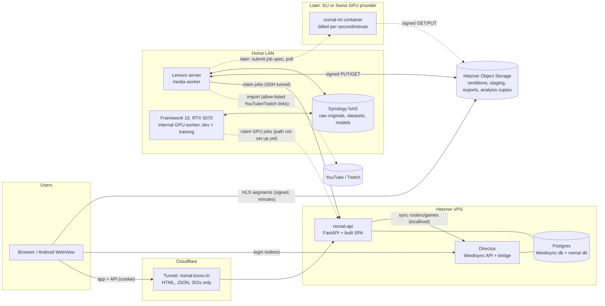
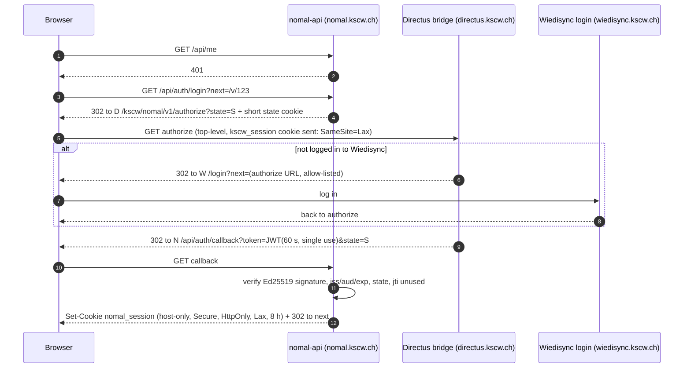
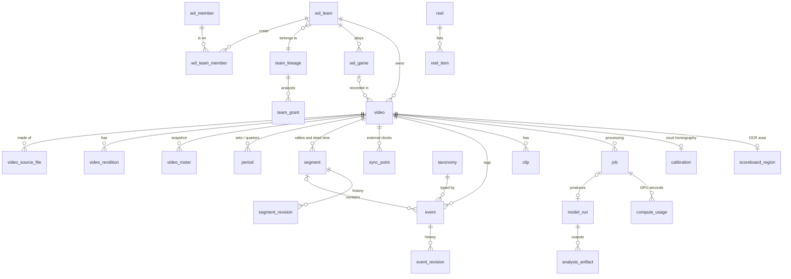
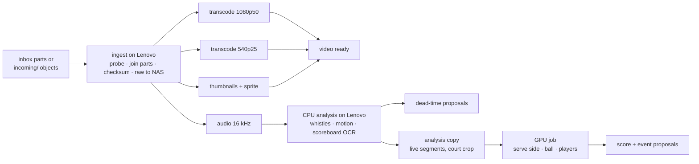

# Nomal: plan

> *Nomal* is Swiss German for "again": watch it again, learn from it.
> In-house video analysis for KSC Wiedikon, replacing what clubs pay Hudl or Balltime for.

| | |
|---|---|
| Status | **Plan, revision 4** (15.10.2026). Nothing built yet; brand icons generated. |
| Owner | Luca Canepa (sole developer) |
| Repo | `KSC-Wiedikon/nomal` (AGPL-3.0, like Wiedisync; private for now) |
| Live host (planned) | `nomal.kscw.ch` (prod), `nomal-dev.kscw.ch` (dev) |
| Depends on | Wiedisync (accounts, teams, rosters, games): `KSC-Wiedikon/wiedisync` |

This is the plan of record. Decisions that change it get a short ADR in `docs/adr/` and an
edit here. It contains **no secrets, IPs, vault paths or home hostnames**: those belong in
the private ops notes (§15).

**Flags** (things that break a stated constraint or need a decision) are marked ⚠ and
collected in §19.

---

## Contents

1. [Goals, non-goals, tiers](#1-goals-non-goals-tiers)
2. [Decisions so far](#2-decisions-so-far)
3. [Architecture](#3-architecture)
4. [Login and the Wiedisync bridge](#4-login-and-the-wiedisync-bridge)
5. [Permissions, privacy and revDSG](#5-permissions-privacy-and-revdsg)
6. [Data model](#6-data-model)
7. [Video pipeline](#7-video-pipeline)
8. [Jobs and workers (how the GPU gets work)](#8-jobs-and-workers-how-the-gpu-gets-work)
9. [Tagging and playback (tier 1)](#9-tagging-and-playback-tier-1)
10. [Automatic analysis (tier 2)](#10-automatic-analysis-tier-2)
11. [Tier 1 as training data for tier 3](#11-tier-1-as-training-data-for-tier-3)
12. [Feature benchmark: Balltime and competitors](#12-feature-benchmark-balltime-and-competitors)
13. [Brand and UI](#13-brand-and-ui)
14. [Repo, stack, environments, deploy](#14-repo-stack-environments-deploy)
15. [Operations and handover](#15-operations-and-handover)
16. [Budget](#16-budget)
17. [Roadmap](#17-roadmap)
18. [Risks](#18-risks)
19. [Open questions and flags](#19-open-questions-and-flags)

---

## 1. Goals, non-goals, tiers

**Goal.** Coaches and players upload match and practice footage, tag what happens, and
watch clips, highlight reels and condensed matches without dead time, all behind their
existing Wiedisync login. Volleyball first; basketball is in the first batch of teams, so
everything sport-specific is data (taxonomies), not code.

**First teams (season 2026/27)**: about 75 matches (H3, D1, Herren 1); DU23-1 is switched off
for now (§5.3).
The budget still assumes 100 videos per season.

| Team in Wiedisync | Sport | League | Note |
|---|---|---|---|
| H3 | Volleyball | 2. Liga | |
| D1 | Volleyball | 2. Liga | Not the basketball "Lions D1" |
| DU23-1 | Volleyball | U23 | **Switched off for now** (15.10.2026): 6 of 15 rostered under 18; its matches are not filmed either (U23 opponents may be under 18), §5.3 |
| Herren 1 | Basketball | 1. Liga regional A (`H1LRA`) | Called "H1" in conversation; Wiedisync also has a *volleyball* H1 (2. Liga), which is not in scope |

### Tiers

| Tier | What | Runs where |
|---|---|---|
| **1 · MVP** | Upload a match (original file, split parts joined automatically, or imported from a YouTube or Twitch link of the club's or a member's channel) · timestamp-synced manual tagging with keyboard shortcuts (event type + player number) · rally markers and **skip-dead-time playback from manual markers** · clips and per-player highlight reels · clip/reel export with ffmpeg · Wiedisync login | API + web on Hetzner; media work on the Lenovo server |
| **2 · Automatic** | **Dead-time skipping** (rallies vs. timeouts, set breaks, warm-up) · **automatic scoring** (volleyball from the serving side, scoreboard OCR when the scoreboard is in frame; basketball later) · ball tracking (TrackNet-style) · player detection + tracking (YOLO + tracker) · court homography → serve placement. Coach corrections become training data. | CPU stages on the Lenovo server; GPU stages on our own GPU at home first (Framework 16, always on), an EU or Swiss provider later; queued like everything else |
| **3 · Later / maybe** | Per-touch action classification and player attribution | Same GPU path, trained on tier 1 + 2 data (training on the Framework 16) |

### Non-goals (to stay finishable by one person in the evenings)

- No live streaming, no live tagging during the match. Footage is processed afterwards.
- No public links of any kind, no social sharing, no embedding outside Nomal.
- No face recognition and no cross-video person re-identification, ever (§5.7).
- No full DataVolley replacement. Statistics stay simple (counts and efficiencies per skill).
- No multi-camera sync, no camera hardware. Telestration comes after launch (§12).
- No minors: nothing under 18 is filmed for Nomal or stored by it (§5.3).
- No camera purchases: each team films with its own camera.

---

## 2. Decisions so far

From the Q&A on 15.10.2026 (second round supersedes the first):

| # | Topic | Decision |
|---|---|---|
| D1 | Capture | Each team films with **its own dedicated camera**, minimum **1080p50**; the club buys none. A **YouTube or Twitch link** is accepted as a source **for the club's own videos only** (the club's channel or a member's own channel): Nomal imports the file (§7.2.2, decided 16.10.2026); the **original file is preferred** (the platforms re-encode) and can replace the import later. |
| D2 | Teams, volume | H3, D1, DU23-1 (volleyball), Herren 1 (basketball). ~100 videos per season in total. **DU23-1: trainings only** (decided 15.10.2026, §5.3). **Matches only for now** (decided 16.10.2026): trainings removed from the product, tables kept until the cleanup migration (§5.3). |
| D3 | Delivery | Hetzner Object Storage. **HLS**: the authenticated API serves the playlist and every segment URL is signed with a **TTL of minutes** at the moment the player asks for it. No long-lived link per video anywhere. A copied link dies quickly; a 2 h match plays without interruption (§7.6). |
| D4 | Compute | **Lenovo server** = always-on media worker (ingest, transcode, clips/exports, CPU analysis). **Inference starts internal** (decided 15.10.2026): on the **Framework 16** (RTX 5070 Laptop GPU, 8 GB, CUDA; always on), with a researched plan to move to an **EU or Swiss provider** later (§8.6). US providers are out. The Framework 16 is also the development and training machine; the RTX 4090 PC is not part of the plan. The worker interface is backend-agnostic (queue → worker), so internal, provider and a future GPU box are interchangeable (§8). |
| D5 | Permissions | Team-scoped defaults accepted (§5.1). **Adults only**: a hard check against member birthdates; nothing under 18 is filmed or stored. |
| D6 | OpenVolley | Not now. The data model stays open for importing points later (§6.6, §10.8). |
| D7 | Repo | `KSC-Wiedikon/nomal`, AGPL-3.0 (created, private). |
| D8 | Docs | This plan lives in the repo and is committed (secret-free by rule). |
| D9 | Brand | Own Nomal brand (§13): assets in `docs/brand/`, `-vb` / `-bb` variants (default `vb`), wordmark "nomal" in Bricolage Grotesque ExtraBold. |
| D10 | Budget | **~CHF 210 per season** running cost in total (cloud GPU ~80, backup storage ~50, test GPU ~35, reserve). Lines that would exceed it are flagged (§16). |
| D11 | Tier 2 scope | Includes dead-time skipping (like Balltime) and automatic scoring. |
| D12 | Defaults accepted | Download policy (coaches only, watermarked, 30 days), retention (season + 1), audio kept with per-video mute, players who leave lose access, no per-player consent (16.10.2026, §5.4). |
| D13 | Opponents | Opponents in adult leagues are adults (the club's position, 15.10.2026); no per-upload confirmation (§5.3). |
| D14 | Camera models | Not collected: Nomal reads resolution, frame rate and codec from each file (§7.1). |

---

## 3. Architecture

### 3.1 Picture



The rule that shapes everything: **Cloudflare only carries small things** (the SPA, JSON,
302 redirects). Its terms do not allow serving video through the normal proxy or a Tunnel
on non-Enterprise plans, so video bytes go straight between object storage and browsers,
the Lenovo server and the GPU.

### 3.2 Components

| Component | Runs on | Does | Tech |
|---|---|---|---|
| **nomal-web** | Built into the `nomal-api` image, served at `nomal.kscw.ch` | Library, player, tagging, reels, admin | React 19, TypeScript, Vite, Tailwind v4, shadcn, TanStack Query, hls.js |
| **nomal-api** | Hetzner VPS (the club's account), Docker, bound to `127.0.0.1`, reached via the existing Cloudflare Tunnel; worker routes only through an SSH tunnel from the worker host (§8.1) | Auth, permissions, metadata, upload orchestration, media redirects, job queue, audit log, budget ledger | Python 3.12, FastAPI, SQLAlchemy 2 + Alembic, Pydantic 2, psycopg 3 |
| **Postgres `nomal`** | Existing Postgres container on the VPS, separate database + own non-superuser role | All Nomal state incl. the job queue | Postgres 16 |
| **Object storage** | Hetzner Object Storage, same region as the VPS, private bucket | HLS renditions, thumbnails, upload staging, exports, temporary analysis copies | S3 API |
| **Media worker** | **Lenovo server** (always on; Ryzen 7 PRO 8700GE 8C/16T, 30 GB RAM, Radeon 780M with VAAPI H.264 encode, ~690 GB free) | Ingest (NAS inbox + browser uploads), transcode, thumbnails, audio, CPU analysis (whistles, motion, scoreboard OCR), analysis copies, clip/reel export, retention | `nomal-worker` container, ffmpeg. **CPU-capped** (it also runs the LAN's DNS and other services) |
| **GPU worker (now)** | **Framework 16** at home (RTX 5070 Laptop GPU, 8 GB; always on) | Pulls GPU jobs from the queue and runs `nomal-ml run <spec>` locally; busy guard (§8.2). Not set up yet: needs its own path to the API (§8.1) | `nomal-worker` + `nomal-ml` image (CUDA 12.8+, PyTorch), NVIDIA Container Toolkit |
| **GPU dispatcher (later)** | Same container on the Lenovo server | Hands GPU jobs to an EU or Swiss provider once that backend is switched on (§8.6); enforces the CHF cap | Part of `nomal-worker` |
| **Framework 16 (dev)** | Same machine | Development, model training/fine-tuning, local test runs; a training run pauses the GPU worker | Blackwell GPU: needs a PyTorch build with CUDA 12.8 or later |
| **NAS** | Synology at home (≈18 TB free) | Raw originals (master copies), ML datasets, model weights, weekly mirror of the bucket | NFS/SMB share `nomal` |
| **Wiedisync bridge** | Inside Wiedisync's `kscw-endpoints` (Directus) | Mints the login token; serves roster/game sync to nomal-api | Small endpoints (§4) |

### 3.3 Why this shape

- **Same origin for app and API** (`nomal.kscw.ch` serves both): Nomal's own session cookie
  is host-only, Nomal's API needs no CORS, and the Android WebView just works.
- **Separate service, shared Postgres server**: keeps Wiedisync's Directus permissions out of
  the hot path and reuses the existing backup pipeline. No cross-database foreign keys:
  Nomal stores Wiedisync IDs and a synced mirror (§6.2).
- **Pull-based home worker**: the Lenovo server is behind NAT; it polls for work, nothing on
  the internet can reach it.
- **GPU as a pluggable backend**: the queue does not know where a GPU job runs. Our own GPU
  now, an EU or Swiss provider later, or a future box take the same job spec (§8.3).
- **Python everywhere except the browser**: API, workers and ML share one package.

---

## 4. Login and the Wiedisync bridge

### 4.1 Constraint found in Wiedisync

The Wiedisync login cookie (`kscw_session`) has been **httpOnly and host-only on
`directus.kscw.ch`** since 28.09.2026. No other host, including `nomal.kscw.ch`, can read it.
Wiedisync's other apps call Directus with credentialed CORS, which needs entries in the
Directus `CORS_ORIGIN` env and in `cors-credentials.js`.

Nomal avoids credentialed CORS entirely with a **redirect + signed token** flow (a minimal,
OIDC-shaped authorization flow).

### 4.2 Flow



- **Token**: EdDSA (Ed25519) JWT, `iss=wiedisync-prod|wiedisync-dev`, `aud=nomal`, 60 s,
  `jti` recorded by Nomal so it can be used once. The private key lives only in the Directus
  env; Nomal holds the public key(s), chosen by `kid` (rotation = add new, retire old).
- **Return URLs are allow-listed** in the bridge. No open redirect.
- **Claims are minimal**: member ID and UUID, display name, global roles, sport-admin scopes,
  team relations for the current and previous season. No email, no birthdate.

```json
{
  "iss": "wiedisync-prod", "aud": "nomal", "sub": "<members.uuid>", "mid": 123,
  "name": "First Last", "roles": ["user"], "sport_admin": [],
  "teams": [{"team": 92, "season": "2026/27", "rel": ["player", "captain"]}],
  "state": "…", "jti": "…", "iat": 0, "exp": 60
}
```

- **Session**: server-side row (hashed ID in the cookie), 8 h, renewed by repeating the
  redirect silently. Role changes reach Nomal within 8 h at most; admins can sign everyone out.
- **Logout** ends the Nomal session; the UI links to Wiedisync logout.

### 4.3 Server-to-server sync

`nomal-api` keeps a small read-only mirror of the Wiedisync data it needs (§6.2):

- `GET /kscw/nomal/v1/teams` (metadata of every current and previous-season team) and
  `GET /kscw/nomal/v1/sync?teams=<ids>` (only the enabled teams) on the bridge, with an
  `X-Nomal-Service-Token` header, called over the VPS's Docker network (no Cloudflare hop). A
  full snapshot each time; at this size there is no need for incremental sync.
- Returns only **Nomal-enabled teams** (current + previous season), their rosters (member
  ID, UUID, name, jersey number, positions, relation, guest flag), and their games and
  trainings (ID, date, time, home/away names, league, hall name, **official set scores** from
  `games.sets_json`). Never birthdates.
- Runs hourly, on admin demand, and right before an upload is accepted.

### 4.4 Changes needed in Wiedisync (small, separate PR there)

| Change | Where | Notes |
|---|---|---|
| `GET /kscw/nomal/v1/authorize` | new `kscw-endpoints/src/nomal-bridge.js` | Reads `req.accountability`, builds claims, signs, redirects. Logs issuance with `writeUserLog`. |
| `GET /kscw/nomal/v1/teams`, `GET /kscw/nomal/v1/sync?teams=` | same file | `X-Nomal-Service-Token` (not `Authorization: Bearer`, which Directus would claim), internal network only, read-only, versioned contract with tests. |
| `GET /kscw/nomal/v1/adult-check?team=&date=` | same file | Pass/fail per rostered person for a recording date (§5.3); birthdates never leave Wiedisync. |
| Allow-listed cross-host `next` on `/login` | `LoginPage` / `AuthRoute` (`?next=` exists for in-app paths) | Only the bridge's authorize URL. |
| ~~Team toggle in `teams.features_enabled`~~ | — | **Changed in M0 (ADR-001):** full admins enable teams **in Nomal**, per lineage. The bridge returns personal data only for the team ids Nomal asks for, so Wiedisync needs no migration and coaches cannot enable their own team. |
| Env | Directus `.env` (prod + dev) | `NOMAL_JWT_PRIVATE_KEY`, `NOMAL_JWT_KID`, `NOMAL_RETURN_URLS`, `NOMAL_SYNC_TOKEN_HASH`, and on dev `NOMAL_LOGIN_URL=https://wiedisync-dev.kscw.ch/login`; recreate the container (restart does not re-read env). |
| Later: "Video" link on game cards | `GameCard` | Plain link to `nomal.kscw.ch/games/<id>`. |
| Docs | `INFRA.md`, `SECURITY.md`, `PERMISSIONS.md` | Same commit, per Wiedisync rules. |

No `CORS_ORIGIN` change is needed. A Cloudflare Tunnel public hostname `nomal.kscw.ch`
(and `nomal-dev.kscw.ch`) pointing at the API's local port is.

---

## 5. Permissions, privacy and revDSG

*Not legal advice. The goal is a design a Swiss data-protection review would find
reasonable; have the club's privacy contact read §5 before launch.*

### 5.1 Who can do what

Relations come from the login token and Nomal's `team_grant` table (analysts). "Team" means
the team's **lineage** (§6.3) unless a season is named.

| Action | Player | Analyst¹ | Coach / team manager | Sport admin (that sport) | Admin / superuser² |
|---|---|---|---|---|---|
| Watch team videos, tags, clips | own seasons³ | ✓ | ✓ all seasons | ✓ | ✓ (logged, banner) |
| Create own private reels, comment on clips | ✓ | ✓ | ✓ | ✓ | |
| Share a reel with the team | | ✓ | ✓ | ✓ | ✓⁴ |
| Upload / link a video, edit roster snapshot | | ✓ | ✓ | ✓ | |
| Tag, mark rallies, correct scores and model output | | ✓ | ✓ | ✓ | ✓⁴ |
| Download / export MP4 (watermarked) | | | ✓ | ✓ | ✓⁴ |
| Delete a video | | | ✓ | ✓ | ✓ |
| Grant analyst | | | ✓ | ✓ | ✓⁵ |
| Enable a team for Nomal | | | | | in Wiedisync |

¹ A player a coach picks to help tag; Nomal-local grant per team lineage. Called "helper" in the
  app (team page → Helpers; built 17.10.2026). Any active club member in the mirror can be
  picked, from any team; grants are read on every request (never from the login token), so a
  removed helper loses the team at once; a disabled team hides its grants. Helpers are viewers
  for the filming rules (§5.3): only the roster is checked. Their guide: `/how-to-help`.
² Board members without an admin scope get no access.
³ Players see the seasons they were rostered in; they lose access when they leave.
⁴ Owner, 16.10.2026: admins do the first tagging, so they tag, share and export too.
⁵ Since 17.10.2026: admins, too, add and remove a team's helpers.

The rules live in **one module** (`nomal/core/permissions.py`) with a table-driven test
that enumerates this matrix. Every API route goes through it.

### 5.2 No public links

- Every media request goes through `nomal-api` with the session cookie. Segments get a
  302 to an object-storage URL **signed for 5 minutes, for one 4-second segment** (§7.6).
- Exports (MP4) are for coaches only, **burned-in watermarked** ("KSCW intern · <name> ·
  <date>"), expire after 30 days, and are downloaded through the same redirect (signed at click).
- No share-by-link feature exists. Sharing means "visible to the team in Nomal".

### 5.3 Adults only: nothing under 18 filmed or stored

Enforced in code, not just stated:

1. **Hard check against `members.birthdate`.** For a recording date, a rostered person
   (players, guests, coaches, team managers) passes only if a birthdate exists and they are
   18 or older on that date. **No birthdate = fails** (the year of birth alone is not accepted).
   The check runs inside Wiedisync (`adult-check`), so birthdates never reach Nomal.
2. **Before filming**: the team page in Nomal shows each upcoming game as *filming allowed* or
   *blocked*, with the reason ("2 roster members without birthdate"), so a coach knows before
   setting up the camera. The filming guide says: no camera if blocked.
3. **Before storing**: every upload, inbox file and YouTube link re-runs the check for the
   recording date. Blocked means refused before any bytes are stored (browser uploads are
   checked before the first part is signed; refused inbox files are deleted from the share).
4. **Nightly**: if someone who fails the check joins an enabled team, new uploads freeze, the
   coach and admin are notified, existing videos are flagged for review.
5. **Opponents**: Nomal cannot verify opponents' ages. The club's position (15.10.2026): adult
   leagues have no under-18 opponents, so adult-league matches are filmed without a per-upload
   confirmation. Opponents appear by jersey number only, their data stays team-internal, and
   footage is deleted or trimmed on request. Recorded in `docs/PRIVACY.md`.

**DU23-1: switched off for now** (decided 15.10.2026, evening). On the real rosters 6 of its
15 people are under 18, so the team fails the hard check, and with matches only (below) and its
matches not allowed it has nothing to film for Nomal anyway. Switching it off also stops Nomal
from mirroring their names. Switch it back on (Admin → Teams) once its roster passes, e.g. next
season; its stored policy below (no matches) still applies then.

**DU23-1: trainings only** (decided 15.10.2026). Its opponents are U23 teams that very likely
field under-18 players, which Nomal cannot check, so DU23-1 matches are not filmed for Nomal.
Its trainings pass the same hard check as everyone else: every rostered person needs a
birthdate and must be 18 or older on the day, otherwise the training is blocked too. Nomal
enforces this with a per-team policy (`team_policy.matches_allowed = false`, §6.10): uploads
linked to a game are refused for that team, and its upcoming games show *filming not allowed*.

**Matches only for now** (decided 16.10.2026). Trainings are removed from the product: no
training uploads, no trainings on the team page, and the team policy has only the matches
switch (so DU23-1 films nothing for now). A match that is not in Wiedisync (friendly,
tournament, cup) is uploaded with its date and a title and passes the same checks. The tables
stay until the cleanup migration after M2–M4: `wd_training` (still synced, read by nothing),
`video.training_id`, `team_policy.trainings_allowed`.

### 5.4 Consent and information

**No per-player consent** (decided 16.10.2026, replacing the opt-in of the first plan).
Swiss Volley allows anyone to record a match (Volleyballreglement 2026/27, Art. 86 "video
recording": third parties may record; the home team provides the opponent's camera spot
behind the court, centred, about 3 m high). The club films its own matches and trainings
on that basis and informs its members instead of asking each one: the privacy page and
`docs/PRIVACY.md` say what is filmed, who sees it, the processors (§5.6) and GPU processing
"on club hardware, or at a provider in Switzerland or the EU named on the privacy page", so
the planned move (§8.6) needs an updated privacy page and a notice to members. A member who
objects asks a coach or admin, who can delete a video or untag them. The adult gate (§5.3)
and the team policy stay.

The club's privacy policy on `kscw.ch` gets a Nomal section; Nomal has its own short privacy
page (what, why, who sees it, how long, processors, contact, rights).

### 5.5 Retention

| Data | Where | Default retention |
|---|---|---|
| Upload staging | Object storage `incoming/` | Until ingested; lifecycle rule deletes after 14 days regardless |
| Analysis copies (GPU input) | Object storage `analysis/` | Deleted when the GPU job finishes; lifecycle rule after 3 days |
| HLS renditions, thumbnails | Object storage `media/` | Recording season + 1 (a 2026/27 match until 31.05.2028). After the recording season, the 1080p rendition is dropped and 540p kept (§16 cost lever) |
| Raw originals | NAS `nomal/raw/` | Same as renditions; short labelled windows may stay in the ML dataset (§11) |
| Exports | Object storage `exports/` | 30 days |
| Tags, rallies, scores, rosters | Postgres | As long as the video; member link removed when a player withdraws or leaves and asks |
| ML datasets, models | NAS | Until the model using them is retired; listed in a dataset manifest |
| Audit log | Postgres | 12 months |
| Sessions, login nonces | Postgres | Purged after 30 days |

A nightly `retention` job enforces this and logs what it deleted.

### 5.6 Processors and where data goes

| Processor | Data | Where | Note |
|---|---|---|---|
| Hetzner (VPS, Object Storage) | Everything Nomal stores | Germany / EU | Adequate country; DPA with Hetzner |
| Cloudflare | HTML, JSON, redirects (no video bytes) | Global edge | Already the club's provider |
| GPU processing | Analysis copies (video), no names, no IDs | **Now: club hardware at home** (no third party). Later: an EU or Swiss provider | The move needs a DPA (§8.6) |
| YouTube (Google), Twitch | Source of imported videos from the club's and members' channels (§7.2.2); Nomal fetches them, the browser never talks to them | Google, Twitch | Only for imported videos |

**Decision (15.10.2026): GPU inference starts internal**, on club-controlled hardware at home,
so no video leaves the club for processing. The later move (§8.6) goes to a **Swiss or EU
provider only**, under a DPA. US providers are excluded: Modal, for example, is a US company;
on its free plan jobs run in US regions, even region-pinned jobs (Team plan, about USD
250/month) pass its US control plane per its docs, and no public Swiss-US Data Privacy
Framework certification or DPA was found (15.10.2026). After the move the same minimisation
applies: the provider receives only temporary, court-cropped analysis copies of the live
segments, without audio unless a task needs it, with no names or IDs, deleted after the job.

### 5.7 Things Nomal never does

- No face recognition, no face embeddings, no person re-identification across videos.
  Player attribution uses **jersey numbers and position on court only**. (Biometric data used
  for unique identification is sensitive personal data under the revDSG; avoid it entirely.)
- Detection is masked to the court polygon plus a margin, which also excludes spectators.
- No third-party analytics and no third party in the browser: imported YouTube/Twitch videos
  are fetched by the worker and played from Nomal's own storage.

### 5.8 Audit log

Records logins, video views (once per video per session), uploads, deletions, exports and
downloads, permission and consent changes (helpers added and removed: `helper_added`,
`helper_removed`), admin "view as", GPU submissions (which video,
which provider), retention deletions. Coaches see the log for their team's videos; members can
request their own entries.

### 5.9 Audio

Camera audio carries whistles (used for dead-time detection) and also bench talk. Default:
kept in renditions; a per-video "mute for viewers" switch strips it from playback. The NAS
original keeps it.

---

## 6. Data model

### 6.1 Overview



Sketches below are **not final DDL**; they fix names, keys and the shape of the hard parts.
IDs are UUIDv7 (time-ordered, client-generatable) except mirrored Wiedisync IDs (integers).
Timestamps are `timestamptz`. Video times are **integer milliseconds of media time**, plus
the frame number where it matters.

### 6.2 Wiedisync mirror (read-only, replaced by sync)

```text
wd_member        id int PK (= members.id), uuid, display_name, number, positions[], active, synced_at
wd_team          id int PK (= teams.id), lineage_id → team_lineage, name, sport
                 ('volleyball'|'basketball'), season '2026/27', league, team_key, listed, synced_at
                 -- every listed team (metadata only); personal data only for enabled lineages
wd_team_member   (team_id, member_id, rel, is_guest)  rel ∈ player|coach|team_responsible|captain
wd_game          id int PK (= games.id), team_id, date, time, home_name, away_name,
                 our_side 'home'|'away', league, hall_name, home_score, away_score,
                 official_sets jsonb  -- from games.sets_json, used by auto scoring (§10.3)
wd_training      id int PK (= trainings.id), team_id, date, start_time, hall_name
adult_check      (team_id, date) → passed bool, failing_count, checked_at   -- no birthdates
sync_state       last_run, last_ok, counts, error
```

No email, phone, address or birthdate ever reaches Nomal.

### 6.3 Seasons and team lineage

Wiedisync **clones every team row on 1 June** (new IDs). A video belongs to the team row of its
season (`video.team_id`). For "this team across seasons" Nomal has `team_lineage (id, sport,
label)`, matched at sync by `(sport, teams.team_id)`, falling back to `(sport, name)`; an admin
can fix a wrong match. **Whether a team uses Nomal is a flag on its lineage**
(`team_lineage.enabled`, set by full admins in Nomal; ADR-001), so it carries over to the new
season's team row. Sport is always part of the key: "H1" exists in both sports.

### 6.4 Videos

```text
video             id, team_id → wd_team, kind 'match'|'training'|'other',
                  game_id → wd_game NULL, training_id → wd_training NULL,
                  title, sport, recorded_at, recording_started_at NULL (wall clock, for imports),
                  source 'file'|'import', import_url NULL, import_channel_id NULL,
                  replaced_import_offset_ms NULL,
                  status 'awaiting_upload'|'uploading'|'queued'|'processing'|'ready'|'failed'|'deleted',
                  duration_ms, fps_num, fps_den, width, height, has_audio, audio_muted,
                  capture jsonb  -- camera make/model, codec, bitrate, VFR flag, from metadata
                  meets_standard bool, standard_issues text[]  -- e.g. '25fps', '720p'
                  retention_until, created_by, created_at, deleted_at, deleted_by,
                  rallies_reviewed_at NULL, rallies_reviewed_by NULL  -- §10.1
                  actions_reviewed_at NULL, actions_reviewed_by NULL  -- §10.4a
video_source_file video_id, part_no, nas_path, bytes, sha256, duration_ms, offset_ms
video_rendition   video_id, name '1080p50'|'540p25', codec, bitrate, segment_seconds,
                  segment_count, storage_prefix, bytes, job_id
video_roster      video_id, side 'us'|'them', number, member_id NULL (us only),
                  position NULL, is_libero    UNIQUE(video_id, side, number)
inbox_file        id, nas_path, size, probed jsonb, recorded_at_guess, status, video_id NULL
```

- Cameras split long recordings into several files: `video_source_file` keeps the parts and
  their offsets; ingest joins them losslessly.
- `meets_standard = false` (e.g. 25 fps, 720p) still plays and can be tagged, but is skipped
  by tier 2 and shown with a hint.
- `video_roster` is a **snapshot** (numbers differ between teams, guests play); tags resolve
  number → member through it, so later roster changes never rewrite history.

### 6.5 Taxonomy (sport-specific, data not code)

```text
taxonomy         sport, version, code, name_key (i18n), hotkey, category,
                 default_pre_ms, default_post_ms, lead_ms,
                 attributes_schema jsonb (JSON Schema: grade, zones, sub-types…),
                 starts_rally bool, ends_rally_on jsonb, active
                 PK (sport, version, code)
```

Seeded from reviewed YAML (`taxonomies/volleyball.yaml`, `taxonomies/basketball.yaml`).
Volleyball follows **DataVolley conventions** (skills S R E A B D F, grades `# + ! - / =`,
zones 1–9). A taxonomy change creates a new `version`; a mapping table translates for datasets.

### 6.6 Periods, segments, scores

```text
period           id, video_id, no (set or quarter), start_ms, end_ms, start_us, start_them,
                 first_serve 'us'|'them' NULL, our_court_side_at_start 'near'|'far',
                 side_switch_at_score NULL (5th set: 8), start_rotation NULL (our setter's zone
                 1-6 at the first serve), final_us, final_them, source, review,
                 -- the scoring's (§10.3): model_first_serve, model_court_side, confidence,
                 -- model_missed_us/them (points after the last rally), model_run_id
segment          id, video_id, period_id NULL,
                 kind 'rally'|'possession'|'timeout'|'set_break'|'warmup'|'stoppage'|'other_dead',
                 start_ms, end_ms,
                 serving 'us'|'them' NULL (facts only), serving_manual NULL (called in review),
                 won_by 'us'|'them' NULL (the coach's),
                 -- the scoring's, next to the coach's and never in their place (§10.3):
                 serving_court 'near'|'far' NULL, serve_confidence NULL,
                 model_serving NULL, model_won_by NULL, model_missed_us/them NULL,
                 score_us_after NULL, score_them_after NULL,
                 score_source 'tags'|'model'|… NULL, score_confidence NULL, score_conflict bool,
                 score_note NULL (missing_before|missing_after|extra|serve|coach|unsure),
                 source 'manual'|'model'|'import', import_system NULL, import_ref NULL,
                 model_run_id NULL, confidence NULL,
                 review 'unreviewed'|'confirmed'|'corrected'|'rejected'|'merged',
                 merged_into NULL (a merged proposal: the segment it went into),
                 created_by, updated_by, timestamps, deleted_at, version
segment_revision same shape as event_revision (§6.7), written by trigger
sync_point       id, video_id, video_ms, system ('openvolley'|'scoreboard'|'manual'),
                 external_ts NULL, external_ref NULL, note
```

- **Skip dead time** = play only `rally`/`possession` segments. Everything between rallies is
  dead by default; explicit dead kinds (`timeout`, `set_break`, `warmup`) exist for reports
  ("points after a timeout") and for training the gap classifier.
- **Scores live on rallies** (`score_*_after`, `won_by`), with where they came from and how
  sure the system is. A coach correction is a revision, i.e. a training label.
- **Facts and suggestions side by side** (since 16.10.2026, §10.3): `won_by` and `serving`
  hold only what a coach decided (or what follows from it: a serve tag, a serve called in
  review, the previous winner, the set's first server, the next rally's known server). The
  model writes `model_serving` / `model_won_by`; the score line (`score_*_after`) counts the
  coach's winners and fills the gaps with the model's (`score_source` "model"). So a model's
  guess never becomes a stat or a training label by accident; the stats count facts only.
- **Ready for OpenVolley later**: `source='import'`, `import_system`, `import_ref` on segments,
  and `sync_point` to map the e-scoresheet's wall-clock point times onto video time.

### 6.7 Events (the tags)

```text
event            id (client UUIDv7), video_id, segment_id NULL, sport, taxonomy_version, code,
                 t_ms, frame, time_precision 'live'|'adjusted'|'frame',
                 side 'us'|'them', number NULL, member_id NULL,
                 attributes jsonb   -- grade, zone_from, zone_to, subtype, made/missed, …
                 court_x NULL, court_y NULL   -- metres, from homography (tier 2)
                 ball_x NULL, ball_y NULL     -- a suggested action: the ball at contact (§10.4a)
                 clip_pre_ms NULL, clip_post_ms NULL, note NULL,
                 source 'manual'|'model'|'import', model_run_id NULL, confidence NULL,
                 review 'unreviewed'|'confirmed'|'corrected'|'rejected',
                 supersedes_id NULL, track_ref NULL,
                 created_by, created_at, updated_by, updated_at, deleted_at, version int
event_revision   id, event_id, version, changed_by, changed_at,
                 action 'create'|'update'|'delete'|'restore'|'confirm'|'reject', before jsonb, after jsonb
```

- Revisions are written by a **Postgres trigger**, so no code path can skip them.
- Deletes are soft: undo is trivial, rejected model output stays as a hard negative.
- The client generates the ID, so saving is an idempotent `PUT /api/events/{id}` (§9.6).

### 6.8 Clips, reels, comments, exports

```text
clip             id, video_id, start_ms, end_ms, title, note, event_id NULL,
                 owner, visibility 'private'|'team', created_at
comment          id, target_type 'clip'|'event'|'segment'|'video', target_id, t_ms NULL,
                 author, body, mentions int[], created_at, edited_at, deleted_at
reel             id, owner, lineage_id NULL, title, kind 'smart'|'manual',
                 query jsonb NULL, visibility 'private'|'team', created_at
reel_item        reel_id, position, video_id, start_ms, end_ms, event_id NULL, clip_id NULL, caption
export           id, kind 'clip'|'reel'|'condensed'|'recap', source jsonb, params_hash,
                 status, object_key, bytes, requested_by, job_id, expires_at
```

- A **clip** is a time range. Watching it seeks inside the HLS stream: no file, no storage.
- A **per-player highlight reel** is a *smart reel*: a saved query ("member 123, attacks
  graded #, season 2026/27") evaluated on open, so it updates as tagging continues.
- An **export** renders a clip, reel or condensed match to MP4 with ffmpeg (§7.7).

### 6.9 Jobs, workers, ML provenance, budget

```text
job              id, kind, video_id NULL, params jsonb, priority, required_caps text[],
                 depends_on uuid[], status 'queued'|'leased'|'running'|'waiting_budget'|
                 'succeeded'|'failed'|'cancelled', attempts, max_attempts, not_before,
                 lease_owner → worker, lease_expires_at, heartbeat_at, progress, message,
                 backend NULL, backend_ref NULL, checkpoint jsonb, result jsonb, error,
                 created_at, started_at, finished_at
worker           id, name, caps text[], token_hash, paused, version, last_seen_at
model_run        id, kind 'analyse'|'train_rallies'|'score'|…, job_id, video_id NULL (a training has
                 none), model_name, model_version (git sha), weights_sha256,
                 dataset_manifest NULL (training: games, their signals' SHA-256, rally counts),
                 params jsonb, metrics jsonb, timing jsonb, created_at
                 -- metrics.videos[<video id>]: what the run did for that video: the finder
                 -- (v0|v1), proposals written, or its score against the coach's rallies
analysis_artifact id, video_id NULL (a model has none), model_run_id, kind 'features'|
                 'rally_model'|'serve_model'|later 'ball_track'|'player_tracks'|…,
                 nas_path (relative to the analysis root), format 'npz'|'pickle' (Parquet
                 when other tools must read it), schema_version, sha256, bytes, stats jsonb
analysis_track   id, video_id, model_run_id, kind 'serve'|'activity', step_ms, finder NULL,
                 source_run_id NULL, channels jsonb (base64 zlib bytes), created_at
                 -- small series the API scores with (§10.3), tens of KB a video
calibration      id, video_id, hall_name, image_points, court_points, homography (3×3),
                 method 'manual'|'auto'|'copied', reproj_error_cm, created_by, copied_from NULL
                 -- built in 0008 (16.10.2026) with lineage_id, status 'confirmed'|'proposed'
                 -- (the court finder's), landmarks, image_aspect, camera, max_error_cm,
                 -- confidence, model_run_id; one row per video and status
                 -- 0009 (17.10.2026): segments jsonb NULL (the camera's setups, each a time
                 -- range with its own landmarks and homography), checked (false: set by the
                 -- court job), at_ms; method also 'auto-hall' (the hall's memory)
scoreboard_region id, video_id, hall_name, rect, layout jsonb (digit boxes: home, away, sets,
                 clock), created_by, copied_from NULL
                 -- built in 0013 (17.10.2026): one per video, rect {x, y, w, h} (0..1, the
                 -- score), layout {kind: flip|led|auto, sets: a second box or null},
                 -- lineage_id, at_ms; what was read is a track (analysis_track "scoreboard")
compute_usage    id, job_id, backend, gpu_type, gpu_seconds, cpu_core_seconds, gib_seconds,
                 est_cost_chf, at
budget           period ('2026/27'), line ('cloud_gpu'|'test_gpu'), cap_chf
```

Per-frame data (ball positions, player boxes, OCR readings) is **not** stored in Postgres: a
2 h match at 50 fps is 360 000 frames. It goes into files on the NAS referenced by
`analysis_artifact` (since 16.10.2026: one compressed numpy `.npz` of signals per video, a
few MB, §10.1); only derived facts (segments, scores, serve placements, proposed events)
become rows. Built in migration `0006` (16.10.2026) with `video.rallies_reviewed_at/_by`
(§10.1). Migration `0007` (16.10.2026) adds `analysis_track`, two small per-video series the
API scores with (§10.3), and the scoring's fields on `segment` and `period` (§6.6).
Migration `0011` (17.10.2026, §10.5) adds the players of a video:

```text
player_cluster   id, video_id, model_run_id, key, team 'us'|'them', tracks jsonb (per track:
                 id, times, detections, side, read number, crop), crops jsonb, detections,
                 ocr_number NULL, ocr_confidence NULL   -- the number reader's suggestion
                 number NULL, member_id NULL, not_player, referee_guess, merged_into NULL,
                 source 'model'|'split', assigned_by, assigned_at
                 -- "a person in this video"; the coach's number is its only identity (§5.7)
event_player     event_id, video_id, model_run_id, cluster_id, track_id, number, member_id,
                 method 'court'|'image', distance, confidence, contact_ms, applied_number,
                 event_version   -- who made the action as Nomal sees it, beside the event
```

and the artifacts `player_tracks` (every box, `.npz` on the NAS), `player_index` (boxes per
analysed frame for the API, JSON in the bucket and on the NAS) and `player_sheets` (the
contact sheets of crops, JPEG in the bucket under `media/{video}/analysis/` and on the NAS).

### 6.10 People, access, privacy

```text
session          id_hash, member_id, claims jsonb, created_at, expires_at, last_seen_at, user_agent
login_nonce      jti, used_at
team_grant       id, lineage_id, member_id (no FK: the mirror purges), member_name, role 'analyst',
                 note, granted_by, granted_by_name, granted_at, revoked_at, revoked_by
                 -- one open grant per (lineage, member, role); revoked rows stay as history
consent          (unused since 16.10.2026, §5.4; dropped after M4) member_id, scope 'nomal', notice_version, status 'accepted'|'withdrawn',
                 via 'nomal'|'paper', recorded_by, at
youtube_channel  channel_id, label, owner ('club' | member_id), proposed_by, confirmed_by,
                 confirmed_at    -- allow-list: the club's and members' own channels
team_policy      lineage_id, matches_allowed bool, trainings_allowed bool, reason, set_by, set_at
                 -- e.g. DU23-1: matches_allowed = false (§5.3)
audit_log        id, at, actor_member_id, action, object_type, object_id, details jsonb
```

---

## 7. Video pipeline

### 7.1 Capture standard (goes into `docs/FILMING_GUIDE.md`)

Each team brings its own camera. Nomal does not need to know the model: it reads resolution,
frame rate, codec and bitrate from every file and flags videos below the standard (§6.4). The
guide states the standard; camera-specific tips are added only if a coach asks.

| Setting | Standard | Why |
|---|---|---|
| Position | **Volleyball: behind the court**, tripod centred on the end line, **2.5–3 m high** (at least 1.5 m). **Basketball: side of the court** (below) | Whole court visible, net divides the teams. Same spec as Hudl/Balltime (8–10 ft, min 5 ft), so footage works in either |
| Framing | Whole court + ~2 m margin, **all four far-court corners visible**, **fixed zoom**, never moved during the match | One homography per video; consistent ML input |
| Lens | **No wide-angle or fisheye mode** (basketball exception below) | Distortion breaks court calibration |
| Rate / resolution | **50 fps, 1080p minimum**; 4K50 if the camera can | Far-court ball tracking needs pixels; 50 fps for fast actions, and it matches 50 Hz hall lighting (60 fps can flicker under it) |
| Shutter | **1/500 s or faster**; if a hall's lights show flicker bands at that speed, use the fastest speed without banding | Motion blur is what kills ball tracking |
| Exposure, focus, white balance | Locked (manual) | Auto modes pump during play |
| Audio | On | Whistles drive dead-time detection |
| Scoreboard | In frame if possible without losing court | Enables scoreboard OCR (§10.3) |
| Start | From warm-up, continuous; split files are fine | Ingest joins parts |
| Check | Nomal shows *filming allowed / blocked* for the game (§5.3) | Adults only |

**Basketball (Herren 1): side of the court, not behind it.** From behind the baseline (the
volleyball position) the far basket is 28 m away and players stand in a line one behind the
other, so the far half is small and hidden. For basketball the camera goes on the **long side
at the half-court line**, as high as the hall allows (gallery or top row of the bleachers),
framing both baskets. It stays fixed (no panning), so tier 2 can still calibrate the court
once per video. If the hall is too narrow to fit both baskets, a mild wide-angle setting is
acceptable for basketball only (never fisheye); the calibration then also corrects the lens
distortion (§10.6). See §19, O8.

### 7.2 Ways in

| Path | For | How |
|---|---|---|
| **NAS inbox** (preferred at home) | Anyone with SD-card access at home | Copy files into the `nomal-inbox` share. The Lenovo worker sees stable files (size unchanged for 2 min), probes them, groups split parts, registers *inbox files*. In Nomal the coach picks the game (suggested from recording time vs. games that day). Nothing crosses the internet twice. |
| **Browser upload** | Coaches elsewhere | Resumable S3 **multipart** upload straight to object storage (`incoming/<video>/`), parts signed by the API (64 MB parts → files up to ~640 GB; 4 in parallel; survives reloads). Several files per video (split recordings). The Lenovo worker downloads, archives to NAS, deletes the staging object. |
| **Import from a link** (planned, §7.2.2) | Matches someone already put on YouTube or Twitch | Paste a link from an allow-listed channel (the club's, members' own) or pick one Wiedisync already stores for the game; the Lenovo worker downloads it and it continues like an upload. Decided 16.10.2026; replaces the earlier plan to embed YouTube without downloading. |

Before any of these is accepted: permission, team policy and adult gate (§5.3). Refused
means no bytes stored. YouTube-hosted footage sits outside Nomal's access control (whoever has
the YouTube link can watch it), so the club and members should upload as *unlisted*; the
adults-only rule applies just the same.

Wiedisync already stores video links per game (`game_recordings`, often YouTube). The sync
carries them, so a coach can import an existing link in one click when its channel is on the
allow-list (§7.2.2).

#### 7.2.1 Split recordings are stitched automatically (planned)

Action cameras split long recordings: DJI cameras start a new MP4 at about 4 GB and write a
low-resolution proxy (`.LRF`) next to each part; GoPro writes `GX01xxxx`, `GX02xxxx`… plus
`.LRV`/`.THM`. Today Nomal joins several files of one video in **file-name order** and the
coach picks the files and the game by hand. Goal: the coach drops the **whole card or
folder**, and Nomal finds the match recording, orders and joins its parts, and suggests the
game; no sorting by hand.

1. **Skip sidecars.** `.LRF`, `.LRV`, `.THM`, `.SRT`, `.OSV`, photos and anything that is not a
   camera video are left out silently and listed as "skipped (preview and data files)". The
   upload page accepts a folder (`webkitdirectory`) as well as files.
2. **Read each file's metadata before uploading.** The browser reads the MP4 `moov` box with
   `File.slice` (camera files keep it at the end, so a few MB at most): start time
   (`creation_time`), duration, resolution, frame rate, codec, and make/model/serial where the
   camera writes them. The NAS inbox already probes the same fields with ffprobe.
3. **Group parts into recordings.** Same camera (serial, else model + resolution + frame rate
   + codec), ordered by start time with file names as tie-break; a part continues the previous
   one when it starts within ±3 s of the previous start + duration. A larger gap starts a new
   recording. This works with an unset camera clock (only differences count).
4. **Suggest the match.** The recording that overlaps the game's time (Wiedisync date + time,
   club time zone, from 60 min before the first serve) is preselected with its game; stray
   clips stay unticked. The coach sees e.g. "3 files · 19:12–21:04 · 1 h 52 min → KSC Wiedikon
   H3 – Volero Legends" and confirms or changes it. If the clock is far off, name order is
   used and the game is picked by hand, as today.
5. **Several recordings for one match** (the camera was stopped at a set break) are allowed:
   joined in time order, the break is kept as metadata and shown as a marker on the timeline
   (and offered as dead time), not as black video.
6. **Joining.** Originals stay untouched on the NAS (master copies); the join happens in the
   transcode via ffconcat, as today. Parts must share resolution, frame rate and codec, or the
   upload page proposes separate videos. DJI split points can carry a sub-second audio gap, so
   the concat transcode resamples audio to stay in sync (`aresample=async=1`) and regenerates
   timestamps; a test with a real Osmo card checks lip-sync at every boundary.
7. **Store it.** `video_source_file` gains `recorded_at`, `duration_ms` and `camera` (one
   migration), so exports keep cutting per file and later features can map wall-clock time
   (scoreboard OCR, Wiedisync set times) onto the video.
8. **Later, optional:** upload the `.LRF` proxy first (about a tenth of the size) so the coach
   can start tagging while the full files still upload; the tags carry over unchanged because
   proxy and original share the timeline.

Before building: a listing and ffprobe output of a real card from the club's Osmo (part names,
split size, whether `.LRF` files are split the same way). Tests: grouping with gaps, an unset
clock, two cameras on one card, sidecars; a browser upload of a three-part match. Size: about
2–3 days; worth doing before the first real season uploads.

#### 7.2.2 Import from a link: YouTube and Twitch (planned)

Many matches are already online (members' channels, club streams). Instead of downloading and
re-uploading them by hand, the coach pastes the link and Nomal fetches the video itself.

1. **Where:** the upload page gets a third source next to *this device* and *NAS inbox*:
   **From a link**. It also offers the links Wiedisync already has for that game.
2. **Which links:** only `youtube.com/watch?v=…`, `youtu.be/…` and `twitch.tv/videos/…`
   (past broadcasts and highlights), checked by strict patterns; nothing else is fetched, so
   no request to arbitrary addresses (SSRF). The video's channel must be on the allow-list (the
   club's channel and members' own channels, confirmed by a coach or admin), checked from the
   video's metadata.
3. **Rules as for uploads:** the coach picks the game (suggested from the publish or stream
   date); permission, team policy and adult gate (§5.3) run before anything is fetched.
4. **The fetch:** a new job kind `import` (worker capability `import`) on the **Lenovo
   worker**: it runs from the home connection, because YouTube often blocks downloads from
   data-centre addresses such as the VPS. It runs `yt-dlp` (pinned version, run from Python,
   never through a shell) with only the YouTube and Twitch extractors, no playlists, no cookies
   (public and unlisted videos only), a size and time limit, and prefers 1080p at 50/60 fps
   (H.264 + AAC where offered). The file lands in the NAS raw folder like an upload and the
   normal chain continues (ingest, renditions, thumbnails); progress shows in the video list.
5. **Keeping it working:** YouTube changes often break older `yt-dlp` versions, so the worker
   image is rebuilt with the newest release on a schedule (and on demand when imports fail),
   after the import tests pass.
6. **Quality:** these platforms re-encode; that is fine for watching, tagging and exports,
   less good for the later automatic analysis. The original from the camera stays better, and
   uploading it later replaces the imported file while keeping all tags.
7. **Timing:** Twitch deletes past broadcasts after 7 to 60 days depending on the channel;
   import them soon after the match (highlights stay).
8. **Terms:** YouTube's and Twitch's terms allow downloads only through their own features or
   with the permission of the platform and the rights holder. The allow-list keeps imports to
   the club's and members' own videos, whose owners agree; the remaining risk is the platform
   blocking downloads, not a dispute with the people filmed. Decided by the club on
   16.10.2026, reversing the earlier "no download" line.

Size: about 1–2 days (job, worker step, allow-list admin, upload-page source, tests with a
short public test video). No budget impact: it runs on the Lenovo and stores like an upload.

### 7.3 Processing chain



Each box is a `job` row (§8). `ready` needs both renditions and thumbnails; tier 2 jobs follow
automatically for matches that meet the standard, once those features exist.

### 7.4 Renditions

| Rendition | Use | Encoding (H.264 High, AAC) | ≈ size |
|---|---|---|---|
| `1080p50` | Tagging, desktop viewing, frame stepping | ~5 Mb/s VBR (max 7), closed GOP 2 s, 4 s fMP4 HLS segments | 2.3 GB/h |
| `540p25` | Phones, weak connections | ~1.2 Mb/s, GOP 2 s, 4 s segments | 0.6 GB/h |
| Thumbnail sprite + WebVTT | Scrub previews | 1 frame / 10 s, 160 px wide | few MB |

H.264 because every browser and the Android WebView decode it in hardware. Inputs vary by
camera (H.264/HEVC, 8/10-bit, sometimes variable frame rate); ingest normalises to constant
50 fps. The Lenovo server encodes with VAAPI on the Radeon 780M where quality allows, else
x264 with a CPU cap. Both are faster than real time for 1080p.

Measured 15.10.2026 on a real H3 match (2 h 12 min, 1080p60 from the club's YouTube footage;
worker image with its production limits, VAAPI): 1080p50 in 22.7 min (5.8× real time,
2.2 GB/h), 540p25 in 9.1 min (14.6×, 0.6 GB/h), **32 min and 6.1 GB of renditions per
match**, at about 0.2 CPU cores (the GPU does the work).

### 7.5 Storage tiers

| Tier | Where | Holds | Size per season (100 matches × ~1.75 h) |
|---|---|---|---|
| Hot | Hetzner Object Storage | HLS renditions, thumbnails, exports, staging, analysis copies | ≈ 0.5–0.6 TB |
| Master | NAS `nomal/raw/` | Original camera files (25–50 Mb/s) | ≈ 2–4 TB (NAS has ≈ 18 TB free) |
| ML | NAS `nomal/datasets/`, `nomal/models/` | Labelled windows, Parquet tracks, weights | tens of GB |
| Mirror | NAS `nomal/bucket-mirror/` | Weekly `rclone sync` of the bucket | = hot |

Raw originals are **not** copied offsite (2–4 TB/season; renditions are the fallback). The
database is backed up with Wiedisync's existing pipeline (§15.2).

### 7.6 Playback: HLS with short-lived segment URLs

As decided: the authenticated API serves the playlist, segment URLs are signed with a TTL of
minutes, and the player keeps going for the full match.

1. hls.js loads `GET /api/media/{video}/{rendition}/index.m3u8` from `nomal.kscw.ch` with the
   session cookie. The API checks permission and returns a VOD playlist whose segment URIs
   point back at the API: `/api/media/{video}/{rendition}/seg/{n}.m4s`.
2. As the player needs each 4-second segment, it requests that URI; the API checks the
   session (cached per session + video for 60 s) and answers **302** to an object-storage URL
   **signed for 5 minutes, for that one segment**. Signing is a local HMAC, no network call.
3. The browser fetches the bytes directly from object storage (bucket CORS allows
   `nomal.kscw.ch`).

So signing happens continuously as playback advances: a 2 h match (~1 800 segments per
rendition) plays without interruption, while any copied URL is either useless without the
session (API URL) or dead within 5 minutes and covers 4 seconds (storage URL). Cloudflare
carries only the tiny 302s.

Fallback, if per-segment redirects ever add noticeable start-up latency: the API returns the
playlist with **directly signed segment URLs** (TTL ~10 min), and an hls.js custom loader
re-fetches the playlist before the signatures expire or on a 403. Same security properties.

Seeking is exact; frame stepping uses `requestVideoFrameCallback` for the true media time.
iPhones: hls.js runs on iOS 17.1+ (Managed Media Source); older iOS uses native HLS, which
follows redirects. **Test on an iPhone in M1.**

### 7.7 Clips, reels, condensed matches, exports with ffmpeg

- **Watching** a clip, reel or condensed match never renders anything: the player seeks to
  `start_ms`, plays to `end_ms`, jumps to the next item (preloading it). Clip windows come from
  the taxonomy (e.g. attack −3 s/+2 s), adjustable per event.
- **Skip dead time** is the same mechanism over rally segments, with 2 s pre-roll (serve toss)
  and 1.5 s post-roll (reaction).
- **Export** (coach only) queues an `export` job on the Lenovo server: cut from the NAS
  original (best quality; falls back to the 1080p rendition), re-encode each piece for
  frame-accurate in/out points, concatenate, burn in the watermark and optional captions
  (player, opponent, date, score), upload to `exports/`, notify. A 2-minute reel takes seconds;
  a condensed match a few minutes.
- **Game recap** (built 17.10.2026; Balltime's "Game Recap" without the paid parts: no
  commentary, no generated text, everything runs on the club's machines). "Create game recap"
  on the video page (whoever may export) queues an export of kind `recap`
  (`nomal/core/recap.py` picks, the worker draws: `nomal/worker/recap.py`):
  - **Plays from facts**: tags that stand and rallies that stand. Kills, aces and block
    points (`A#`, `S#`, `B#`; ours count more than theirs), long rallies (≥ 15 s), the rallies
    that ended a set and the match. **Without tags** (and rallies not marked done): the rally
    finder's rallies, the longest (an unchecked proposal over 30 s is likely two rallies and
    left out) and the set and match points of the score line.
  - Best first until ~2.5 min (3 min at most, the match point always), then in the order
    played; each clip from 1.5 s before the serve to 2 s after the point, no footage twice.
  - **Title card** (4 s, navy and yellow, DejaVu Sans from the worker image): "Game recap" /
    "Spielzusammenfassung", the teams (home first, as in Wiedisync; two lines when long),
    the sets won and the set scores (Wiedisync's, else the sets a coach stands behind; never
    sets only the scoring proposed), the date and the hall. In the requester's language.
  - **Score bug** on every clip, top left, **facts only, never a guess**: "Satz 2" / "Set 2"
    when the set is a fact (a coach's set, or one ending on Wiedisync's official score); the
    score before the rally, switching to the new one at the moment of the point, when every
    point up to it is a fact (the coach's winners, the rallies marked done without a check, or
    the scoreboard showing it, sure and without a check); what the play was ("Kill #7", "Long
    rally"; "Set point" / "Match point" only when that is a fact too). Set a fact, score not:
    "Satz 2" and the play; neither: the play alone. Short fades between clips; the watermark
    as on every export.
  - Same pipeline as the other exports: H.264/AAC 1080p50 pieces joined without re-encoding,
    30 days under Downloads; the app says when it is ready (a toast on any page, while the tab
    that asked is open).
  - **First real render, 17.10.2026**: the H3 home game vs Uster (06.02.2026, 105 min,
    YouTube 1080p60, v0 rallies and scoring from its stored signals, no tags): see the
    runbook (analysis, "Game recap").

---

## 8. Jobs and workers (how the GPU gets work)

### 8.1 Queue in Postgres, workers pull

No message broker. The `job` table *is* the queue; only `nomal-api` touches it. Workers call
four endpoints through an **SSH tunnel** to the VPS (worker routes are refused when a request
arrives through Cloudflare):

| Endpoint | Does |
|---|---|
| `POST /api/worker/claim` `{caps, max}` | Atomically leases the highest-priority runnable job whose `required_caps` ⊆ the worker's caps and whose dependencies succeeded (`SELECT … FOR UPDATE SKIP LOCKED`). Lease 5 min. Long-polls up to 30 s. |
| `POST /api/worker/jobs/{id}/heartbeat` `{progress, message, checkpoint}` | Extends the lease, stores progress and a resumable checkpoint. |
| `POST /api/worker/jobs/{id}/sign` `{op, keys}` | Signed PUT/GET URLs for the objects this job may touch. **Workers never hold storage credentials.** |
| `POST /api/worker/jobs/{id}/complete` / `fail` | Finishes the job; the API writes derived rows in one transaction. |

A reaper returns expired leases to the queue (`attempts+1`, back-off) or fails them after
`max_attempts`. Each worker has its own token (hashed in `worker`), revocable from the admin page.

**How workers reach the API (16.10.2026: SSH tunnel instead of the tailnet).** The VPS was on
the owner's private tailnet and published the API on its tailnet address too
(`NOMAL_TAILNET_IP`). On 16.10.2026 it moved to the club's own Hetzner account and left that
tailnet; it is on no tailnet now. The path since then:

- On the VPS, `NOMAL_TAILNET_IP` is unset, so the APIs listen on loopback only
  (`127.0.0.1:8090` dev, `:8091` prod).
- The Lenovo server connects out with the systemd unit `nomal-api-tunnel.service`
  (`deploy/lenovo/`; install steps in its header). It runs `ssh -N` with two local forwards
  and publishes the APIs on the Docker bridge, where the worker containers reach them:
  `NOMAL_WORKER_API_URL=http://172.17.0.1:18090` (dev), `…:18091` (prod).
- ufw on the Lenovo server lets only Docker networks reach those two ports
  (`ufw allow proto tcp from 172.16.0.0/12 to 172.17.0.1 port 18090,18091`).
- The tunnel carries no `CF-Connecting-IP`, so the worker routes accept its requests. The
  security idea is unchanged: the worker routes are not reachable from the internet, only a
  machine with SSH access to the VPS can reach them, and the VPS has no access to the home
  network.
- The Framework 16 GPU worker (§8.2) is not set up yet. It will need its own path to the API
  (for example its own SSH tunnel), decided when it is set up.

### 8.2 Workers

| Worker | Caps | Notes |
|---|---|---|
| **Lenovo server** (`media`) | `ingest`, `inbox`, `transcode`, `thumbs`, `audio`, `analyse`, `cpu_analysis`, `analysis_copy`, `export`, `retention`, `nas` (+ `gpu_dispatch` once a provider backend exists). With `analyse` the worker runs a second, background lane for the analysis jobs (nice 15), so an hour of analysis never holds up an upload | Always on. Container limits (e.g. 6 CPUs, 8 GB) and `nice` so DNS and the other services on the box stay responsive. Mounts the NAS share. Reaches the API through `nomal-api-tunnel.service` (§8.1). |
| **Framework 16** (`gpu`) | `cuda`, `ml`, `nas` | Internal GPU worker, always on. **Busy guard**: stops claiming jobs while a training run or other GPU-heavy work uses the GPU (checked from free VRAM, plus a `nomal-worker pause` switch); optionally only at night. ML jobs process the analysis copy in 5-minute chunks and checkpoint, so a pause or reboot loses at most one chunk. Laptop care: suspend disabled, battery charge limit ~80 % in firmware, good airflow when docked. A dev agent (`--env dev`) runs beside it, off by default. Not set up yet: it needs its own path to the API (§8.1). |

### 8.3 The GPU interface (backend-agnostic)

GPU work is **one job per video** (`ml_analyse`), not one per model, so models load once. Which
machine runs it is a backend choice; every backend runs the same image with the same spec:

```text
GpuBackend
  submit(spec) -> handle          # start the run
  poll(handle) -> state, progress, metrics
  cancel(handle)

spec (JSON)
  job_id, image "ghcr.io/ksc-wiedikon/nomal-ml:<version>", tasks ["serve_side","ball","players"]
  inputs   analysis copy + time map + calibration (NAS path, or signed GET for a provider)
  outputs  Parquet + result.json (NAS path, or signed PUT for a provider)
  limits   min_vram_gb 16, max_seconds, max_cost_chf

container entrypoint:  nomal-ml run --spec spec.json   -> writes outputs, exits 0/1
```

| Backend | How it runs the image | Use |
|---|---|---|
| `local-agent` | A GPU host runs `nomal-worker` with `cuda` caps, **pulls** `ml_analyse` from the queue like any worker, and runs `nomal-ml run` locally; inputs and outputs on the NAS | **Production now** (Framework 16) |
| `cloud-<provider>` | The Lenovo dispatcher claims the job and **pushes** it to a provider adapter that starts the image on a rented GPU; inputs and outputs are pre-signed object URLs | Later: an EU or Swiss provider (§8.6) |
| `fake` | Returns canned outputs | CI |

The `nomal-ml` container never calls Nomal's API: inputs and outputs are URIs in the spec, and
the agent or the dispatcher relays progress and results to the worker routes (§8.1). Moving to
a provider touches only the adapter. For a provider, the analysis-copy input URLs are the only
long-ish signed URLs in the system: they point at a temporary object no user ever sees, deleted
when the job ends.

**Budget guard.** Every run records GPU, CPU and memory seconds and an estimated cost in
`compute_usage` (electricity for `local-agent`). For a provider backend, the dispatcher checks
the season's spend against the `budget` cap before submitting; when the cap would be exceeded,
the job waits in `waiting_budget` and admins are told.

### 8.4 Job kinds

| Kind | Caps | Output |
|---|---|---|
| `ingest` | `ingest`, `nas` | Probe, join parts, SHA-256, raw on NAS, staging deleted |
| `transcode` (per rendition) | `transcode` | HLS in `media/{video}/{rendition}/` |
| `thumbs`, `audio` | `thumbs` / `audio` | Sprite + VTT; 16 kHz mono FLAC on NAS |
| `analyse` (16.10.2026) | `analyse`, `nas` | One volleyball video: ball per frame (VballNet-Fast, CPU), motion, whistles and loudness as signals in `analysis/` on the NAS; rally proposals, or their score against the coach's rallies (§10.1). Priority −10, background lane |
| `court` (17.10.2026) | `analyse`, `nas` | The camera's setups (bumps, drift, views), the empty hall's picture in `analysis/`, the court through the hall's memory or the finder v2 (§10.6). After each `trajectory` job; priority −10, background lane |
| `train_rallies` (16.10.2026) | `analyse`, `nas` | Rally finder v1 from every reviewed game, held-out scores of v0 and v1, new proposals when v1 wins (§10.1). Priority −5, debounced |
| `cpu_analysis` | `cpu_analysis` | Scoreboard OCR (whistles, motion and the ball moved into `analyse`) |
| `analysis_copy` | `analysis_copy` | Live segments ±3 s, cropped to the court, 1080p50, to `analysis/` |
| `trajectory` (16.10.2026) | `analyse`, `nas` | The ball's path with contacts, the court finder's proposal (§10.4, §10.6). Background lane |
| `players` (17.10.2026, beta) | `analyse`, `nas` (`NOMAL_PLAYERS_CAPS`, e.g. `gpu,nas` for a GPU worker) | People on the court in the rally windows (YOLO26s ONNX, ByteTrack), tracks → clusters, back crops, shirt-number suggestions (§10.5). On demand (`NOMAL_PLAYERS_AUTO` off by default; on: after each `court` job). Priority −12, background lane |
| `ml_analyse` | `cuda` + `ml` (internal) or `gpu_dispatch` (provider), set by the active GPU backend | Serve side, ball track, player tracks → score and event proposals |
| `export` | `export` | MP4 in `exports/` |
| `retention`, `bucket_mirror` | `retention` / `nas` | Deletions (audited), weekly mirror |

### 8.5 Visibility

Admin page: queue (with age of the oldest queued job), workers, GPU spend this season vs. cap,
recent failures with logs. Uptime Kuma (already at `status.kscw.ch`) gets push monitors for the
worker heartbeats (Lenovo server, GPU PC) and for "a job has been queued > 24 h".

### 8.6 Moving to an EU or Swiss GPU provider

Decided 15.10.2026: GPU inference starts internal and moves to a Swiss or EU provider when that
is worth it. The move is prepared now, so later it is an adapter plus a configuration change.

**When to move** (any one of these):

- GPU jobs regularly wait: the oldest GPU job is older than 7 days, or more than 20 % of a
  season's matches waited longer than 48 hours.
- The Framework 16 fails, is replaced, or its 8 GB GPU becomes the bottleneck (bigger models,
  tier 3).
- Tier 3 needs more GPU time than the laptop provides next to development and training.
- Running it at home becomes a nuisance (noise, heat, training and inference fighting over
  the one GPU).

**Must have**: a Swiss or EU company; processing and storage only in Switzerland or the EU/EEA,
with no inputs routed through a non-European control plane; a DPA under revDSG/GDPR; runs a
container image from a private registry; billed per second or minute without a monthly minimum
(or an hourly instance that starts fast enough to be used per job); a GPU with at least 16 GB;
an API or CLI to start a run and poll it. **Nice to have**: a Swiss data centre, ISO 27001,
scale to zero, free egress, start-up credits.

**Steps**:

1. Shortlist from the research note (`docs/research/gpu-providers-eu-ch-2026-10.md`).
2. Benchmark the S0 match on the top two, paid from the test-GPU line: wall time, GPU-hours,
   CHF per video, start-up time. Outputs must match the internal run within tolerance.
3. Sign the DPA; add the provider to `docs/PRIVACY.md` and the privacy page; tell members (the
   privacy page already covers "a provider in Switzerland or the EU named on the privacy page").
4. Implement the `cloud-<provider>` adapter (submit, poll, cancel), analysis copies to object
   storage, and the CHF cap in the budget guard.
5. Run both backends in parallel on five matches and compare.
6. Switch the default backend in config; keep `local-agent` as the fallback. An ADR records it.

**Shortlist** (research note, 15.10.2026; prices excl. VAT, to verify):

| # | Provider | Why | Season cost at 0.5 / 0.8 / 1.5 GPU-h per video | Main risks |
|---|---|---|---|---|
| 1 | **Infomaniak** (Geneva), L4 24 GB in Swiss data centres | Swiss company and law, FADP/GDPR DPA, CHF billing, free bandwidth, OpenStack | ≈ CHF 18 / 26 / 45 (L4 "from €0.29/h", to confirm) | GPU flavors on request; VMs, not jobs (needs the VM adapter); delete, don't stop, or the GPU keeps billing |
| 2 | **OVHcloud AI Training** (France), L4 24 GB | Managed "run an image to completion" jobs, per-minute billing, mature certifications | ≈ CHF 45 / 68 / ⚠ 122 | Fits CHF 80 only up to ~0.9 h per video; processing in France; new-project GPU quota |
| 3 | **Exoscale** (Lausanne), A30 24 GB in Geneva | Swiss, strongest certifications (ISO 27001/27017/27018, SOC 2, BSI C5), per-second billing | ≈ CHF ⚠ 82 / ⚠ 119 / ⚠ 204 | Over CHF 80 unless ≤ 0.5 h per video or the A30 is clearly faster; manual GPU screening |

Fallbacks: Scaleway L4 (Paris, per minute, VM), SwissGPU (Ticino, very cheap, no API or DPA
found), Seeweb (Italy, hourly, DPA unconfirmed), Verda V100 (Helsinki, cheapest, old GPU).

**Adapters this implies**: `openstack-vm` (Infomaniak; also OVHcloud instances): create a
server from a GPU flavor with cloud-init that pulls the image, runs `nomal-ml run`, uploads the
outputs and deletes its own server with a scoped application credential; `ovh-job`
(`ovhai job run`); `exo-vm` (Exoscale CLI/API). The image reads its spec from `NOMAL_SPEC_URL`
(a signed GET), so a provider only has to pass one environment variable. **Cost safety**: the
dispatcher also deletes any `nomal-job-*` server older than the job's maximum runtime, so a VM
that fails to delete itself cannot bill for days.

Questions to put to the providers before signing up: research note §4.

---

## 9. Tagging and playback (tier 1)

### 9.1 Layout (desktop; tagging is a keyboard task)

```
┌─────────────────────────────────────────────┬──────────────────────────────┐
│                                             │ Set 2 · 14:12 · serve: us    │
│                 video                       │ Roster  us: 1 3 5 7 9 11 …   │
│                                             │         them: 2 4 8 12 …     │
│                                             ├──────────────────────────────┤
│                                             │ Entry:  7A#_          ⏎ save │
│                                             │ → #7 Attack · Kill · 12:31.4 │
├─────────────────────────────────────────────┴──────────────────────────────┤
│ timeline: rally bands · dead time greyed · tag markers · score line        │
├────────────────────────────────────────────────────────────────────────────┤
│ event table (synced to playhead, click = seek, inline edit)                │
└────────────────────────────────────────────────────────────────────────────┘
```

On phones Nomal is a viewer (library, condensed matches, reels, "my clips", comments). A
touch layout with roster and skill buttons exists for tablets and as a fallback.

### 9.2 Keyboard (configurable, cheatsheet on `?`)

Single-letter commands work when the entry buffer is empty; typing a digit or `a` starts a tag.

| Key | Action |
|---|---|
| `Space` | Play / pause |
| `←` / `→` | 1 frame back/forward when paused, 2 s while playing |
| `Shift+←` / `Shift+→` | 5 s; `Ctrl+←/→` previous/next rally |
| `,` / `.` | Speed down / up (0.25×–2×) |
| `Shift+D` | Toggle **skip dead time** |
| `R` | Start rally here; again = end rally (winner `u`/`t`, preset from the last tag) |
| `T` / `B` | Mark timeout / set break (optional; for reports and training) |
| digits + skill + grade, `Enter` | Create a tag (grammar below) |
| `Tab` (while typing) | Toggle side us/them |
| `Esc` | Cancel entry |
| `Ctrl+Z` / `Ctrl+Shift+Z` | Undo / redo |
| `[` / `]`, then `C` | Mark clip in / out, save clip |
| `G`, then `F` | Go to the selected event; snap its time to the current frame |

### 9.3 Entry grammar

Volleyball (DataVolley-flavoured): `[a]<number><skill>[grade][zones]`, e.g. `7A#` = our #7
attack, kill; `a12S=` = their #12 serve error; `5R+` = our #5 reception, positive. Live
preview with names from the roster snapshot; unknown numbers flagged but allowed.

Basketball (Herren 1, from M4): `[a]<number><code>`, e.g. `23S3+` = our #23 three-point shot
made, `23S2-` missed, `11RO` offensive rebound, `11AS` assist, `7TO` turnover, `7ST` steal,
`9BL` block, `14F` foul, `5FT+` free throw made.

**Time capture**: the tag time is the playhead at the *first keystroke*, minus the taxonomy's
`lead_ms`, marked `time_precision='live'`; `F` snaps to the exact frame (`'frame'`).

### 9.4 Rallies and score from tags (volleyball)

A serve tag opens a rally if none is open. A terminal grade (`#` on attack/serve/block, `=`
error) proposes ending the rally, the winner and the next score; the coach confirms with
`Enter` or corrects. Tagging a match therefore also produces the rally list, the dead time
between rallies and the score line, which tier 2 is trained and evaluated against.

### 9.5 Skip dead time from day one

From M2, any video with rally markers (from `R`, from tags, or later from tier 2) plays in
**condensed mode**: rallies only, with pre/post-roll, timeouts and set breaks skipped, a rally
strip to jump around, and the score shown per rally. Before tier 2 exists, a coach who only
wants condensed playback can press `R` twice per rally while watching at 2×; that is the
fastest useful manual pass.

### 9.6 Never lose work

Every change goes to an IndexedDB outbox first and is sent as an idempotent
`PUT /api/events/{id}` with the client-generated ID and `version`. Network loss shows a
"n unsynced" badge; reload resumes. Concurrent taggers: last write wins per event, every change
is in the revision log.

### 9.7 Statistics and reports (M3b)

Per match and season, per player and team, each number clickable into a reel of the
underlying tags:

- Box score: counts by skill and grade, efficiencies (e.g. attack: (kills − errors −
  blocked) / attempts; reception: positive %, plus a 0–3 pass-rating view mapped from the
  DataVolley grades).
- Side-out % and break-point % from the rally list and the serving side.
- Rotation analysis: points, side-out and break-point per rotation, from the starting rotation
  entered per set (`period`) and the serving sequence (a team rotates on every side-out).
- Zone heatmaps for serves and attacks (zones 1–9 from the tags).
- Search bar and saved filters ("#3 attack #", "set 3, rotation 2, reception -").
- CSV export.

A **regrade queue** (Hudl-style: the list advances, number keys set the grade, `U` undoes)
makes grading passes or attacks after a quick first tagging pass fast.

**Built so far (branch `feat/stats`, 16.10.2026)**: the box score, side-out and break-point %,
and the CSV export, computed on read from the tags (`backend/nomal/core/stats.py`, no table).
`GET /api/videos/{id}/stats` (the match and each set) and `GET /api/teams/{id}/stats` (every
ready match of that team row; counts are summed, ratios recomputed), each also as `.csv`
(`?lang=de` for German headers). Whoever may watch the video or see the team reads them. On
the video page a number plays its tags one after another; on the team page it opens the smart
reel builder with that query. Volleyball only.

How the grades are read (the meanings the tagging screen shows per skill; TA = every tag of
the skill, an ungraded tag counts as an attempt that is neither a point nor an error):

| Grade | Serve | Reception | Attack | Block |
|---|---|---|---|---|
| `#` | ace, rating 3 | perfect, rating 3 | kill | point |
| `+` | positive, 2 | good, 2 | in play | touch |
| `!` | OK, 2 | OK, 2 | in play (covered) | touch (back to the attacker) |
| `-` | negative (they passed perfectly), 1 | poor, 1 | in play | touch |
| `/` | overpass forced, 3 | overpass, 0 | blocked | error (invasion) |
| `=` | error, 0 | error, 0 | error | error (or touch out) |

- Serve: aces, errors, in play = TA − aces − errors, efficiency = (aces − errors) / TA, rating
  = mean of the graded serves on the scale above (0–3).
- Reception: errors, perfect % = `#` / TA, positive % = (`#` + `+`) / TA, pass rating 0–3.
- Attack: kills, errors, blocked, hitting % = (K − E − B) / TA, kill % = K / TA, error % =
  (E + B) / TA (so hitting % = kill % − error %).
- Block: points, touches (`+ ! -` and ungraded), errors (`= /`). Dig, set, freeball: counts.
- Points per player: kills + aces + block points.
- Team: points won and lost (rallies), side-out % = rallies we received and won / received,
  break-point % = rallies we served and won / served (only rallies with a known server and
  winner). A tag counts for the set of its rally.
- Rotations (since 16.10.2026): a set's starting rotation (our setter's zone 1–6 at its
  first serve, `period.start_rotation`, entered in the Sets bar) is walked through the
  rallies: we rotate (setter zone 1 → 6 → 5 → 4 → 3 → 2 → 1) on every side-out we win.
  Points, side-out % and break-point % per rotation, per set and for the match, from the
  coach's facts only (a winner is the coach's or the next rally's known server; where neither
  is known the walk stops for that set).
- Rotations and the setter (step 5a/5b, 17.10.2026), on tabs next to the box score ("Players",
  "Rotations", "Setter"), per match, set and season:
  - A set may carry its starting lineup (`period.start_lineup`: our six shirt numbers in zones
    I-VI at the first serve), entered in the Sets bar next to the starting rotation (a court-
    shaped dialog; marking the setter sets the starting rotation). After k side-outs zone I
    holds who started in zone I + k.
  - Per rotation: the team numbers above plus our serve (TA, aces, errors, efficiency),
    reception (TA, positive %, efficiency = (# and + − = and /) ÷ TA) and attack (TA, kills,
    hitting %) in its rallies; a rotation chart per rotation (our six at the serve, the setter
    marked; with the setter's zone only, the setter and P1-P6). Every number plays its rallies
    (the server sends each rotation's rallies with the winner the walk used). The opponent's
    rotation is not tagged and not counted.
  - Setter analysis, from the tags alone: each of our set tags (`E`) with the next tag of its
    rally if that is our attack (attacker, zone from its `zone_from`, else the set's `zone_to`:
    4 left, 3 middle, 2 right, 1 5-9 back row/pipe; kill, error, blocked, in play) and the tag
    before it (our reception's grade: perfect #, good + !, poor - / =; anything else in the
    rally: transition; nothing, an ungraded pass or their serve: unknown). Distribution per
    attacker, zone, rotation, first contact and setter with kill % and hitting %, a court
    heat map of the zones; every number plays its sets up to the attack. No tempo: the
    taxonomy has none.
  - API: `rotations` (richer) and `setter` on the match, each set and the season box,
    `rotation_columns`; CSV `?part=rotations` and `?part=setter`. Season numbers of these two
    tabs are not played (a smart reel can't name a rotation yet).
- Not yet: zone heatmaps for serves, the search bar, saved filters and the regrade queue.

---

## 10. Automatic analysis (tier 2)

Everything produces **proposals** (`source='model'`, `review='unreviewed'`) that a coach
confirms or corrects in one **Review** tab per video (modelled on Hudl's, §12.3: rally
boundaries, set boundaries, starting rotations, serving sides and scores, calibration, later
unidentified players; keyboard-first, the list advances on each answer). Corrections are
revisions and become training data.
Nothing is shown as fact until reviewed or until its measured accuracy passes the bar below.
CPU stages run free on the Lenovo server; only what needs a GPU goes to the GPU backend.

### 10.1 Dead-time skipping (volleyball)

The Balltime-style "skip the downtime" feature. Live play = rallies; everything else is dead.

**The loop (built 16.10.2026)**, from the owner's "start tagging one video and then build up
the recognition with each video". Runbook: [`runbooks/analysis.md`](runbooks/analysis.md).

1. **Analyse.** Once a volleyball video is ready (and meets the capture standard), the
   `analyse` job (§8.4) decodes the NAS originals once (every n-th frame to ~30 fps,
   512x288; VAAPI, else CPU), finds the ball in every frame with VballNet-Fast on the CPU
   (§10.4), measures motion in a 3x4 grid and reads the whistle band of the audio. These
   *signals* (a compressed `.npz` of a few MB, no pictures, no sound) go to `analysis/` on
   the NAS; features are derived from them on every run, so a better rule needs no new pass
   over the video. The current finder then proposes rallies.
2. **Propose.** Proposals are rally segments with `source='model'`, `review='unreviewed'`,
   a `confidence` and their `model_run_id`. A model never writes into a video that has
   rallies a person made, confirmed or corrected: there it only scores itself against them
   (boundary precision, recall and F1 at ±1 s, IoU, counts: the per-game accuracy).
   Proposals nobody touched are replaced on a rerun; one that overlaps a rally a coach
   rejected is dropped. Stats and condensed playback ignore a proposal until it is accepted.
3. **Review.** Accept → `confirmed`; a moved boundary, another kind or winner → `corrected`
   (the revision tables keep before and after); delete → `rejected` (soft-deleted: a hard
   negative); merged into another proposal → `merged` with `merged_into` (soft-deleted, no
   label either way: the surviving one carries it); undo → `unreviewed` again. The server
   marks edits and deletes itself when a client does not say. "Rallies done"
   (`POST /api/videos/{id}/rallies-reviewed`, `video.rallies_reviewed_at`) makes the game
   training data; it is refused (409 with the count) while a proposal is still open, and a
   game reopened later trains again only once it is done again.
4. **Learn.** Ten minutes after the last "done", one `train_rallies` job learns v1 from every
   reviewed game, scores v0 and v1 on each game while it is held out (split by match, §11),
   and keeps v1 only when its mean boundary F1 beats v0's. A kept v1 re-proposes for every
   game nobody has done, and the next analyses use it. `python -m nomal.cli rally-eval`
   prints the per-game scores.

- **v0, rules (now)**: the ball in plausible tracks (stuck spots and parked balls removed)
  over 2 s, or less ball with more movement than usual; gaps up to 3 s bridged; edges from
  the raw half-second activity, opened 1 s before the ball shows (the toss: the tagging page
  opens a rally 2 s before the serve tag) and closed 1 s after it is lost. When a referee
  whistles (≥ 0.8 whistles per minute), whistles inside a stretch split it into rallies and
  give the end, and a rally never starts before its serve whistle. 3–90 s. Without sound
  (friendlies) it runs on the ball and motion alone. The earlier plan of a whistle-first
  state machine gave way to this: the ball is the stronger signal (spike S0), whistles miss
  in friendlies and multiply in tournament halls.
- **v1, learned (now)**: a gradient-boosted classifier (scikit-learn HistGradientBoosting on
  the CPU, seconds to train) answers "in a rally?" per half-second from ~40 features (ball
  seen, tracked, speed, height, track length; motion overall and per court band; loudness;
  whistle on, since, until, rate; the same over 2, 6 and 20 s and the 3 s before and after)
  plus v0's own answer, smoothed with hysteresis into rallies of 2.5–120 s. Needs two
  reviewed games (one to learn from, one to check on); each game weighs the same.
- **Gaps (built 16.10.2026, `nomal/ml/gaps.py`)**: with the sets (§10.3), the stretch before
  the first serve is `warmup`, between sets `set_break`, after the match `other_dead`; a gap
  of 30 s or more inside a set is a `timeout` when it looks like one (40–100 s, the players
  at the benches: movement along the sides of the picture, little on court, no ball in play;
  at most four a set), else a `stoppage` from 40 s (substitutions, an injury, ball
  retrieval). Ordinary dead time stays unlabelled. Proposals like the rallies' (source
  "model", review "unreviewed", a confidence), answered in the review (accept, relabel `W B T
  D O`, reject), replaced on every scoring unless answered; never over a coach's own label
  or one a coach rejected. Condensed playback plays rallies only; the video page marks the
  warm-up, set starts and timeouts and starts at the first serve.
- **Still to do**: telling our referee's pitch from the next court's in tournament halls, and
  a court mask against the neighbours' balls.
- **Review UI**: rally strip with `Enter` accept, `←/→` nudge a boundary, `X` reject, `M`
  merge, `S` split.
- **Bar**: boundary F1 ≥ 0.9 at ±1 s on held-out matches before condensed mode is the default
  view for new videos.
- **First run, 16.10.2026** (2. Liga, H3 vs Volero Legends, 132 min, YouTube 1080p60), in
  the worker image with its 6-CPU limit but outside the worker, while other work ran on the
  box: **28.9 min** wall (4.6x faster than the match), 2.8 CPU-hours (decoding 38 %),
  1.5 GB of memory, 237,264 frames at 139 frames/s, 8 MB of signals. The ball was found in
  33 % of the frames, in a plausible track in 22.5 %; 436 whistles (3.3 per minute, median
  3,875 Hz, as in S0). **v0 proposes 193 rallies** (37 min of play, median 8.6 s; 2.3
  whistles per rally); features and v0 take 0.6 s. The first version proposed 325: shoe
  squeaks split rallies and the ball thrown back after the whistle looked like play, hence
  the serve-whistle anchoring. Ignoring the whistles (as in a friendly), v0 finds 226 on
  the same match, at boundary F1 0.72 against the whistle version. VAAPI decoding was no
  faster in the image (the model is the bottleneck) and found ~1 % fewer balls, so the CPU
  decodes by default. No coach's rallies exist yet: the first boundary F1 comes with the
  first reviewed game.
- **Bonus**: the live segments define the **analysis copy** for the GPU (§8.4), which cuts GPU
  time to the live share of the match.

### 10.2 Dead-time skipping (basketball, later)

Basketball play is continuous; dead ball means the game clock is stopped (fouls, free throws,
timeouts, quarter breaks). With the scoreboard in frame, **game-clock OCR** gives this almost
for free (clock running = live). Without it, whistles + motion as in v0. Planned after volleyball.

### 10.3 Automatic scoring (volleyball)

Rally scoring: **the team that wins a rally serves the next one.** So the score follows from
knowing who serves each rally, plus the rules and the official result:

1. **Serving court per rally** (near/far): a small image classifier on frames around the
   serve, trained on the manual serve tags from tier 1 (every serve tag is a labelled example);
   later cross-checked against where the ball track starts (§10.4).
2. **Court side → team** per set from `period.our_court_side_at_start` (one click per video,
   or inferred from the first set's serve tags), with the rules: teams change sides after each
   set and, in a deciding fifth set, when the leading team reaches 8.
3. **Winner of rally i = serving team of rally i+1.** The last rally of a set has no next
   serve; its winner is whoever reaches the set-winning score.
4. **Constraint from the official result**: Wiedisync holds the official set scores
   (`games.sets_json`, synced from Swiss Volley). The inferred point sequence of each set must
   end at that score; a small alignment step finds the cheapest consistent sequence (missed or
   extra rallies, misread serve sides) and marks the uncertain rallies for review.
5. **Scoreboard OCR when the scoreboard is in frame**: the coach draws the scoreboard box once
   per hall (`scoreboard_region`, reused for later videos in that hall); the Lenovo worker
   samples it at 2 fps, reads digits (seven-segment/LED digits: a tiny digit classifier trained
   on our crops, PaddleOCR as an alternative), smooths over time, and turns changes into
   timestamped points. Where OCR is confident it wins; disagreements with serve inference are
   flagged.
6. **Edge cases** the constraint will surface: replayed rallies (no point), points from
   sanctions (point without a rally), scorer corrections on the scoreboard. The coach fixes
   these in the score line; each fix is a labelled correction.

Output: `won_by`, `serving`, `score_*_after`, `score_source`, `score_confidence` per rally;
the score line in the UI; scores in exports and reels ("set 3, 22:20"). **Bar**: ≥ 98 % of
rallies with the right winner on held-out matches with the set-score constraint; flagged
rallies ≤ 5 %.

**Built 16.10.2026** (steps 1–4; the scoreboard, step 5, on 17.10.2026: below):

- **Serve side** (`nomal/ml/serve.py`, worker): the camera stands behind one end line, so the
  far court is a narrow band around the net where the ball spends most of its time (the
  video's median ball height). v0: the ball's first plausible track after a rally starts
  shows far from that band (low, at the server's hands, or high above them on a jump-serve
  toss) and flies into it → near serve; it starts in the band and comes towards the camera →
  far serve (a late first track is trusted less). v1: a gradient-boosted classifier over the
  same features (first and later height, distance to the band, speed, how much of the first
  0.6 s is tracked, movement at each end line before, the loudest moment) plus v0's answer,
  trained in the `train_rallies` job on the serves of reviewed games (the coach's server and
  the set's sides give near/far), scored leaving one game out, used only when its mean
  accuracy beats v0's. Not an image classifier yet: the ball track decides.
- **Tracks**: the analysis (and a training, for every game, when the serve model changed)
  sends two small series per video (`nomal/ml/tracks.py`, table `analysis_track`): P(near
  serve) for a rally starting at every half-second (~10 KB) and the activity per second
  (ball, movement in the middle and along the sides, whistles; ~20 KB). Not per-frame data:
  the API has no NAS, and with them it scores any rally, also one a coach moved or added,
  without asking the worker again.
- **Scoring** (`nomal/ml/scoring.py`, plain Python in the API, `nomal/core/scoring.py`): a
  dynamic programme over (score, next server) per set, given our side at its start and its
  first server; a rally can be no point (cost from the finder's confidence), points can be
  missing (cheaper in a gap long enough for a rally, with play or whistles in it), a serve
  can be misread (its evidence's log-odds), contradicting a coach's serve or winner costs
  12. With the official set score the set must end exactly there; without, on a set point.
  Our side and the first server of set 1 are chosen for the whole match (sides change after
  every set, the first serve alternates in sets 1–4, the deciding set has its own toss and
  switches at 8); a coach's "we serve first" / "we start near" for a set wins and carries to
  the others. Max-marginals (the cheapest path with the other winner) give each rally's
  confidence; "check" when a point seems missing before or after it, it looks like no point,
  the serve evidence or a coach disagrees, or the winner is unsure (< 70 %). About a second
  a match.
- **Sets**: a coach's sets when there are any (also a proposal the coach filled in);
  otherwise proposed (`period` source "model") at the long breaks (≥ 45 s, a set break ~3
  min costs nothing) with the official number of points per set, or plausible set sizes;
  rallies before the first set (warm-up) and after the last are left out. A coach's own set
  replaces the open proposals; a rejected one is not proposed again.
- **When**: after every analysis and training, when a coach marks the rallies done, changes
  a set (bounds, number, first serve, sides) or calls a serve in review, and on request
  (`POST /api/videos/{id}/scoring`, `python -m nomal.cli score`). Each run is a `model_run`
  (kind "score") with the metrics in `GET /api/videos/{id}/analysis` (`scoring`): per set
  the official score, the score line's final and where the evidence alone ends; flagged
  rallies; gaps; on games with a coach's serves and winners, the serve-side and winner
  accuracy of a run blind to them.
- **Review**: the suggested server and winner on each rally, the score line with "check"
  marks, `1`/`2` call the serving team, gap labels in the same list, "First serve" / "We
  start" and the starting rotation per set in the Sets bar.
- **First real run, 16.10.2026** (the H3 vs Volero Legends match of §10.1, its stored signals,
  v0 rallies, outside the workers): serve track 1.7 s and activity 0.7 s to compute, 9.5 KB
  and 22 KB stored; 191 of 193 rallies in four sets cut at the three set breaks (331, 258,
  262 s) with the official 52/50/47/48 points; the 871 s before the first serve a warm-up,
  14 timeouts (of nine checked on the video, eight were team huddles, one a long break with the players on court), 3 stoppages (both checked: play interrupted on court). Our side
  and first server were picked by the alignment alone (H3 far and serving in set 1, 99.7 %),
  consistent with H3's jerseys in other videos. Every set ends on its official score after
  3+0, 6+0, 2+5, 0+0 (missed + no-point) corrections; 29 % of the rallies are flagged for a
  check (most "unsure" next to a missing point, set 3 the worst with 30 of 50). The evidence
  alone ends no set exactly on the official score (sets 2 and 3 missing 6 and 2 points of v0
  rallies): far from the bar, as expected without a coach's labels; a visual check of 48
  serves of set 3 found 45 read right and 3 unclear frames. Next: coaches review this game,
  the serve v1 learns from it, the rally finder's recall.

**Scoreboard, built 17.10.2026** (step 5):

- **The box**: "Mark the scoreboard" on the video page (whoever may tag): a box dragged around
  the score on the paused frame, optionally a second one around the sets won, and the kind of
  board (flip cards, lit digits, not sure). Stored per video (`scoreboard_region`); a video
  without one is offered the last box drawn in the same hall (the board's place is the
  hall's), else the team's last one. "No scoreboard in this video" forgets it (most of our
  halls have none in the picture).
- **Reading** (`scoreboard` job, the worker's background lane, CPU; `nomal/ml/scoreboard.py`,
  `nomal/worker/scoreboard.py`): ffmpeg crops the box from the NAS originals at 2 fps. Two
  readers, both free and local: a **light one** (local threshold, glyph-shaped components, a
  one-hidden-layer network, 270 KB of numpy weights trained on synthetic flip cards and seven
  segments with 10 TrueType faces, degraded like a hall camera: `scripts/ml/scoreboard_digits.py`;
  a thin upright stroke of the digits' height counts as a "1"), and **PaddleOCR's PP-OCRv5
  recogniser**, the ONNX file the players job already brings into the worker image, reading
  each number on its own (cut at the widest gap between the glyphs). Agreeing, they are surer;
  one reading a tens digit the other lost wins; otherwise the surer one, doubted.
- **Smoothing** (`nomal/ml/board.py`, plain Python): a score counts only when read for ≥ 2 s
  (a head in front of the board does not break it, a stray misreading inside is ignored); of
  those, the path with the most support where the score only rises by +1 (a jump of a few
  points while it was hidden, at a cost) and falls back to ~0:0 at a new set; everything off
  that path is a misreading. The readings stay on the NAS (`analysis_artifact` "scoreboard",
  npz); what the board showed and when (a few KB) is `analysis_track` "scoreboard".
- **In the scoring**: the board during each rally is the score before it, so +1 between two
  rallies names the first one's winner and no change says "no point". That is evidence in the
  alignment (step 4): contradicting it costs 9 × its confidence, more than a misread serve
  and a missed rally together (the board wins over the serve evidence) and less than a coach's
  winner (12) or the official score (a hard constraint). Which side of the board is ours: the
  official set scores when the board's set finals say it, else the side that fits the rest of
  the evidence better. Flagged "board": rallies where the path still disagrees with the board
  and rallies where the scoring blind to the board was sure of another answer (≥ 70 %).
  Metrics (`GET /api/videos/{id}/analysis` → `scoring.board`): orientation, rallies named,
  how often the score line follows the board, disagreements with the serves, and on reviewed
  games the board's winners against the coach's.
- **First real check, 17.10.2026** (the Volero friendly of 17.09.2026, a flip board on the
  scorer's table at the bottom left, seen from the side, its left edge cut by the picture,
  the scorer in front of it most of the time; 10 minutes of set 1 checked by eye): 14 scores
  came out of the smoothing, all right; 17 scores were shown in that time, 3 missed (14:8,
  whose "1" the picture's edge cuts off, and two hidden almost all the time). Before
  smoothing, 44 % of the half-second samples were read; of 35 moments checked by eye, 11 read
  right, 6 wrong (the cut "1", "18 10" read "1 8"), 18 hidden or unread: the +1 path drops
  every wrong one. Ten minutes took 55 s on the Lenovo (6 threads: 1080p60 decoding, two OCR
  calls per sample). On synthetic boards in fonts the network never saw: flip cards 91 %
  right and 5 % wrong, lit digits 73 % right and 9 % wrong (the rest unread).
- **Limits**: a camera that moves takes the board out of the box (the court job's setups do
  not move the box yet); a board far from the camera (a few pixels per digit) is not read.

Basketball scoring later via scoreboard OCR (score + clock): a jump of +1/+2/+3 also
proposes the shot type.

### 10.4 Ball tracking

- TrackNet-family heatmap model on 3-frame stacks at 30 fps, fine-tuned on our footage on the
  Framework 16. **Baseline since spike S0: VballNet-Fast** (MIT, TrackNetV4-based, trained on
  indoor volleyball from behind the back line), **WASB** (MIT) as a second opinion; both work
  on our footage as downloaded ([S0 report](research/spike-s0-2026-10.md)). Labels: a "click
  the ball" tool on sampled frames (target 3–5 k frames across halls and lighting), plus
  negatives; first from the halls where S0 found the models weakest (distant or very wide
  cameras).
- Post-processing: outlier removal, gap interpolation, trajectory fitting; contact and bounce
  candidates from direction changes. **Built 16.10.2026** (`nomal/ml/trajectory.py`, the
  `trajectory` job after each analysis): stuck spots and one-frame spikes out, tracks linked
  over gaps of up to 5 frames (filled), contacts where the path turns ≥ 40° or changes speed
  2.2-fold, labelled *bounce* (came down, went up slower), *low* (came down, went up as fast:
  dig, reception) or *high*; each piece between contacts smoothed on its own. Served as a
  compact track (`GET /api/videos/{id}/ball-track`, 15 samples/s, delta-coded integers,
  gzip): **98 kB for a 2 h 12 min match**. The video and tagging pages draw the last 1.2 s as a
  "Trajectories" overlay (off by default on phones).
- Runs only on live segments of the analysis copy.
- **Bar**: precision ≥ 0.9 at recall ≥ 0.8 within 5 px on held-out frames, near and far court
  reported separately.

### 10.4a Suggested actions (volleyball)

**Built 17.10.2026** (`nomal/ml/actions.py`, `nomal/core/actions.py`, the `actions` and
`train_actions` jobs; migration `0010`). Per rally (a proposal or a coach's), Nomal suggests
the serve, receptions, sets, attacks, blocks, digs and freeballs at the ball's contacts, as
tags with `source='model'`, `review='unreviewed'`, a `confidence` and their `model_run_id`.
Each one carries what the player attribution (§10.5) needs to attach a player later: the
contact's time (`t_ms`, `frame`; `time_precision` "frame" when the analysis saw every frame of
the video, else "adjusted"), the side, the ball at the contact (`event.ball_x`, `ball_y`,
normalised image coordinates) and, with a calibrated court, the floor below it at the skill's
usual contact height (`court_x`, `court_y`). The player (`number`) stays empty.

- **Candidates**: the trajectory's contacts (§10.4) without the tops of flights; tracks that
  start fast (the ball just hit, often the serve) and changes of direction while the tracker
  lost the ball; not what no hand can touch: above 3.6 m, a fast rising ball that nearly
  stops (the top of a steep high ball, the net, a catch), a slow ball low in the picture
  (rolling, handed to the server).
- **Side of the net**: the camera stands behind the end line at about net height, so a ball
  at net height looks the same on either side. Evidence: whether the far half (up to 4 m) can
  show there at all, the depth that explains the bend of the flights before and after the
  contact (gravity bends a far flight less in the picture), apparent speed. The camera is the
  coach's calibration (or the court finder's when confident), else a nominal camera of the
  filming standard with its horizon at the ball's median height.
- **v0, the rules**: per rally a small dynamic programme over the candidates, each skipped or
  given a role (the serve; the 1st, 2nd, 3rd touch of a side; a block at the net right after
  an attack; the floor): three touches a side, the third goes over, a block does not count,
  minimum flight times, a serve that was not seen. Skills follow from the roles (first touch
  after a serve a reception, after an attack a dig, the second a set, the one over an attack
  unless lobbed, a first touch straight over an overpass `/`). Grade hints only when the
  scoring is sure who won: ace `#` (with `=` on the reception that touched it last), serve
  error `=`, kill `#` for the winner's last attack, `/` and `#` for an attack blocked for a
  point, `=` for the loser's last attack; else no grade.
- **v1, learned**: two gradient-boosted classifiers over every candidate (position, turn,
  speeds, the flights' depth, the side evidence, its place in the rally, v0's role): the skill
  or "no action", and the side. Labels: the tags of games whose actions a coach marked done,
  matched to candidates within ±0.3 s. `train_actions` (ten minutes after the last "actions
  done") scores v0 and v1 on each game left out (split by match, §11) and keeps v1 only when
  its mean action F1 (contact within ±0.3 s with the coach's skill and side) beats v0's; a
  kept model suggests again for every game nobody has done. Also reported: the contact
  recall (the coaches' tags with a candidate within ±0.3 s: what the ball's path can find).
- **The bar** (since 17.10.2026, a coach's review costs more than wrong suggestions save):
  suggestions are written only once the finder in use passes it on games whose actions a
  coach reviewed, held out: at least two games, **precision of fully right suggestions**
  (contact within ±0.3 s with the coach's skill and side) **≥ 0.70** and **contact recall ≥
  0.6** (`NOMAL_ACTION_SUGGEST_MIN_PRECISION`, `NOMAL_ACTION_SUGGEST_MIN_RECALL`;
  `NOMAL_ACTION_SUGGESTIONS` = `auto` (default) | `on` (write anyway, for testing) | `off`).
  Below it every run still measures itself where a coach tagged and writes nothing (its old
  untouched suggestions go); the training that first passes it brings suggestions to every
  game nobody has reviewed. The tagging page, the analysis card and the stats say plainly why
  there are none yet ("… now: 2 games, last score 41 %"); "Actions reviewed" stays available
  for a game the coach tagged, which is how the loop gets its labels.
- **Rules for writing**: never into a rally that has a person's tags (made, imported, or a
  suggestion accepted or corrected): there the run only scores itself against them
  (precision, recall, F1 of contacts at ±0.3 s, skill and side accuracy, action F1; in
  `GET /api/videos/{id}/analysis` → `actions.vs_coach`). Untouched suggestions are replaced on
  every run; none within ±0.3 s of one a coach rejected or of a tag that is there.
- **When**: after each trajectory job, 90 s after a scoring a coach caused (sets, serve calls,
  rallies done; debounced), after a rally training, after an accepted action training, on
  request (`POST /api/videos/{id}/actions`, `python -m nomal.cli actions`). Seconds a match.
- **Review**: dashed in the tag list (with an inline accept) and on the timeline; the review
  mode gains an Actions queue next to the rallies: the contact loops (1 s before to 0.5 s
  after), `Enter` accept, `X` reject, `S R E A B D F` the skill, `# + ! - / =` the grade (again:
  none), a number then `Enter` the player, `Tab` the side, `←/→` one frame, `Shift+Enter` the
  rest of the rally, `U` undo; "actions reviewed" (`POST /api/videos/{id}/actions-reviewed`,
  `video.actions_reviewed_at`, refused while suggestions are open) makes the game training
  data. A changed skill, side, grade or time is a correction; naming the player is not.
- **Facts only**: stats, smart reels, the score and the serving team ignore a suggestion until
  a coach accepts it (`tagging.event_stands`); the stats say how many wait.
- **First real run, 17.10.2026** (the H3 vs Volero Legends match of §10.1, v0 rallies and the
  scoring, outside the workers, the court clicked by hand; the nominal camera gives nearly the
  same): 2.9 k candidates, 7.2 per rally; 587 suggestions, 3.1 per rally: 188 serves (one in
  188 of 191 rallies), 97 receptions, 120 sets, 71 attacks, 85 digs, 24 freeballs, 2 blocks;
  grade hints on 72 (28 aces, 14 serve errors, 10 kills). 3 s to read the signals and find the
  candidates, 0.5 s to label (with the bar off). Eyeballed on the video, 60 random suggestions in three rounds
  (the rules tuned between them): 30 % right in time, skill and side; 57 % at a real contact,
  where the side was right in about three of four. Most errors are not contacts at all (the
  ball in flight, at the ceiling, on the floor after the point), serves put on a later contact
  of a rally the finder cut, and skills shifted by one where the tracker missed a touch. Far
  from a bar: the learning loop and the players (§10.5: who is under the ball) are the way
  up; a first reviewed game gives the first measured F1.

### 10.5 Player detection and tracking

- Ultralytics YOLO person detector (AGPL-3.0, compatible with Nomal's licence) + ByteTrack
  (MIT), masked to the court polygon + margin, at 25 fps on live segments (tracker fills in).
- Team assignment: side of the net (volleyball); kit-colour clustering (basketball).
- No identity across videos (§5.7). Track IDs are per video.
- **Built 17.10.2026** (`players` job, `nomal/ml/{people,bytetrack,players}.py`, migration
  `0011`): see "Players in a video" below.

**Players in a video (17.10.2026, beta).** Off by default (`NOMAL_PLAYERS_AUTO=false`): ~2 h
of the Lenovo's CPU per match and many more cards than players (§10.9), so a coach finds them
on demand ("Find players" on the video page, `POST /api/videos/{id}/players/find`) or an admin
with `nomal.cli players --video ID | --all-ready`; switched on, the job follows the court job
(§10.6). The attribution runs whenever a video has players. On the Lenovo's background
lane (CPU; a GPU worker can take it with other caps and ONNX Runtime providers, §8.3):

1. **Detection and tracking**: the rally windows (±1 s, joined when < 2 s apart) are decoded
   per camera file at 10 fps, cropped to the court's ROI (the mask: side lines ± 1.75 m, end
   lines ± 5 m, 2.8 m of head room; each window through the camera's setup it starts in;
   without a calibration the floor below 30 % of the frame).
   Ultralytics **YOLO26s** (COCO, person class, AGPL-3.0) at 1280 px on the ROI's longer side,
   ONNX Runtime CPU: no PyTorch in the worker image (a throw-away Docker stage exports the
   ONNX, `scripts/ml/player_weights.py`). YOLO26's end-to-end head needs no NMS and was as fast
   as YOLO11s and found as many people (spike on the Legends hall: 18 people a frame at
   1280 px, 87 ms per frame with 4 threads; YOLO11m/26m 245 ms). ByteTrack (Kalman + two-round
   IoU association, written in numpy/scipy: Ultralytics' tracker needs PyTorch, supervision
   brings matplotlib and more) gives per-window tracks; a box whose feet are outside the mask is
   dropped; a track whose feet stay past a side line is a referee, line judge or the bench.
2. **Teams**: the side of the net (feet in court metres, the net at 9 m; uncalibrated: the
   foot height between the two teams) and which team was at the camera's end in that rally
   (where the server stood and who served, else the set's side; else kit colours learnt from
   the known rallies, with "near in the first rally = us" as the start, and "swap teams").
3. **Clusters**: the tracks of a team become people: the same read shirt number links tracks,
   tracks seen at the same time (two people) or with different numbers never join, the rest
   by average linkage on appearance (colour of head, shirt, shorts and legs regions: no face,
   no re-identification model). Up to four back crops per cluster (largest, sharpest, one
   whose number reads as the cluster's preferred), one per track for splitting.
4. **Shirt numbers** (a suggestion only): PaddleOCR's text detector and English recogniser
   (Apache-2.0, ONNX via RapidOCR) on the torso of each track's best crops, decoded to digits
   only; a track's number needs repeated readings. Precise but misses many single digits.
5. **Gallery** (`/videos/{id}/players`, `GET/PATCH/POST /api/videos/{id}/players…`): per
   team one card per cluster with its crops, the reader's suggestion and its action count;
   the coach types the number (Enter moves on), merges, splits, marks "not a player", swaps
   teams. A rerun keeps a number where the same number is read on the same team.
6. **Attribution** (API, pure Python): for every action, the ball at the contact (the
   suggestion's own `ball_x/ball_y` when it has them, else the ball track's nearest contact,
   bounces excluded), the analysed frame nearest it, the boxes of the action's team there,
   the nearest player in the image (distance to the box in box heights); confidence from the
   distance and the margin to the second nearest. A floor distance through the camera (the
   ball 0.8 m up for receptions, digs and free balls, 2.3 m for the rest, the camera's setup
   at that time) is built but off: on the Legends game it was 4.7 m off at the median.
   A model's unanswered action gets `number`/`member_id`/`track_ref` written (taken back when
   the gallery no longer supports it); a person's number is never overwritten; the coach's
   tags without a number get a suggestion beside them that "apply" turns into the coach's.
   Recomputed on every gallery change and, for new or changed tags, on the next read.
   Metrics: "% of actions identified" and the agreement with the coach's numbers, in the
   players run's `metrics.attribution` and `GET /api/videos/{id}/analysis` (`players`).

### 10.6 Court homography

- The camera is fixed, so **one homography per video**: a calibration UI (click 6–8 court
  landmarks on a frame, `cv2.findHomography`, reprojection error shown), pre-filled from the
  last calibration in the same hall. Runs on the Lenovo server (CPU). For basketball footage
  filmed with a mild wide-angle setting (§7.1), the calibration also estimates lens distortion
  and undistorts before the homography.
- Later: automatic line/keypoint detection initialised from the hall's last calibration.
- **Bar**: reprojection error < 15 cm on held-out landmarks.
- **Built 16.10.2026** (migration `0008`, `calibration` per video and status): the coach
  clicks 4–10 landmarks (corners; centre and attack lines' ends stand in for corners out of
  the picture and check the fit) on the paused frame; the API fits the homography (DLT,
  pure Python), recovers the camera from it (focal length and position, principal point at
  the centre) so points above the floor map too, and returns the court's lines and the
  error. Pre-filled from the court finder (`nomal/ml/court_detect.py`: vanishing point, side
  lines, the court's spacing along them, a camera that could see it; offered at confidence
  ≥ 0.6) or from the team's last calibration (same hall first). Not yet: lens distortion
  (the wide Legends hall fits at ± 24 cm), a camera bumped during a match.
- **Set automatically, 17.10.2026** (migration `0009`, the `court` job after each trajectory
  job; runbook: [analysis](runbooks/analysis.md#the-court-set-automatically-court-job)):
  - *The camera's setups*: a key frame every 30 s, matched (ORB, RANSAC homography) to an
    anchor frame; where floor probe points land, smoothed over five frames, splits the match
    where they wander more than 4 px (at 1280×720). A jump between two frames (> 8 px) is a
    *bump*, placed by halving between them on key frames (to a few seconds); a slow sag is a
    *drift*; frames that match no anchor make another *view* (the camera carried elsewhere).
    Every H3 game moved: tripod heads sag 10–35 px a match; Legends was bumped at 1:11:30
    (25 px), Stäfa at 2:54. Each setup carries the homography of its picture onto the longest
    (main) setup's, so one court serves them all.
  - *The hall's memory*: the main setup's empty hall (median of 15 key frames) is kept as a
    JPEG on the NAS (`analysis_artifact` `court_frames`). A new video is matched (SIFT,
    RANSAC; the floor around the court first, the whole picture too, the floors seen from
    above when the tripod stood elsewhere) against the calibrated pictures of other videos:
    a coach's always, the court job's at confidence ≥ 0.75; the team's and the hall's first.
    The court comes over, its lines are fitted to the new picture's, and the confidence
    weighs the matches against the court's lines on line pixels. Stäfa → Uster (same hall):
    0.92, 2.2 cm RMS against a hand calibration of Uster, landmarks within 1 px.
  - *The finder v2* for a hall seen for the first time (`nomal/ml/court_find.py`): line
    pixels grouped by paint colour (the middle of clear lines; faint pixels join the paint
    they lie towards from their floor); per colour, two side lines through the vanishing
    point and a line across fix the court up to the focal length (square pixels, principal
    point at the centre), which is swept; judged on that colour's pixels along the model,
    the share of the colour the court explains, the net's tapes above the centre line (the
    camera is known with the court) and the ball's bounces on the court; a camera that
    could film a match (≤ 12 m up, ≤ 16 m behind). Finds the court on rendered multi-sport
    floors where v1 takes another sport's lines; on the real halls not yet (wide lenses,
    faint far lines): every guess stays below 0.55 and is not offered.
  - *What it writes*: the court as the video's calibration when sure (hall memory ≥ 0.6,
    finder ≥ 0.7), `checked` false until a coach looks ("set automatically: check"); always
    its proposal (offered in the dialog from 0.45 as the best guess). The setups go into
    `calibration.segments` (from_ms, to_ms, landmarks, homography, camera, how it began,
    `to_main`); the row's own fields stay those of the main setup, so a reader that knows
    nothing of setups gets most of the match; `calibration.segment_at(row, t_ms)` (web:
    `calibrationAt`) picks the setup of a moment, Tendencies uses it. A coach's calibration
    always wins: the job only adds the setups to it (from where the coach paused); a coach
    fixing one setup carries the fix to the setups nobody set, and becomes the hall's
    memory. Metrics per run: method, confidence, setups and bumps, the court against the
    coach's (`vs_coach`, held out); `python -m nomal.cli court-eval`.

### 10.7 Serve placement

A homography maps the **floor plane** only, and the ball is in the air. So placement uses
floor-level evidence: the bounce point when the ball lands, else the receiver's foot position
at the reception contact. Output: `court_x/court_y` on serve events and a serve chart per
server, filterable by result. **Bar**: ≥ 80 % agreement with manually tagged serve zones.
**Built 16.10.2026 (first version)**: the "Tendencies" diagram on the video page draws each
serve and attack to the first bounce (floor) or low contact (mapped at 0.7 m with the
camera) in its window after the tag, else from its DataVolley zones; coloured by outcome
(point, error, in play), filterable by player, side and set; an arrow plays its moment. Not
stored on the events yet (`court_x/court_y`): computed in the browser from the track and the
calibration.

### 10.8 Later: OpenVolley import

OpenVolley's e-scoresheet logs every point with a wall-clock time plus rosters with numbers.
With one `sync_point` (first serve), it gives rally ends, scores and the serving team: perfect
labels for §10.1 and §10.3. The model is ready (§6.6); the importer is not planned yet.

### 10.9 GPU time per video

The budget assumes **~1.5 L4-hours per video**. The design aims lower, because CPU stages run
at home and the GPU sees only the live part of the match:

| Stage | Where | Estimate per 2 h match (to be measured in spike S0) |
|---|---|---|
| Whistles, motion, dead time, scoreboard OCR, calibration | Lenovo CPU | free (tens of minutes of CPU) |
| Analysis copy (live segments, court crop) | Lenovo CPU/VAAPI | free |
| Serve-side classifier | GPU | 1–2 min |
| Ball tracking, 50 fps on live segments | GPU | ~5–10 min |
| Player detection, 25 fps on live segments | GPU | ~10–15 min |
| Container start, model load, decode overhead | GPU | ~3–5 min |
| **Total** | | **≈ 0.4–0.6 L4-h**, design cap **0.8 L4-h** |

Spike S0 (§17) measures the real number on the Framework 16's RTX 5070 Laptop GPU (expected to
be roughly L4-class for these models) and on one shortlisted provider. **Measured 16.10.2026**
([S0 report](research/spike-s0-2026-10.md)): VballNet-Fast runs at 125 frames/s on the Lenovo's
CPU, so **ball tracking moves to the Lenovo** (free) and leaves the GPU for players and
fine-tuning; YOLO11m unbatched does ~40 frames/s on the laptop GPU (players at 25 fps over the
live part ≈ 25 min, to bring down with batching in M8). The provider benchmark is still open. With 8 GB of VRAM the
models run one after another in FP16 with small batches. The L4 figures also matter for the
later move (§8.6, §16.2).

**Players on the Lenovo's CPU, measured 17.10.2026** (§10.5; the Legends game, 2 h 12 min):
183 rally windows, 2,647 s, 26,468 frames at 10 fps; YOLO26s at 1280 px with 4 threads:
**1 h 51 min wall** (detection and tracking 6,629 s, number reading 172 s, clusters 16 s),
5.2 CPU-hours, on a busy box (load 15–20: the prod worker's backfill ran beside it). The
analyse job of the same game took 59 min there with 4 threads, so the players are ~1.9× the
analyse job. On a quiet box the detector alone runs at 87 ms a frame (~40 min a match).
Detection only around contacts (±1 s) would save little: contacts cover most of a rally.
The result is honest but rough: 4,601 tracks became 449 cards (260 ours, 188 theirs; 121 seen
≥ 30 s); cards with a read shirt number are mostly one player, the rest mix teammates. Hence
the beta, on demand.

---

## 11. Tier 1 as training data for tier 3

1. **Every label carries provenance**: `source`, `created_by`, `model_run_id`, `confidence`,
   `review`. A dataset query can say "frame-precise, human-made or human-confirmed, taxonomy v2".
2. **Time precision is explicit** (`live` / `adjusted` / `frame`). Live tags are weak labels;
   only frame-precise tags train temporal localisation. The UI makes snapping cheap (`G`, `F`).
3. **Corrections are data**: confirm, correct (before/after in the revision tables) or reject
   (soft delete). Rejections are hard negatives; corrections are the most valuable labels.
   This covers events, rally boundaries, dead-time kinds, serving side and scores.
4. **Stable vocabulary**: versioned taxonomy with mappings; `docs/TAGGING_GUIDE.md` defines each
   code, *including the exact frame to tag* ("attack = the frame the hand touches the ball").
5. **Link labels to tracks**: once tracks exist, each event gets a `track_ref` (player track
   nearest the ball at the contact frame, on the correct side), confirmed with the event. That
   is the player-attribution label. Built 17.10.2026 (§10.5): written into a model's actions
   with the player, beside the coach's tags in `event_player`.
6. **Datasets are snapshots**: `nomal-ml export-dataset` writes a manifest (query, IDs, taxonomy
   version, video SHA-256s) and cuts short labelled windows from the NAS originals into
   `nomal/datasets/<name>/`. Models record their dataset manifest. Once a raw file is deleted
   under §5.5, only these windows remain (minimisation).
7. **Evaluation split by match**, never by frame, with held-out matches from other halls.
8. **Training happens on the Framework 16** (RTX 5070 Laptop, 8 GB): fine-tuning TrackNet and
   small YOLO variants fits with modest batch sizes. Runs that do not fit use the test-GPU
   budget line (§16).

Tier 3 ships like tier 2: proposals in a review queue first, auto-accept only above a measured
precision bar per skill.

---

## 12. Feature benchmark: Balltime and competitors

Researched on 15.10.2026 from vendor help centres, manuals and pricing pages. Full notes with
sources: [`docs/research/competitors-2026-10.md`](research/competitors-2026-10.md).

### 12.1 What the market looks like

- **Balltime is now Hudl** (acquired 06.02.2025, sold as "Hudl Assist powered by Balltime AI")
  and is **volleyball only**. Its pipeline runs in the same order as Nomal's tier 2: downtime
  removal → actions → teams → players → ball → court positions.
- **Their recording spec is our setup**: centred on the end line, 8–10 ft high, 1080p, no
  wide-angle lens, all four far-court corners visible. Footage filmed for Nomal would also
  work there, and vice versa.
- **Downtime is most of a match**: Balltime cites about 67 % downtime indoors. A condensed
  2-hour match is about 40 minutes; the GPU (§10.9) only needs to see that part.
- **Nobody documents** separate timeouts and set breaks, or scoreboard OCR. Hudl's editable
  AI score is the closest thing to automatic scoring.
- **Price context** (USD, US list prices): Hudl club volleyball from $500 per team per year
  (Core; Plus $1,250, Premier $1,600), club basketball from $400. SportsVisio volleyball season
  pack $900 per team (22 games). DataVolley 4 €299–799 per year (no video AI). For four teams,
  Hudl Core alone is about USD 2,000 a year; Nomal's target is CHF 210.

### 12.2 Triage: what Nomal adds, and when

Difficulty for Nomal: **Easy** = days of evenings, no new ML; **Medium** = a couple of weeks
or depends on a tier 2 output; **Hard** = new ML or 3D from one camera; **Out** = against a
non-goal or policy.

| Feature | Who has it | Nomal | When |
|---|---|---|---|
| **Skip dead time / condensed match** | Balltime/Hudl, Pixellot (basketball) | Planned | Manual M2, auto M5 (VB), M9 (BB) |
| Timeouts and set breaks as separate segments | Nobody documents it | Easy (gap rules + `T`/`B` keys) | M2 manual, M5 auto |
| Merge several files into one match | Balltime/Hudl | Planned (split parts) | M1 |
| Rally list filtered by player, action, outcome, set, rotation | Balltime, Hudl, DataVolley | Easy | M2 |
| Search bar + saved filters ("#3 attack #") | Hudl | Easy (reuses the tag grammar) | M3b |
| Edit set boundaries and starting score | Hudl Review tab | Easy (`period` rows) | M2 |
| Starting rotation per set | Hudl, DataVolley | Easy | M3b |
| Box score, every stat links to its video | Hudl, DataVolley, SportsVisio | Planned | M3b |
| Side-out % and break-point % | Hudl Assist, DataVolley, SoloStats | Easy (rally list + serving side) | M3b |
| Rotation analysis | Hudl, DataVolley, SoloStats | Easy once starting rotations and serving are known (rotation advances on each side-out) | M3b from tags, automatic with M6 |
| Zone heatmaps (serve/attack zones 1–9) | Hudl, DataVolley | Easy (zones are in the tags) | M3b |
| Regrade queue with number keys (pass 0–3, attack outcome) | Hudl | Easy | M3b; reused for model review from M5 |
| CSV export of stats | Hudl (CSV), VolleyStation (XLSX) | Easy | M3b |
| Practice / drill breakdowns | Balltime/Hudl, VBStats, SoloStats | Easy (training videos + `drill` segments with a label) | M3 |
| Comments pinned to a moment, @mentions, audience (coaches / team / one person) | Hudl | Easy | M3 |
| Clips, playlists, highlight builder across matches | Most | Planned | M3 |
| Automatic per-player highlight reels | Balltime/Hudl, VS Next, SportsVisio, Pixellot, Trace | Planned as smart reels from tags; automatic once tier 3 tags exist | M3 |
| Click a court diagram for attack/serve start and end → lines and charts | Hudl (fill-in), ovscout2, DataVolley | Medium (court widget; floor coordinates) | After launch; automatic with M8 |
| Setter distribution | Hudl, DataVolley | Medium (needs set and attack zones) | After launch |
| Telestration on a paused frame (arrow, circle, line, freehand) | Hudl, Veo, Spiideo, Pixellot | Medium (vector overlay stored with a time; burned in on export) | After launch |
| Season trends and goals | Hudl, Synergy | Easy–medium | After launch |
| DVW export/import (DataVolley) | DataVolley, Volleymetrics, ovscout2 | Medium (format is documented by the openvolley tools) | When a coach asks |
| AI-written match summary | Hudl Plus, SportsVisio | Easy technically (a language model over aggregated stats), but adds a processor | Optional; numbers only, no names |
| Automatic scoring | Balltime (editable), VS Next [mkt] | Planned | M6 |
| Scoreboard OCR | Nobody | Medium | M6 |
| Court calibration (6 points) | Hudl (6), ovscout2 (4) | Planned | M8 (simple UI could come earlier) |
| Ball trajectories | Balltime/Hudl | Medium–hard | M7 |
| Data overlays (court lines, trajectories) | Hudl | Medium (after calibration + ball) | M8 |
| Unidentified-athlete queue (assign a track to a roster player) | Hudl | Medium (needs tracks) | M9 |
| Automatic actions and stats | Balltime/Hudl, VS Next, SportsVisio, Pixellot | Hard | Tier 3 |
| Jersey-number recognition | Pixellot [mkt] | Hard | Tier 3, maybe |
| Ball speed, contact and jump height | Balltime/Hudl, Pixellot | Hard (3D from one camera) | Out for now |
| Workload metrics from video | VS Next [mkt], Pixellot | Hard, and borderline physical profiling | Out |
| Livestreaming, auto-tracking or panoramic cameras, multi-angle | Hudl Focus, Veo, Pixellot, Spiideo | Out (no hardware, non-goal) | — |
| Vertical social reels, recruiting profiles, export to YouTube | Balltime/Hudl, VS Next | Out (no public links; players don't download) | Revisit only as a coach-approved export |
| Live tagging, live data to the bench, analyst service, league exchange | DataVolley, Hudl, Volleymetrics | Out (non-goals) | — |

### 12.3 Patterns worth copying

- **Hudl's Review tab**: one place per video for everything that needs a human: set
  boundaries, starting rotations, court calibration, missing coordinates, unidentified
  athletes, regrades. Number keys and auto-advance make it fast. Nomal's review screens (§10)
  become one **Review** tab per video with the same order and the same keyboard-first style.
- **ovscout2** (open source, R/Shiny) is the closest prior art to tier 1: fixed end-line
  camera, 4-corner calibration, typed codes, the video pausing for input after key touches,
  and .dvw output. Worth reading before M2.
- **Pixellot** recognises players by height, kit colour and jersey number without face
  recognition: the same line Nomal draws in §5.7.

### 12.4 What Nomal does that they don't (or don't document)

- Timeouts and set breaks as their own segments, not just "downtime".
- Automatic scoring checked against the **official set scores** from Wiedisync, plus
  scoreboard OCR.
- Data stays with the club (Hetzner, NAS), adults only, no face recognition.
- Every correction is stored as training data with full provenance (§11).

---

## 13. Brand and UI

### 13.1 Assets

The source assets are in **`docs/brand/`** (added 15.10.2026), each in a **`-vb`**
(volleyball) and a **`-bb`** (basketball) variant. **Default is `vb`** (login, library home,
anything not tied to one sport). `docs/brand/preview.png` shows them at every size.

| File | What |
|---|---|
| `nomal-icon-vb.svg`, `nomal-icon-bb.svg` | App icon: the mark on a white rounded square (512 × 512) |
| `nomal-mark-vb.svg`, `nomal-mark-bb.svg` | The mark alone (a trail of dots and the ball), transparent, for the app bar, login and export watermark |

The **wordmark** is lowercase "nomal" set as text in **Bricolage Grotesque ExtraBold** (there is
no wordmark SVG; an outlined one can be made from the font for the export watermark). The font
is under the SIL Open Font License and is **self-hosted** (e.g. via `@fontsource`), not loaded
from Google Fonts, so viewers' IP addresses are not sent to Google.

### 13.2 Colours

| Token | Hex | Use |
|---|---|---|
| `navy` | `#13203A` | Primary text on light, app bar, dark-mode background |
| `light` | `#EEF1F5` | Light-mode background, text on navy |
| `vb-yellow` | `#FFC72C` | Volleyball accent: fills, highlights, focus rings, active states |
| `vb-blue` | `#1F5FBF` | Volleyball accent: links, primary buttons in light mode |
| `bb-orange` | `#F26B1D` | Basketball accent |

The sport accent is switched by a `data-sport="vb|bb"` attribute on the page root, set from the
current team or video; the logo and favicon follow (default `vb`).

Contrast (WCAG 2.x), computed for these exact values:

| Combination | Ratio | Rule |
|---|---|---|
| navy on light | 14.3 | ✓ body text |
| vb-blue on light / white on vb-blue | 5.4 / 6.1 | ✓ links, primary buttons (white label) |
| navy on vb-yellow | 10.4 | ✓ text on yellow fills |
| navy on bb-orange | 5.3 | ✓ **use navy, not white, on orange buttons** |
| white on bb-orange | 3.05 | large text only |
| bb-orange on light | 2.7 | ✗ never as text on light; fills and icons with a navy outline only |
| vb-yellow on light | 1.4 | ✗ never as text or thin icons on light |
| vb-yellow / bb-orange on navy | 10.4 / 5.3 | ✓ dark-mode accents |
| vb-blue on navy | 2.7 | ✗ dark mode uses yellow for volleyball accents |

### 13.3 Icons

Generated on 15.10.2026 by `scripts/brand/build-icons.mjs` (headless Chromium; see
`scripts/brand/README.md`) into `docs/brand/icons/{vb,bb}/`:

- `favicon.svg` and `favicon.ico` (16/32/48): **the ball alone** (approved 15.10.2026). The
  trail of dots is only a few pixels at tab size and turned the full icon into a white square
  with a speck.
- `icon-192.png` and `icon-512.png`.
- `icon-maskable-192.png`, `icon-maskable-512.png` and `apple-touch-icon.png` (180), full
  bleed; the artwork already sits inside the maskable safe zone.
- `site.webmanifest` with the `vb` icons and theme colour navy.

The page swaps the favicon link for basketball. Generated files are committed, so builds don't
need the toolchain.

**Dark backgrounds**: the mark's trail dots are navy and disappear on navy, so the script also
writes `mark-on-dark.svg` with the dots in `light` (#EEF1F5) (approved 15.10.2026). Use it on
the navy app bar and in dark mode.

### 13.4 Behaviour conventions

Borrowed from Wiedisync's kscw-ui rules: the `Button` height scale (44 px touch targets),
tables for lists of records, Swiss formats (`dd.mm.yyyy`, 24 h, locale `de-CH`), sentence-case
labels, no native browser dialogs, dark mode from tokens, English first with German at minimum.
The colours are Nomal's own.

---

## 14. Repo, stack, environments, deploy

### 14.1 Repo layout

```text
nomal/
  README.md, LICENSE (AGPL-3.0)
  docs/
    PLAN.md                  this file
    adr/                     one file per decision change
    brand/                   logo assets (provided), generated icons
    research/                competitor and GPU-provider research, spike reports (2026-10)
    ARCHITECTURE.md          written in M0 from §3–§8, kept current
    PRIVACY.md               processing record, processors, retention, rights, residual risks
    FILMING_GUIDE.md         §7.1 for coaches, one page per camera model
    TAGGING_GUIDE.md         codes, grammar, exact-frame definitions
    RUNBOOK.md               deploy, restore, rotate keys, add a worker, switch GPU backend
  backend/                   one Python package (uv)
    nomal/core/              models, schemas, permissions, signing, taxonomy loader
    nomal/api/               FastAPI app, routes, auth, media redirects, job queue
    nomal/worker/            agent loop, media jobs, CPU analysis, GPU dispatcher + backends
    nomal/ml/                nomal-ml entrypoint, models, training, dataset export
    migrations/              Alembic
    tests/
  web/                       React app (Vite), built into the API image
  taxonomies/                volleyball.yaml, basketball.yaml
  scripts/brand/             icon generation
  spikes/                    throwaway spike code kept for reproducibility (s0/: models on our footage)
  deploy/
    hetzner/compose.yaml     nomal-api (prod + dev)
    lenovo/compose.yaml      media worker (+ provider dispatcher later)
    lenovo/nomal-api-tunnel.service  SSH tunnel from the Lenovo server to the APIs (§8.1)
    gpu/compose.yaml         internal GPU worker (local-agent, NVIDIA runtime)
    ml/Dockerfile            nomal-ml (CUDA) image
  .github/workflows/         lint, test, build images, release
```

### 14.2 Stack

| Area | Choice | Why |
|---|---|---|
| API | FastAPI, SQLAlchemy 2, Alembic, Pydantic 2, psycopg 3 | Typed, shares code with workers/ML |
| Python tooling | uv, ruff, mypy (strict on `core`), pytest | Fast, one lockfile |
| Web | React 19, TS, Vite, Tailwind v4, shadcn, TanStack Query, hls.js, i18next | Same as Wiedisync |
| Upload | Uppy with S3 multipart | Resumable |
| Media | ffmpeg (pinned build in the image), ffprobe | — |
| ML | PyTorch (CUDA 12.8+ builds for Blackwell), Ultralytics YOLO, ByteTrack via `supervision`, OpenCV, Polars/PyArrow | Licences compatible with AGPL |
| YouTube, Twitch | `yt-dlp` (pinned, run by the Lenovo worker, YouTube and Twitch extractors only) | Channel check and import (§7.2.2) |

### 14.3 Environments

| | Dev | Prod |
|---|---|---|
| Web + API | `nomal-dev.kscw.ch` | `nomal.kscw.ch` |
| Wiedisync | `directus-dev.kscw.ch` (nightly scrubbed prod clone, IDs match) | `directus.kscw.ch` |
| Database | `nomal_dev` | `nomal` |
| Bucket | `…-nomal-dev` (lifecycle: 30 days) | `…-nomal` |
| Workers | Same Lenovo worker, second agent with `--env dev`, lower priority | Primary |
| GPU backend | `local-agent` (dev agent on the Framework 16), or `fake` | `local-agent` on the Framework 16 (a provider later, §8.6) |
| Local | `docker compose`: Postgres + MinIO + a fake bridge that issues dev tokens | — |

Everything goes to dev first, as in Wiedisync.

### 14.4 Deploy

- GitHub Actions: lint + tests on every push; on a tag, build `nomal-api`, `nomal-worker` and
  `nomal-ml` images to GHCR (private).
- VPS, once per environment: `scripts/setup-hetzner.sh dev|prod`.
  - It creates the secrets, the database and its login role, the `NOMAL_*` lines in the
    Directus `.env` and `/opt/nomal-<env>/.env`.
  - It recreates Directus once and runs the first deploy.
  - It moves the secrets into the vault (`scripts/vault-secrets.sh`).
  - The tunnel route (`kscw-club` → `http://127.0.0.1:8090` dev, `:8091` prod) is separate.
- VPS, every release: `scripts/deploy.sh dev|prod`.
  - It builds the image locally (no registry yet), loads it on the VPS and dumps the database.
  - Then it runs Alembic, restarts, and checks `/api/health`.
- Container limits on the VPS (it also runs prod Directus): API `mem_limit: 512m`, `cpus: 1.0`.
- Lenovo server: `docker compose pull && up -d` (systemd timer for the tag in a `stable` file).
  - Once: `deploy/lenovo/nomal-api-tunnel.service` and its ufw rule, so the workers reach the
    APIs (§8.1).

### 14.5 Testing

- Unit: permissions matrix, entry grammars, taxonomy loader, retention, token verification
  (expired, wrong audience, replayed `jti`), score inference on synthetic rally sequences
  (incl. side switches and the fifth-set switch at 8), budget guard.
- Integration (pytest + Postgres + MinIO): upload → ingest → transcode on a 20 s fixture clip
  with two split parts → HLS playable; job leasing under concurrency; lease expiry; the GPU
  dispatcher against the `fake` backend.
- E2E (Playwright): log in via the fake bridge, tag a fixture video with the keyboard, toggle
  skip dead time, build a smart reel; a non-member gets 403 on playlist and segment; a segment
  URL is refused after its TTL.
- Contract test for the Wiedisync bridge payloads (fixtures shared with the Wiedisync PR).

---

## 15. Operations and handover

### 15.1 What someone taking over needs

- `docs/RUNBOOK.md`: deploy, roll back, restore the DB, rotate the JWT key and worker tokens,
  add or replace a worker, **switch the GPU backend**, raise a budget cap, clear a stuck job,
  what each alert means.
- `docs/ARCHITECTURE.md` and the ADRs: why things are the way they are.
- Secrets live in the password vault, referenced by entry name in the private ops notes, never
  in the repo. Env files on hosts are `0600`.
- Ops details that must not be public (home hostnames, tailnet names, bucket names,
  credentials) live in the private infra notes next to Wiedisync's `INFRA.md`.

### 15.2 Backups

| What | How |
|---|---|
| `nomal` DB (tags, scores: the irreplaceable part) | Add the `nomal` database to Wiedisync's existing `backup-postgres.sh` (6-hourly dump → GPG → Google Drive + R2 + NAS). Restore test extended with row floors on `event`, `segment`, `video`. |
| Renditions | Weekly mirror to NAS; re-encodable from raw while raw exists. |
| Raw originals | NAS only (RAID). Conscious decision: no offsite copy. |
| Models + datasets | NAS; small enough to sync offsite if wanted. |

### 15.3 Monitoring

Uptime Kuma: `nomal.kscw.ch/api/health`, worker heartbeat, oldest-queued-job age, GPU spend vs.
cap. Errors: structured JSON logs; frontend errors to the club's Sentry (new project).

---

## 16. Budget

Target: **~CHF 210 per season, all running costs.** Your breakdown: cloud GPU ~80, backup
storage ~50, test GPU ~35, reserve (~45). Assumed rates: 1 USD ≈ CHF 0.80, 1 EUR ≈ CHF 0.94,
electricity ≈ CHF 0.30/kWh (check current rates). Prices from public pricing pages and
third-party trackers on 15.10.2026; verify before ordering.

### 16.1 GPU now: internal

Inference runs on the Framework 16 (§8.2), which is on anyway. The extra cost is the GPU's
electricity: roughly 0.12–0.15 kW more under load × 40–80 GPU-hours per season (100 videos ×
0.4–0.8 h) ≈ 5–12 kWh ≈ **CHF 2–4 per season**. Not counted: wear on a laptop that exists
anyway.

### 16.2 GPU later: an EU or Swiss provider

The CHF 80 line becomes the budget for the move (§8.6): about **CHF 0.80 per video**, all-in.
Season cost for 100 videos from the provider research (CHF, excl. VAT, including per-job
start-up overhead; the same runtime is assumed on every GPU until S0 measures it):

| Provider | 0.5 GPU-h/video | 0.8 GPU-h/video (design cap) | 1.5 GPU-h/video (your assumption) |
|---|---|---|---|
| Infomaniak L4 (Swiss; price to confirm) | 18 | 26 | 45 |
| OVHcloud AI Training L4 (France) | 45 | 68 | ⚠ 122 |
| Scaleway L4 (France) | 49 | 71 | ⚠ 122 |
| Exoscale A30, Geneva (Swiss) | ⚠ 82 | ⚠ 119 | ⚠ 204 |

So the 1.5 GPU-h assumption fits CHF 80 only at Infomaniak (or the cheap fallbacks). OVHcloud
and Scaleway need the design target of ≤ 0.8 h; Exoscale needs ≤ 0.5 h or a GPU clearly faster
than an L4. Swiss VAT (8.1 %) may come on top.

### 16.3 Everything

| Line | Your budget | Now (internal GPU) | After the move | Note |
|---|---|---|---|---|
| GPU inference | 80 | **≈ 2–4** (electricity) | ≈ 18–68 at ≤ 0.8 h/video (Infomaniak to OVHcloud) · ⚠ up to 122 at 1.5 h on OVHcloud | §16.1–16.2 |
| Hot storage (Hetzner Object Storage) | — | ⚠ **≈ 68–80** | ≈ 68–80 | **Not in your breakdown.** Base ~€5–6/month for 1 TB + 1 TB traffic; year 2 holds two seasons (~1.1 TB) unless past seasons' 1080p rendition is dropped (§5.5) |
| Backup storage | 50 | ≈ 0–5 | ≈ 0–5 | DB rides Wiedisync's existing backups; rendition mirror and raw stay on the NAS. Proposal: **use this line for hot storage** |
| Test GPU | 35 | 35 | 35 | Provider benchmarks (S0, §8.6) and training that doesn't fit 8 GB |
| Other electricity | — | ≈ 5–10 | ≈ 5–10 | Lenovo server is on anyway; Framework 16 training |
| VPS, egress, domains, YouTube API | — | ≈ 0 | ≈ 0 | Existing server; traffic within the included quota |
| **Total** | **210** | **≈ CHF 110–135** | **≈ CHF 125–200** · ⚠ ≈ 230–250 at 1.5 h/video on OVHcloud | |

Starting internal leaves roughly CHF 75–100 of the CHF 210 unused per season. Suggestion: keep it
as the reserve for the move rather than spend it elsewhere. Levers if a provider costs more than
planned: process only the matches coaches ask for, player detection at 10 fps, drop past
seasons' 1080p rendition, or keep internal as the main backend.

---

## 17. Roadmap

Sized for evenings (~6–8 h/week). Each milestone ends with something usable and a short
written check. Rough total to launch for the first 4 teams: **5–7 months** (S0 to M4,
including stats in M3b). Teams can start using M2 and M3 on dev before the formal launch.

**Status (15.10.2026)**: M0 code is done and tested on the Lenovo server.
- Backend: 32 tests.
- Web: 29 tests.
- An end-to-end run through the production image passed.
- Wiedisync bridge: KSC-Wiedikon/wiedisync#8, merged and deployed to dev.

**Live on dev since 15.10.2026**: https://nomal-dev.kscw.ch.
- `nomal_dev` database, Directus dev env and the `kscw-club` tunnel route are in place.
- The first sync covered H3, D1, DU23-1 and Herren 1.

Still open for M0: one real login by a person (the "done when" check), and the prod setup
(`scripts/setup-hetzner.sh prod`; the Wiedisync prod bridge code is already live, unconfigured).

D1 2026/27 shares a lineage with D2 2025/26. That is correct: Swiss Volley team 1393 was promoted
from 3. Liga and renamed (16 of 19 players stayed).

**M1 (15.10.2026), on branch `m1-video`**: built and tested on the Lenovo server (ADR-002).
- Backend: 49 tests, including real ffmpeg on a generated clip.
- End-to-end run against local S3 (SeaweedFS), the real worker and a synthetic 3-minute
  1080p50 match split into two camera files:
  - upload of 457 MB in 64 MB parts, then ingest, 1080p50 + 540p25 HLS and thumbnails,
    ready in 48 s;
  - both renditions decode through the API's 302s;
  - the same files through the NAS inbox.
- In the worker image, VAAPI encodes about 5.8× real time.
- On dev since 15.10.2026: the M1 API (video off until the bucket exists), the media worker
  on the Lenovo server (VAAPI; reaching the API over the tailnet, since 16.10.2026 through an
  SSH tunnel, §8.1; data on local disk until the NAS share exists), and the DU23-1 policy
  "trainings only".
- **Wiedisync's adult check on real (dev) rosters, 15.10.2026**: H3, D1 and Herren 1 pass.
  DU23-1 fails because 6 of its 15 rostered people are under 18. So DU23-1 trainings are
  blocked too, as long as minors are on that roster.
- Waiting on:
  - the Hetzner bucket and its keys (budget line O7);
  - the NAS shares `nomal/raw-*` and `nomal/inbox-*`;
  - the worker deployment;
  - the browser check on desktop, Android and an iPhone with a real 2-hour match (the
    "done when").

| # | Milestone | Contents | Done when |
|---|---|---|---|
| **S0** | Spike (before M1); **run 16.10.2026 on H3's YouTube games** ([report](research/spike-s0-2026-10.md)) | Film one match to the standard. On the Framework 16: off-the-shelf TrackNet + YOLO, look at the far court, run a draft `ml_analyse` and **measure GPU-hours per video**; one benchmark run on Infomaniak or OVHcloud (test-GPU line). Whistle detection on its audio. Done: ball trackers, YOLO, whistles; open: provider run, 4K originals, a whole match. | Capture standard confirmed or changed (4K, mount height); GPU-h/video measured on the Framework 16 and one provider |
| **M0** | Foundations | Repo, CI, local compose; FastAPI + React skeleton with the Nomal brand (icons already in `docs/brand/icons/`); Alembic; Wiedisync bridge on **dev** + Wiedisync PR; tunnel hostname, DB, bucket; ADR-001 | Log in on `nomal-dev.kscw.ch` with a Wiedisync dev account and see your Nomal-enabled teams and games |
| **M1** | Video in, video out | Job queue + Lenovo media worker; NAS inbox + browser multipart upload (split files); ingest + transcode + thumbnails; HLS with per-segment signing; adult hard gate + *filming allowed/blocked*; consent (dropped 16.10.2026, §5.4); audit log; DU23 decision applied | A real 2 h match plays on desktop, Android and an iPhone; a segment URL dies after 5 min; a non-member gets 403; a blocked team cannot upload |
| **M2** | Tagging + condensed playback | Volleyball taxonomy; roster snapshot; grammar + hotkeys; timeline + event table; rally key + rally/score from tags; **skip dead time (manual)** with timeout/set-break keys; set boundaries + starting score; rally list filters (player, action, outcome, set); outbox; revision triggers | A full match tagged in ≤ 1.5× its length; condensed playback works; pulling the network cable loses nothing |
| **M3** | Clips, reels, export, comments | Virtual clips; smart per-player reels; highlight builder across matches; comments pinned to a moment with @mentions and audience; drill segments for trainings; ffmpeg export with watermark (incl. condensed match) | A player opens "my attacks this season" on a phone; a coach downloads a watermarked condensed match |
| **M3b** | Stats and reports | Box score with click-to-video; side-out/break-point %; starting rotations + rotation analysis; zone heatmaps; search bar + saved filters; regrade queue; CSV export (§9.7) | A coach answers "how do we side out in rotation 1?" in Nomal without a spreadsheet |
| **M4** | Launch | Basketball taxonomy + grammar for Herren 1; import from YouTube/Twitch links (§7.2.2); automatic stitching of split recordings (§7.2.1); German UI; privacy page; filming/tagging guides; runbook; prod deploy; onboard the 4 teams | First prod match of each team tagged by its coach without your help |
| **M5** | Tier 2a: automatic dead time | CPU v0 (ball + whistles + motion) on the Lenovo worker; rally review UI; analysis copies; internal GPU worker on the Framework 16 (`local-agent`, busy guard) + GPU-hour ledger; learned v1 from the reviewed games. **16.10.2026**: analyse job, v0, v1 with its training loop and per-game scores built (§10.1); review UI, analysis copies and the GPU worker open | F1 ≥ 0.9 at ±1 s; condensed mode is the default for new matches |
| **M6** | Tier 2b: automatic scoring (VB) | Serve-side classifier from tier-1 serve tags; side-switch rules; official-set-score constraint; scoreboard region UI + OCR; score correction UI | ≥ 98 % correct rally winners with ≤ 5 % flagged on held-out matches |
| **M7** | Tier 2c: ball | Ball-labelling tool; TrackNet fine-tune on the Framework 16; Parquet artifacts | Ball bar met on near court; far court measured |
| **M8** | Tier 2d: players + court | YOLO + ByteTrack; calibration UI; serve placement charts | Serve zones agree ≥ 80 % with manual tags |
| **M9** | Basketball tier 2 + tier 3 spike | Clock/score OCR for basketball dead time and scoring; event proposals from tracks + ball contacts; unidentified-athlete queue | Measured precision per skill; decide whether to continue |
| **Later** | Pick by demand | Court-diagram clicks for attack/serve lines; setter distribution; telestration; trends and goals; DVW import/export; optional AI match summary (§12.2) | Each one when a coach asks for it |
| **Move** | EU/Swiss GPU provider | Steps in §8.6: benchmark, DPA, adapter, parallel run, switch | When a trigger in §8.6 fires |

---

## 18. Risks

| Risk | Impact | Mitigation |
|---|---|---|
| One developer, evenings | Stalls, bus factor | Small stack, ADRs, runbook, milestone-sized scope, non-goals |
| Tagging too slow for coaches | Nobody tags | Grammar, rally/score automation, measure in M2, recruit analysts, condensed mode first |
| Different camera per team | Inconsistent input, some below 50 fps | Ingest normalises; `meets_standard` flag; per-camera page in the filming guide; tier 2 skips sub-standard videos |
| Far-court ball tracking at 1080p | Tier 2 weak | Spike S0; 4K / higher mount; fast shutter |
| Internal GPU is a laptop (busy with training, hot, broken; 8 GB VRAM) | ML backlog, model size limits | Busy guard, chunked checkpoints, optional night window, FP16 and small models, test-GPU line for big training runs, move to a provider (§8.6) |
| GPU cost above plan after the move | Budget broken | S0 + provider benchmark, CPU stages at home, live segments only, budget guard, internal fallback |
| Provider data protection after the move | revDSG exposure | Swiss/EU only, DPA, minimised analysis copies, privacy page updated (§5.6, §8.6) |
| DU23-1 and U23 opponents | Breaks "nothing under 18" | Trainings only (decided); `team_policy.matches_allowed = false` enforced |
| Lenovo server is also the LAN's DNS and runs other services | Transcodes hurt the LAN | Container CPU/memory caps, `nice`, VAAPI |
| VPS shared with prod Directus | Nomal hurts Wiedisync | Container limits; video never touches the VPS |
| iOS playback quirks | iPhone users can't watch | Test in M1; playlist-refresh fallback (§7.6) |
| Leaked export | Privacy incident | Coach-only, watermark, 30-day expiry, audit |
| Imports break or get blocked | A platform change or block stops imports | Pinned `yt-dlp`, scheduled updates with tests; the original file upload always works |
| Wiedisync changes (rollover, schema) | Broken sync | Versioned bridge contract + tests; lineage mapping |
| "H1" exists in both sports | Wrong team linked | Sport is part of every team key and every picker |
| Cloudflare terms on video | Account action | Video never through Cloudflare |
| Price changes | Cost creep | S3-standard storage; GPU backends are swappable |

---

## 19. Open questions and flags

| # | Question | Status / recommendation |
|---|---|---|
| O1 | DU23-1 and under-18 opponents | ✓ **Decided 15.10.2026: trainings only.** Its trainings still pass the hard birthdate check. |
| O2 | Opponents in adult leagues | ✓ **Decided 15.10.2026: treated as adults** (the club's position). No per-upload confirmation; opponents by number only; deletion on request. |
| O3 | "H1 (basketball)" = basketball **Herren 1** (league H1LRA), not volleyball H1 (2. Liga). | Assumed yes. |
| O4 | GPU provider | ✓ **Decided 15.10.2026: start internal, move to an EU or Swiss provider later** (§8.6; research in `docs/research/gpu-providers-eu-ch-2026-10.md`). |
| O5 | Internal GPU host | ✓ **Decided 15.10.2026: the Framework 16** (always on), which is also the dev and training machine. |
| O6 ⚠ | After the move, 1.5 GPU-h/video stays within CHF 80 only at Infomaniak (≈ CHF 45, price to confirm); OVHcloud ≈ CHF 122, Exoscale ≈ CHF 204 (§16.2). | Design to ≤ 0.8 h (§10.9); measure in S0 on the Framework 16 and on Infomaniak or OVHcloud. |
| O7 ⚠ | Hot storage (≈ CHF 68–80/season) is not in the budget breakdown. | Use the CHF 50 backup line for hot storage and drop past seasons' 1080p rendition. |
| O8 | Basketball camera: side of the court at the half-court line, as high as possible (§7.1). Where in Herren 1's halls is there a gallery or a high spot on the long side? | Check the home hall first; away halls vary. |
| O9 | YouTube sources | ✓ **Decided 15.10.2026: the club's channel and members' own channels**, on a coach-confirmed allow-list. Channel IDs are added as members propose them. **16.10.2026: Twitch too, and Nomal imports the file instead of embedding** (§7.2.2). |
| O10 | Camera models | ✓ **Not needed**: Nomal reads the specs from each file. |
| O11 | Brand | ✓ **Done 15.10.2026**: assets in `docs/brand/`, icons generated, `mark-on-dark.svg` and the ball-only favicon approved (§13.3). |
| O12 | Repo visibility | Private now; flip to public when you're happy, like Wiedisync. |
